# YateGear - DDD

## Índice

- [Alcance del Tema 5](#alcance-del-tema-5)
- [Contenido del repositorio](#contenido-del-repositorio)
- [1. Contexto y entrevista](#1-contexto-y-entrevista)
  - [La empresa](#la-empresa)
  - [Fase 0: entrevista al experto del negocio](#fase-0-entrevista-al-experto-del-negocio)
  - [Cómo influyeron los hallazgos en el diseño](#cómo-influyeron-los-hallazgos-en-el-diseño)
  - [Hallazgos descartados](#hallazgos-descartados)
  - [Preguntas del guion citadas](#preguntas-del-guion-citadas)
- [2. Motivación](#2-motivación)
  - [V1 - Motivación](#v1---motivación)
- [3. Mapa de capacidades y proceso E2E](#3-mapa-de-capacidades-y-proceso-e2e)
  - [V2 - Mapa de capacidades](#v2---mapa-de-capacidades)
  - [V3 - Cadena de valor y proceso E2E](#v3---cadena-de-valor-y-proceso-e2e)
- [4. Descomposición de servicios](#4-descomposición-de-servicios)
  - [V4 - Descomposición de servicios](#v4---descomposición-de-servicios)
  - [V4.01 - Servicios de plataforma y proceso E2E](#v401---servicios-de-plataforma-y-proceso-e2e)
  - [V4.02 - Detalle: Gestión de yates y disponibilidad](#v402---detalle-gestión-de-yates-y-disponibilidad)
  - [V4.03 - Detalle: Gestión de reservas](#v403---detalle-gestión-de-reservas)
  - [V4.04 - Detalle: Evaluación del riesgo del arriendo](#v404---detalle-evaluación-del-riesgo-del-arriendo)
  - [V4.05 - Detalle: Gestión de cobros del arriendo](#v405---detalle-gestión-de-cobros-del-arriendo)
  - [V4.06 - Detalle: Gestión del depósito para daños](#v406---detalle-gestión-del-depósito-para-daños)
  - [V4.07 - Detalle: Gestión de la entrega y la inspección](#v407---detalle-gestión-de-la-entrega-y-la-inspección)
  - [V4.08 - Detalle: Seguimiento de ubicación y combustible](#v408---detalle-seguimiento-de-ubicación-y-combustible)
  - [V4.09 - Detalle: Gestión de calificaciones](#v409---detalle-gestión-de-calificaciones)
  - [V4.10 - Capa anticorrupción](#v410---capa-anticorrupción)
- [5. Dominios y lenguaje ubicuo](#5-dominios-y-lenguaje-ubicuo)
  - [V5 - Dominios](#v5---dominios)
  - [V7 - Lenguaje ubicuo](#v7---lenguaje-ubicuo)
- [6. Agregados, comandos y eventos](#6-agregados-comandos-y-eventos)
  - [V6.1 - Gestión del arriendo](#v61---gestión-del-arriendo)
  - [V6.2 - Cobros y depósito](#v62---cobros-y-depósito)
  - [V6.3 - Disponibilidad de yates](#v63---disponibilidad-de-yates)
  - [V6.4 - Operación del arriendo](#v64---operación-del-arriendo)
  - [V6.5 - Calificaciones](#v65---calificaciones)
- [7. Mapa de contextos e interoperabilidad](#7-mapa-de-contextos-e-interoperabilidad)
  - [V8 - Mapa de contextos](#v8---mapa-de-contextos)
  - [V9 - Interoperabilidad y anticorrupción](#v9---interoperabilidad-y-anticorrupción)
- [8. Trazabilidad de la meta al componente](#8-trazabilidad-de-la-meta-al-componente)
  - [V10 - Trazabilidad vertical](#v10---trazabilidad-vertical)
  - [V10.1 - Trazabilidad por capacidades](#v101---trazabilidad-por-capacidades)
  - [V10.2 - Detalle: Confirmar la reserva](#v102---detalle-confirmar-la-reserva)
- [9. Bounded Context Canvas](#9-bounded-context-canvas)
  - [V11 - Bounded Context Canvas: Gestión del arriendo](#v11---bounded-context-canvas-gestión-del-arriendo)
- [10. Decisiones y supuestos](#10-decisiones-y-supuestos)
- [11. Convenciones del modelo](#11-convenciones-del-modelo)
- [12. Tabla de aportes](#12-tabla-de-aportes)

## Alcance del Tema 5

La solicitud del usuario:

> "Somos una empresa que arrienda yates que pertenecen a terceros y que están almacenados en diferentes marinas. Necesitamos un software que apoye toda la gestión del arrendamiento, desde la reserva hasta la devolución, con control del riesgo que implica entregar bienes que no son nuestros".

Los seis puntos del alcance llevan el mismo ID que tienen en la propiedad `Alcance` de los requerimientos de la V1.

| ID | Alcance | Dónde se resuelve |
|---|---|---|
| A1 | Inventario de yates disponibles por marina, para que el cliente consulte los de la marina más cercana. Los propietarios deciden si su yate está habilitado o bloqueado para arriendo. | V1: "Inventario de yates por marina, habilitados o bloqueados por el propietario". V4: SP-01 "Oferta de yates por marina". V8: "Contexto Disponibilidad de yates". |
| A2 | Reserva y notificación al propietario del yate y a la marina, para que realicen la preparación y la entrega. | V1: "Reserva confirmada y notificada al propietario y a la marina". V4: SP-02 "Reserva del arriendo". V8: "Contexto Gestión del arriendo". |
| A3 | Pagos asociados al arriendo: valor del alquiler, depósito para daños, seguro y combustible consumido. | V1: "Pagos del arriendo: alquiler, depósito, seguro y combustible". V4: SP-02 "Reserva del arriendo" y SP-03 "Ajustes de dinero del cierre". V8: "Contexto Cobros y depósito". |
| A4 | Seguimiento en tiempo real de la ubicación y el nivel de combustible del yate, visible para la marina y para el cliente. | V1: "Seguimiento en tiempo real de ubicación y combustible". V4: SP-05 "Seguimiento del yate arrendado". V8: "Contexto Operación del arriendo". |
| A5 | Cierre del arriendo: devolución y recepción del yate, inspección y ajustes de dinero (cobro de combustible, devolución o retención del depósito). | V1: "Cierre con devolución, inspección y ajustes de dinero". V4: SP-03 "Ajustes de dinero del cierre" y SP-04 "Entrega y recepción del yate". V8: "Contexto Cobros y depósito" y "Contexto Operación del arriendo". |
| A6 | Sistema de calificaciones mutuas entre clientes y propietarios. | V1: "Calificaciones mutuas entre clientes y propietarios". V4: SP-06 "Calificaciones mutuas". V8: "Contexto Calificaciones". |

La columna "Dónde se resuelve" sale de las relaciones del modelo. En la V1 está el requerimiento del punto; en la V4, el servicio de plataforma que realiza ese requerimiento; en la V8, el contexto cuyo servicio de dominio sirve a ese servicio de plataforma y además realiza una capacidad impactada del mismo punto del alcance. Esta interpretación sigue la regla de la V10: si la trazabilidad de los requerimientos y la de las capacidades difieren, se toma como principal la trazabilidad de las capacidades.

## Contenido del repositorio

- [modelo/YateGear.archimate](modelo/YateGear.archimate): el modelo ArchiMate fuente. Es un único modelo con 425 elementos, 913 relaciones y 27 vistas, y se abre con Archi.
- [generador/](generador/): el generador de código. Lee el modelo y un YAML por contexto y genera la primera versión de la aplicación en C# (.NET 8): los cinco contextos en un solo programa, comunicados por un bus de eventos, con sus escenarios de prueba y su trazabilidad hasta el modelo. Cómo se usa: [generador/README.md](generador/README.md); qué falta y quién hizo qué: [generador/PENDIENTES.md](generador/PENDIENTES.md).
- [vistas/](vistas/): las 27 vistas exportadas como imagen. Cada archivo lleva el código de su vista, por ejemplo `V4.01.png`.
- [entrevista/](entrevista/): la evidencia de la Fase 0.
  - [01-instruccion-rol-experto.md](entrevista/01-instruccion-rol-experto.md): la instrucción de rol del experto.
  - [02-guion-entrevista.md](entrevista/02-guion-entrevista.md): el guion de la entrevista.
  - [EntrevistaSimuladaIA.pdf](entrevista/EntrevistaSimuladaIA.pdf): la conversación completa exportada.
  - [Analisis-hallazgos-entrevista.pdf](entrevista/Analisis-hallazgos-entrevista.pdf): el análisis de hallazgos.

## 1. Contexto y entrevista

### La empresa

YateGear S.A.S. arrienda yates pertenecientes a terceros, almacenados en marinas aliadas del Caribe (CTX-01, CTX-03). YateGear firma un contrato con cada propietario, que la autoriza a ofrecer su yate en arriendo, y otro contrato con el cliente en cada arriendo (CTX-01). No se limita a poner en contacto a las partes: cobra todo el dinero, maneja el depósito, le paga después al propietario y responde ante él si algo le pasa a su yate (CTX-03). Gana una comisión sobre el valor del alquiler y le paga al propietario el resto una vez al mes (CTX-01).

La empresa tiene 15 personas en cuatro áreas: Comercial, Operaciones, Finanzas y Servicio al cliente (CTX-02). Trabaja con tres marinas aliadas, que guardan, preparan, entregan y reciben los yates con sus propios procesos y sistemas, que no van a cambiar (CTX-03). El arriendo es por días y el cliente navega el yate, así que debe tener licencia de navegación vigente (CTX-01). Hoy el arriendo se coordina por WhatsApp, con una hoja de cálculo de yates y con contratos en PDF que se envían por correo (E2E-01).

### Fase 0: entrevista al experto del negocio

La Fase 0 complementa el entendimiento del dominio con una entrevista a un experto del negocio simulado con IA. El experto interpreta a Hideo Kojima, gerente de operaciones de YateGear, y solo aporta conocimiento del negocio: no diseña. La evidencia está en [entrevista/](entrevista/):

| Archivo | Qué contiene |
|---|---|
| [Instrucción de rol](entrevista/01-instruccion-rol-experto.md) | El rol del experto, las reglas de la entrevista y la ficha de la empresa. El experto responde en lenguaje de negocio, no diseña, no usa jerga técnica y no inventa normas. |
| [Guion](entrevista/02-guion-entrevista.md) | Preguntas por tema: contexto de la organización (CTX), motivación del negocio (MOT), proceso de punta a punta (E2E), actores y reglas de negocio (ACT, REG), excepciones (EXC), vocabulario, indicadores y normatividad (VOC, IND, NOR), interoperabilidad (INT) y cierre (CIE). Cada pregunta es abierta [A], de profundización [P] o de validación [V]. El bloque de interoperabilidad tiene dos preguntas, INT-01 e INT-02, y una tabla con los siete sistemas y terceros del enunciado, de INT-CRM a INT-GPS. |
| [Conversación exportada](entrevista/EntrevistaSimuladaIA.pdf) | La entrevista completa. Las preguntas siguen el orden y el texto del guion. |
| [Análisis de hallazgos](entrevista/Analisis-hallazgos-entrevista.pdf) | 21 hallazgos aceptados o contrastados (H-01 a H-21) y 6 descartados (D-01 a D-06), cada uno con la pregunta de la que sale. |

El análisis clasifica cada hallazgo con tres criterios:

- Aceptado: coherente con el enunciado y con las demás respuestas; se usa en el diseño.
- Contrastado: verificado en una fuente externa; se usa en el diseño.
- Descartado: no se usa en el diseño, con el criterio indicado.

Los tres hallazgos contrastados y su fuente:

| Hallazgo | Fuente | Qué confirma |
|---|---|---|
| H-09 | Dirección General Marítima (DIMAR), notas "Gente de mar certifica sus conocimientos para obtener Licencia de Navegación que otorga Dimar" y "Dimar promueve la formalidad en las actividades marítimas" (dimar.mil.co) | La DIMAR otorga licencias de navegación a quienes operan embarcaciones menores de uso recreativo, y sus requisitos remiten a los Decretos 1597 de 1988 y 1070 de 2015. |
| H-10 | Kushki, documentación "Autorización y captura para pagos únicos en Colombia" (docs.kushki.com) | El cobro en dos pasos existe: se autoriza un monto y se cobra al terminar el servicio. La autorización dura 28 días en tarjeta de crédito (7 en débito) y permite una sola captura. De ahí sale el supuesto V4-SUP-07. |
| H-19 | Ley Estatutaria 1581 de 2012, texto publicado en el Régimen Legal de Bogotá (alcaldiabogota.gov.co) | La autorización es el consentimiento previo, expreso e informado del titular, y los datos no se pueden entregar a terceros sin su autorización. |

En este documento, cada respuesta del experto se cita con el ID de su pregunta en el guion, por ejemplo E2E-03, y se lee en la [conversación exportada](entrevista/EntrevistaSimuladaIA.pdf). La tabla [Preguntas del guion citadas](#preguntas-del-guion-citadas) dice qué se preguntó en cada ID. La pregunta CIE-02 del guion no se hizo: la conversación termina en CIE-01.

### Cómo influyeron los hallazgos en el diseño

La tabla da el estado de cada hallazgo según el análisis y las vistas donde se usa. Un uso cuenta solo cuando la vista o uno de sus elementos cita el hallazgo de forma explícita en su documentación. V4 incluye las vistas de apoyo V4.01 a V4.10, V6 son las vistas V6.1 a V6.5 y V10 incluye la V10.1 y la V10.2. La última columna nombra hasta tres elementos del modelo que citan el hallazgo en su documentación, con la vista donde aparecen.

| ID | Pregunta | Hallazgo | Estado | Vistas donde se usa | Qué produjo en el diseño |
|---|---|---|---|---|---|
| H-01 | CTX-01, CTX-03 | YateGear no es dueña de los yates, pero cobra todo el dinero, maneja el depósito, paga al propietario y responde ante él por daños. | Aceptado | V1, V2, V4, V5, V6, V7 | Impulsor "Riesgo de responder por bienes ajenos" (V1); agrupación "Subdominios centrales" (V5); objeto de datos "Yate" (V6.3) |
| H-02 | CTX-02, ACT-01 | Cuatro áreas internas: Comercial, Operaciones, Finanzas y Servicio al cliente, cada una con un rol definido en el arriendo. | Aceptado | V2, V3, V5 | Agrupación "Comercial" (V2); actores "Asesor comercial" y "Analista de finanzas" (V3) |
| H-03 | MOT-01, MOT-03 | Impulsores: más demanda, control para los propietarios y riesgo. Evaluación: dobles reservas, reclamos por cobros, depósito en 10 días y poca visibilidad del yate. Metas: cero dobles reservas, cobros con evidencia y menos riesgo. Resultados: reclamos a la mitad y depósito en máximo 3 días. | Aceptado | V1, V4 | Meta "Cero dobles reservas" (V1); resultado "Reclamos por cobros reducidos a la mitad" (V1); servicio "Consultar el estado de cuenta del arriendo" (V4) |
| H-04 | MOT-02 | Interesados: gerencia, propietarios, clientes y marinas, cada uno con su expectativa. | Aceptado | V1, V2, V3, V5 | Interesado "Marinas" (V1); meta "Crecer con control" (V1); actor "Propietario" (V3) |
| H-05 | MOT-04 | Principios: proteger el yate del propietario y que todo cobro vaya con evidencia. Restricciones: presupuesto moderado, marinas que no cambian sus sistemas y manejo de datos personales. | Aceptado | V1, V4, V7, V8, V9 | Principio "Todo cobro va con evidencia" (V1); restricción "Marinas que no cambian sus sistemas" (V1); servicio "Avisos y actas de las marinas" (V4) |
| H-06 | MOT-05 | Los seis puntos del alcance se confirman sin cambios. | Aceptado | V1, V3 | Requerimiento "Inventario de yates por marina, habilitados o bloqueados por el propietario" (V1); agrupación "Alcance de la aplicación" (V3) |
| H-07 | E2E-03, E2E-08, REG-01 | La reserva solo se confirma con riesgo aceptable, contrato firmado y pagos hechos (alquiler, seguro y depósito). Después se notifica al propietario y a la marina. | Aceptado | V1 a V11 | Requerimiento "Reserva confirmada y notificada al propietario y a la marina" (V1); servicio "Confirmar la reserva" (V4); objeto de datos "Arriendo" (V6.1) |
| H-08 | E2E-02, E2E-08, REG-02 | Un yate se puede ofrecer si el propietario lo tiene habilitado y no tiene reserva en esas fechas; la marina no decide la disponibilidad. El propietario no puede bloquear fechas ya confirmadas. | Aceptado | V1 a V7 | Servicio "Gestionar la ocupación del calendario" (V4); significado "Disponible para arrendar" (V7); agrupación "Agregado Calendario del yate" (V6.3) |
| H-09 | E2E-03, NOR-01 | El cliente navega el yate y debe tener licencia de navegación vigente. | Contrastado | V1, V3, V4, V5, V6, V7, V8, V11 | Restricción "Licencia de navegación vigente del cliente" (V1); servicio "Verificar los requisitos del cliente" (V4); representación "Licencia de navegación" (V7) |
| H-10 | E2E-04, INT-PAG | Los pagos ocurren en dos momentos: al reservar (alquiler, seguro y bloqueo del depósito) y al cerrar (combustible, tiempo adicional y liberación o cobro del depósito). | Contrastado | V1 a V9 | Servicio "Bloquear el depósito" (V4); agrupación "Agregado Depósito para daños" (V6.2); interfaz "Interfaz con la pasarela de pagos" (V9) |
| H-11 | CTX-01, E2E-04 | Finanzas paga cada mes al propietario lo que le corresponde de sus arriendos, descontando la comisión. | Aceptado | V2 a V9 | Capacidad "Pago mensual a propietarios" (V2); servicio "Envío de arriendos cerrados a Finanzas" (V4); objeto de datos "Cuenta del arriendo" (V6.2) |
| H-12 | E2E-05, INT-GPS | La marina usa el seguimiento por seguridad y para saber si el yate vuelve a tiempo; el cliente, para ver su consumo de combustible. Si se pierde la señal, la marina contacta al cliente. Los datos solo se reciben. | Aceptado | V1 a V10 | Requerimiento "Seguimiento en tiempo real de ubicación y combustible" (V1); servicio "Detectar la pérdida de señal" (V4); interfaz "Interfaz con el proveedor de ubicación y combustible" (V9) |
| H-13 | E2E-06 | El cierre compara las fotos y el acta de entrega contra la inspección para cobrar el combustible y decidir el depósito. Hoy tarda 10 días porque la información llega por WhatsApp. | Aceptado | V1 a V10 | Servicio "Determinar las diferencias entre entrega y devolución" (V4); objeto de negocio "Acta de entrega" (V4.07); representación "Evidencia" (V7) |
| H-14 | E2E-06, EXC-01 | Si el cliente devuelve el yate tarde, se le cobra el tiempo adicional. | Aceptado | V1 a V7 | Servicio "Liquidar y cobrar los cargos del cierre" (V4); representación "Tiempo adicional" (V7); evento "Cargos del cierre cobrados" (V6.2) |
| H-15 | EXC-02, INT-ASE | Si el daño supera el depósito, la diferencia se reclama a la aseguradora con la evidencia. La evaluación del reclamo la hace la aseguradora. | Aceptado | V2 a V9 | Servicio "Reclamar el excedente de daños a la aseguradora" (V4); agrupación "Agregado Reclamo a la aseguradora" (V6.2); interfaz "Interfaz con la aseguradora" (V9) |
| H-16 | E2E-07 | Las calificaciones son mutuas y se hacen al cerrar el arriendo. El cliente califica el yate y lo que se le ofreció; el propietario califica el cuidado y la puntualidad del cliente. Sirven como indicador y para dar confianza. | Aceptado | V1 a V8 | Proceso "Registrar las calificaciones mutuas" (V3); servicio "Calificar al propietario" (V4); agrupación "Agregado Calificación" (V6.5) |
| H-17 | VOC-01 | "Bloqueo", "disponible" y "entrega" tienen dos significados según el área. | Aceptado | V1 a V9 | Representación "Bloqueo" (V7); capacidad "Coordinación de la preparación y entrega del yate al cliente" (V2); servicio de aplicación "Cobros por la pasarela de pagos" (V8) |
| H-18 | IND-01 | Indicadores: ocupación, reclamos por cobros, días para devolver el depósito y calificación promedio. | Aceptado | V1, V2, V4, V7 | Capacidad "Gestión de indicadores del negocio" (V2); representación "Calificación promedio" (V7) |
| H-19 | NOR-01 | Los datos del cliente se comparten con la evaluadora, la aseguradora y la pasarela, y se rigen por la Ley 1581 de 2012. | Contrastado | V1 a V9, V11 | Requerimiento "Autorización del cliente para el tratamiento de sus datos" (V1); restricción "Ley 1581 de 2012 de protección de datos personales" (V1); servicio de aplicación "Verificar los requisitos del cliente" (V8) |
| H-20 | INT-01, INT-02 | Se confirman las siete interoperabilidades del enunciado: seis en ambas direcciones y la de ubicación y combustible en una sola. | Aceptado | V2, V4, V5, V8, V9 | Capacidad "Gestión de clientes" (V2); componente "Capa anticorrupción" (V8); interfaz "Interfaz con el CRM" (V9) |
| H-21 | CIE-01 | Núcleo del software: cero dobles reservas, cobros con evidencia, no entregar el yate sin las tres condiciones y depósito en 3 días. El seguimiento y las calificaciones también se quieren, pero no son el núcleo. | Aceptado | V1, V2, V4, V5, V10 | Meta "Cero dobles reservas" (V1); capacidad "Evaluación del riesgo del arriendo" (V2); agrupación "Subdominios centrales" (V5) |

### Hallazgos descartados

Según el análisis, un hallazgo descartado no se usa en el diseño. En las vistas se cita solo para justificar una exclusión.

| ID | Pregunta | Hallazgo | Criterio del análisis | Dónde justifica una exclusión |
|---|---|---|---|---|
| D-01 | MOT-04, CIE-01 | Mantenimiento de los yates, operación interna de las marinas y dispositivos de ubicación y combustible. | El experto confirmó que no los espera del software: son responsabilidad del propietario, de las marinas y del proveedor. Se registran como exclusiones. | V4: exclusiones EX-07 "Mantenimiento de yates" y EX-09 "Gestión de dispositivos de rastreo". V7: V7-DEC-08. |
| D-02 | E2E-03, EXC-02 | Cómo la marina prepara el yate y cómo la aseguradora evalúa un siniestro. | Son procesos propios de esos terceros. Solo se modela la información que se intercambia con ellos. | V4: exclusiones EX-06 "Gestión de siniestros" y EX-08 "Preparación del yate en la marina". V7: V7-DEC-08. |
| D-03 | EXC-02 | Plazo exacto para que una cancelación no tenga reembolso. | El experto no lo definió y lo remitió al contrato con el cliente. No se inventa un número: queda como condición del contrato y como supuesto documentado. | V4: contratos de SB-08 "Cancelar la reserva" y SB-15 "Reembolsar una cancelación". V6: regla de SB-15 y límite de la información del negocio (sección 10). V7: términos "Cancelación" y "Reembolso". V11: preguntas abiertas. |
| D-04 | E2E-07 | Sanciones por una mala calificación. | La empresa no las ha definido. No se diseñan reglas que el negocio no tiene. | V4: exclusión EX-10 "Sancionar por mala calificación". V5: clasificación de "Calificaciones" como subdominio genérico. V6: límite de la información del negocio (sección 10). |
| D-05 | E2E-03, INT-01 | WhatsApp como canal con propietarios y marinas. | Es la forma actual de trabajar, no un sistema con el cual integrarse. El software lo reemplaza con notificaciones. | V4: exclusión EX-13 "Mensajería por WhatsApp". V5: análisis del ecosistema. |
| D-06 | NOR-01 | La DIMAR como interoperabilidad. | No hay intercambio de información con la DIMAR en el proceso. Queda como restricción normativa en V1. | V4: exclusión EX-11 "Consulta de licencias ante la DIMAR". V5: análisis del ecosistema. |

### Preguntas del guion citadas

Preguntas del guion citadas en este documento

| ID | Tema del guion | Tipo | Pregunta |
|---|---|---|---|
| CTX-01 | Contexto de la organización | Abierta | ¿Cómo funciona el negocio de YateGear? ¿Cómo gana la empresa y cómo gana el propietario? |
| CTX-02 | Contexto de la organización | Profundización | ¿Qué áreas tiene la empresa y qué hace cada una en un arriendo? |
| CTX-03 | Contexto de la organización | Validación | Entendemos que YateGear no es dueña de los yates y que es intermediaria entre propietarios, marinas y clientes. ¿Es correcto? |
| MOT-01 | Motivación del negocio | Abierta | ¿Por qué necesitan este software ahora y qué problemas tienen hoy? |
| MOT-02 | Motivación del negocio | Profundización | ¿Quiénes se benefician del software y qué espera cada uno? |
| MOT-03 | Motivación del negocio | Profundización | ¿Qué metas tienen y qué resultados medibles esperan lograr con el software? |
| MOT-04 | Motivación del negocio | Profundización | ¿Qué principios siguen al manejar yates que no son suyos y qué limitaciones debemos tener en cuenta? |
| MOT-05 | Motivación del negocio | Validación | Entendemos que el software debe cubrir los seis puntos del alcance (A1 a A6). ¿Falta o sobra alguno? |
| E2E-01 | Proceso de punta a punta (E2E) | Abierta | Cuéntenos un arriendo de principio a fin, desde que el cliente consulta hasta que se cierra el arriendo. |
| E2E-02 | Proceso de punta a punta (E2E) | Profundización | (A1) ¿Cómo debería consultar el cliente los yates disponibles en la marina más cercana? ¿Cómo decide el propietario si su yate está habilitado o bloqueado? |
| E2E-03 | Proceso de punta a punta (E2E) | Profundización | (A2) ¿Qué se revisa antes de confirmar una reserva? ¿Qué se le notifica al propietario y a la marina? |
| E2E-04 | Proceso de punta a punta (E2E) | Profundización | (A3) ¿Cómo funcionan los pagos del arriendo y en qué momento se hace cada uno? |
| E2E-05 | Proceso de punta a punta (E2E) | Profundización | (A4) ¿Para qué necesitan la marina y el cliente ver la ubicación y el combustible del yate en tiempo real? |
| E2E-06 | Proceso de punta a punta (E2E) | Profundización | (A5) ¿Cómo es la devolución y la inspección, y cómo se hacen los ajustes de dinero? |
| E2E-07 | Proceso de punta a punta (E2E) | Profundización | (A6) ¿Qué califica el cliente del propietario y el propietario del cliente? ¿Para qué se usa? |
| E2E-08 | Proceso de punta a punta (E2E) | Validación | Entendemos que el proceso inicia con la consulta de disponibilidad de la marina, continúa con la reserva y la evaluación de riesgo. Luego se realiza la formalización del contrato y los pagos, seguida de las notificaciones al propietario y a la marina. Posteriormente se lleva a cabo la entrega, el seguimiento durante el servicio y, al finalizar, la devolución e inspección. Finalmente, se realizan los ajustes económicos correspondientes y se registran las calificaciones de las partes. ¿Está bien? |
| ACT-01 | Actores y reglas de negocio | Abierta | ¿Quiénes participan en un arriendo y de qué es responsable cada uno? |
| REG-01 | Actores y reglas de negocio | Abierta | ¿Qué reglas nunca se pueden romper en un arriendo? |
| REG-02 | Actores y reglas de negocio | Validación | Entendemos que un yate no puede tener dos reservas en las mismas fechas y que el propietario no puede bloquear fechas ya reservadas. ¿Es correcto? |
| EXC-01 | Excepciones | Abierta | ¿Qué problemas son los más comunes en un arriendo y cómo los resuelven? |
| EXC-02 | Excepciones | Profundización | ¿Qué pasa si hay daños mayores al depósito o si se cancela una reserva? |
| VOC-01 | Vocabulario, indicadores y normatividad | Profundización | ¿Hay palabras que signifiquen cosas distintas según quién las use? (por ejemplo "bloqueo", "disponible" o "entrega") |
| IND-01 | Vocabulario, indicadores y normatividad | Abierta | ¿Qué indicadores usan o quisieran usar para saber cómo va el arriendo de yates? |
| NOR-01 | Vocabulario, indicadores y normatividad | Abierta | ¿Qué normas deben cumplir en el arriendo? |
| INT-01 | Interoperabilidad | Abierta | ¿Con qué áreas, sistemas y empresas externas intercambia información el proceso de arriendo? |
| INT-02 | Interoperabilidad | Profundización | Para cada uno de la tabla: ¿qué información se intercambia, en qué dirección (enviamos, recibimos o ambas) y en qué momento del proceso? |
| INT-CRM | Interoperabilidad | - | Sistema o tercero del enunciado: CRM para la gestión de clientes en los procesos comerciales |
| INT-CON | Interoperabilidad | - | Sistema o tercero del enunciado: Gestión de contratos con propietarios y clientes |
| INT-ASE | Interoperabilidad | - | Sistema o tercero del enunciado: Aseguradoras |
| INT-RIE | Interoperabilidad | - | Sistema o tercero del enunciado: Empresas que evalúan el nivel de riesgo de cada arriendo |
| INT-MAR | Interoperabilidad | - | Sistema o tercero del enunciado: Marinas |
| INT-PAG | Interoperabilidad | - | Sistema o tercero del enunciado: Pasarelas de pago |
| INT-GPS | Interoperabilidad | - | Sistema o tercero del enunciado: Fuente de datos de ubicación y combustible del yate |
| CIE-01 | Cierre | Abierta | ¿Qué es lo más importante que debe resolver el software y qué no esperan que haga? |
| CIE-02 | Cierre | Validación | Le leemos un resumen de lo que entendimos. ¿Qué corregiría? |

## 2. Motivación

### V1 - Motivación

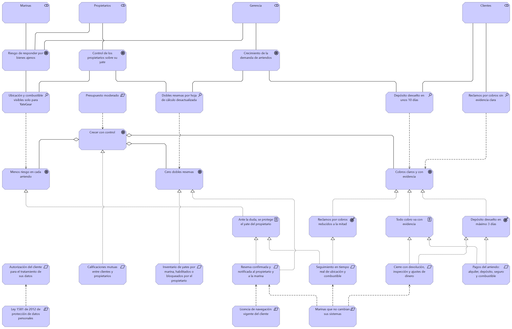

La V1 muestra por qué existe la aplicación. Recorre la cadena de motivación del negocio en franjas, de arriba abajo: interesados --> impulsores --> evaluaciones --> metas --> resultados y principios --> requerimientos --> restricciones. Sus metas y sus requerimientos son el punto de partida de la trazabilidad vertical de la V10.

Para leerla: lo concreto realiza lo abstracto, así que las flechas de realización van hacia arriba aunque la cadena se lea de arriba abajo. Las restricciones influyen en lo que limitan (V1-DEC-02). "Crecer con control" agrega las otras tres metas (V1-SUP-01). El punto del alcance de cada requerimiento (A1 a A6) está en su propiedad `Alcance`, no en su nombre. La vista no lleva referencias a las fuentes: están en la documentación del modelo y en las tablas de esta sección.

Elementos de la V1 con su fuente (30)

| Tipo | Elemento | Fuente |
|---|---|---|
| Interesado | Gerencia | H-04; MOT-02 |
| Interesado | Propietarios | H-04; MOT-02 |
| Interesado | Clientes | H-04; MOT-02 |
| Interesado | Marinas | H-04; MOT-02 |
| Impulsor | Crecimiento de la demanda de arriendos | H-03; MOT-01 |
| Impulsor | Control de los propietarios sobre su yate | H-03; MOT-01 |
| Impulsor | Riesgo de responder por bienes ajenos | H-01, H-03; CTX-03, MOT-01 |
| Evaluación | Dobles reservas por hoja de cálculo desactualizada | H-03; MOT-01, EXC-01 |
| Evaluación | Reclamos por cobros sin evidencia clara | H-03; MOT-01 |
| Evaluación | Depósito devuelto en unos 10 días | H-03, H-13; MOT-01, E2E-06 |
| Evaluación | Ubicación y combustible visibles solo para YateGear | H-03, H-12; MOT-01, E2E-05 |
| Meta | Crecer con control | MOT-02; H-04. Supuesto V1-SUP-01 |
| Meta | Cero dobles reservas | H-03, H-21; MOT-03 |
| Meta | Cobros claros y con evidencia | H-03; MOT-03 |
| Meta | Menos riesgo en cada arriendo | H-03; MOT-03 |
| Resultado | Reclamos por cobros reducidos a la mitad | H-03; MOT-03 |
| Resultado | Depósito devuelto en máximo 3 días | H-03; MOT-03 |
| Principio | Ante la duda, se protege el yate del propietario | H-05; MOT-04 |
| Principio | Todo cobro va con evidencia | H-05; MOT-04 |
| Requerimiento (A1) | Inventario de yates por marina, habilitados o bloqueados por el propietario | H-06, H-08; MOT-05, E2E-02 |
| Requerimiento (A2) | Reserva confirmada y notificada al propietario y a la marina | H-06, H-07; MOT-05, E2E-03 |
| Requerimiento (A3) | Pagos del arriendo: alquiler, depósito, seguro y combustible | H-06, H-10; MOT-05, E2E-04 |
| Requerimiento (A4) | Seguimiento en tiempo real de ubicación y combustible | H-06, H-12; MOT-05, E2E-05 |
| Requerimiento (A5) | Cierre con devolución, inspección y ajustes de dinero | H-06, H-13, H-14; MOT-05, E2E-06 |
| Requerimiento (A6) | Calificaciones mutuas entre clientes y propietarios | H-06, H-16; MOT-05, E2E-07 |
| Requerimiento | Autorización del cliente para el tratamiento de sus datos | H-19; NOR-01 |
| Restricción | Presupuesto moderado | H-05; MOT-04 |
| Restricción | Marinas que no cambian sus sistemas | H-05; MOT-04, CTX-03 |
| Restricción | Ley 1581 de 2012 de protección de datos personales | H-05, H-19 (contrastado); NOR-01 |
| Restricción | Licencia de navegación vigente del cliente | H-09 (contrastado); NOR-01 |

Relaciones de la V1 con su fuente (39)

| Relación | Origen | Destino | Fuente |
|---|---|---|---|
| Asociación | Gerencia | Crecimiento de la demanda de arriendos | MOT-01, MOT-02 ("atender más arriendos") |
| Asociación | Gerencia | Riesgo de responder por bienes ajenos | MOT-02 ("sin que se nos salgan de las manos las reservas, el dinero ni el riesgo") |
| Asociación | Propietarios | Control de los propietarios sobre su yate | MOT-01, MOT-02 |
| Asociación | Propietarios | Riesgo de responder por bienes ajenos | MOT-02 ("que su yate se cuide") |
| Asociación | Marinas | Riesgo de responder por bienes ajenos | Supuesto V1-SUP-07 |
| Asociación | Clientes | Reclamos por cobros sin evidencia clara | MOT-02 (quieren cobros claros y con evidencia) |
| Asociación | Clientes | Depósito devuelto en unos 10 días | MOT-02 (quieren el depósito rápido) |
| Asociación | Crecimiento de la demanda de arriendos | Dobles reservas por hoja de cálculo desactualizada | MOT-01 |
| Asociación | Crecimiento de la demanda de arriendos | Depósito devuelto en unos 10 días | Supuesto V1-SUP-02 |
| Asociación | Control de los propietarios sobre su yate | Dobles reservas por hoja de cálculo desactualizada | E2E-02 (el bloqueo del propietario llega por WhatsApp y la hoja se desactualiza) |
| Asociación | Control de los propietarios sobre su yate | Ubicación y combustible visibles solo para YateGear | MOT-01 ("saber qué pasa con él") |
| Asociación | Riesgo de responder por bienes ajenos | Ubicación y combustible visibles solo para YateGear | E2E-05 |
| Influencia | Dobles reservas por hoja de cálculo desactualizada | Cero dobles reservas | MOT-01, MOT-03 |
| Influencia | Reclamos por cobros sin evidencia clara | Cobros claros y con evidencia | MOT-03 |
| Influencia | Depósito devuelto en unos 10 días | Cobros claros y con evidencia | Supuesto V1-SUP-03 |
| Influencia | Ubicación y combustible visibles solo para YateGear | Menos riesgo en cada arriendo | E2E-05 |
| Agregación | Crecer con control | Cero dobles reservas | Supuesto V1-SUP-01 |
| Agregación | Crecer con control | Cobros claros y con evidencia | Supuesto V1-SUP-01 |
| Agregación | Crecer con control | Menos riesgo en cada arriendo | Supuesto V1-SUP-01 |
| Realización | Reclamos por cobros reducidos a la mitad | Cobros claros y con evidencia | MOT-03, E2E-05 |
| Realización | Depósito devuelto en máximo 3 días | Cobros claros y con evidencia | Supuesto V1-SUP-03 |
| Realización | Ante la duda, se protege el yate del propietario | Menos riesgo en cada arriendo | MOT-04 |
| Realización | Todo cobro va con evidencia | Cobros claros y con evidencia | MOT-04 |
| Realización | Inventario de yates por marina, habilitados o bloqueados por el propietario | Cero dobles reservas | H-21; CIE-01 |
| Realización | Reserva confirmada y notificada al propietario y a la marina | Cero dobles reservas | REG-02 |
| Realización | Reserva confirmada y notificada al propietario y a la marina | Ante la duda, se protege el yate del propietario | H-07; MOT-04 (riesgo alto: no se arrienda) |
| Realización | Pagos del arriendo: alquiler, depósito, seguro y combustible | Todo cobro va con evidencia | E2E-04 ("Todo cobro de este momento debe ir con evidencia") |
| Realización | Pagos del arriendo: alquiler, depósito, seguro y combustible | Depósito devuelto en máximo 3 días | E2E-04 (liberación del depósito) |
| Realización | Seguimiento en tiempo real de ubicación y combustible | Ante la duda, se protege el yate del propietario | E2E-05 ("va con nuestro principio de proteger el yate del propietario") |
| Realización | Seguimiento en tiempo real de ubicación y combustible | Reclamos por cobros reducidos a la mitad | E2E-05 ("justo lo que buscamos para reducir los reclamos a la mitad") |
| Realización | Cierre con devolución, inspección y ajustes de dinero | Todo cobro va con evidencia | E2E-06 |
| Realización | Cierre con devolución, inspección y ajustes de dinero | Depósito devuelto en máximo 3 días | E2E-06 |
| Realización | Calificaciones mutuas entre clientes y propietarios | Crecer con control | Supuesto V1-SUP-04 |
| Influencia | Presupuesto moderado | Crecer con control | Supuesto V1-SUP-05 |
| Influencia | Marinas que no cambian sus sistemas | Reserva confirmada y notificada al propietario y a la marina | Supuesto V1-SUP-06 |
| Influencia | Marinas que no cambian sus sistemas | Seguimiento en tiempo real de ubicación y combustible | Supuesto V1-SUP-06 |
| Influencia | Marinas que no cambian sus sistemas | Cierre con devolución, inspección y ajustes de dinero | Supuesto V1-SUP-06 |
| Influencia | Ley 1581 de 2012 de protección de datos personales | Autorización del cliente para el tratamiento de sus datos | H-19; NOR-01 |
| Influencia | Licencia de navegación vigente del cliente | Reserva confirmada y notificada al propietario y a la marina | H-09; E2E-03 |

#### Decisiones de la V1

| ID | Qué se decidió | Por qué |
|---|---|---|
| V1-DEC-01 | Interesado e impulsor se unen con asociación. | Es la forma que usa la especificación de ArchiMate para decir qué impulsor le interesa a un interesado. La influencia también sería válida, pero no aporta más. |
| V1-DEC-02 | Las restricciones se conectan con influencia. | La tabla de relaciones de ArchiMate 3.2 no permite realización desde una restricción hacia un requerimiento. La influencia dice que la restricción limita aquello a lo que apunta. |
| V1-DEC-03 | Solo hay dos resultados: "Reclamos por cobros reducidos a la mitad" y "Depósito devuelto en máximo 3 días". | Los indicadores de H-18 (ocupación y calificación promedio) no son resultados que haya dado el experto. |
| V1-DEC-04 | "Autorización del cliente para el tratamiento de sus datos" se conecta solo con la Ley 1581. | Es una obligación legal y no realiza una meta del negocio. Unirla con "Menos riesgo en cada arriendo" sería una deducción que el experto no hizo. |

#### Supuestos de la V1

| ID | Supuesto | Por qué se asumió |
|---|---|---|
| V1-SUP-01 | "Crecer con control" es la meta paraguas que agrega "Cero dobles reservas", "Cobros claros y con evidencia" y "Menos riesgo en cada arriendo". | El experto dijo "crecer con control" como expectativa de la gerencia (MOT-02). Convertirla en la meta que agrupa las tres metas del software es decisión del equipo. |
| V1-SUP-02 | "Crecimiento de la demanda de arriendos" se asocia con "Depósito devuelto en unos 10 días". | El cierre manual (WhatsApp y revisión a mano de Finanzas) no da abasto con más arriendos. El experto no vinculó explícitamente las dos ideas. |
| V1-SUP-03 | La demora del depósito y el resultado "Depósito devuelto en máximo 3 días" apuntan a "Cobros claros y con evidencia". | El experto no dijo a qué meta aporta el depósito. Se deduce porque devolver o retener el depósito es un ajuste que depende de evidencia clara (E2E-06: "Queremos que el depósito se devuelva en máximo 3 días y que cada ajuste quede claro para el cliente"). |
| V1-SUP-04 | "Calificaciones mutuas entre clientes y propietarios" realiza "Crecer con control". | El experto dijo que las calificaciones sirven para "saber si vamos bien" y dan confianza a ambos lados (E2E-07), pero no las ligó a una meta. |
| V1-SUP-05 | "Presupuesto moderado" limita "Crecer con control". | El experto dijo que el presupuesto limita la solución ("no podemos pensar en algo exagerado", MOT-04). Que el destino sea la meta paraguas es decisión del equipo. |
| V1-SUP-06 | "Marinas que no cambian sus sistemas" limita la reserva (notificación a la marina), el seguimiento (visible para la marina) y el cierre (inspección que llega de la marina). | El experto dio la restricción (MOT-04) y describió qué se intercambia con la marina (INT-MAR). Qué requerimientos limita es deducción del equipo. |
| V1-SUP-07 | "Marinas" se asocia con "Riesgo de responder por bienes ajenos". | El experto dijo que a la marina le sirve el seguimiento sobre todo por seguridad y que eso va con el principio de proteger el yate del propietario (E2E-05). Que eso la una al riesgo de responder por bienes ajenos es deducción del equipo. |

Las metas de la V1 son el destino de los cursos de acción de la V2, y sus requerimientos los realizan los servicios de plataforma de la V4 (V4-DEC-10).

## 3. Mapa de capacidades y proceso E2E

### V2 - Mapa de capacidades

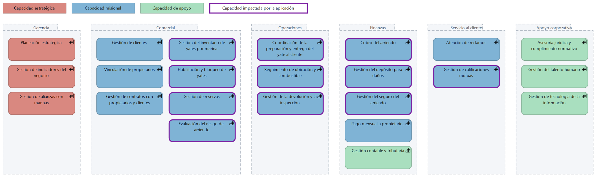

La V2 muestra el mapa de capacidades completo del negocio: 23 capacidades agrupadas en 6 áreas. El relleno indica el tipo de cada capacidad y el borde morado marca las 11 que impacta la aplicación. La relación entre las capacidades y las metas de la V1 que las justifican está en el modelo, por medio de los cursos de acción, y se ve en la V10.1 (V2-DEC-01).

Para leerla: cada área agrega sus capacidades, y la agregación se ve por anidamiento, sin líneas (sección 11). La leyenda de arriba explica los colores y está hecha con notas de la vista, no con elementos del modelo. El área y el tipo son independientes: Finanzas tiene capacidades misionales y una de apoyo (V2-DEC-02). Las cuatro áreas del negocio salen de H-02 (CTX-02); Gerencia sale de H-04 (MOT-02), y Apoyo corporativo es un supuesto (V2-SUP-05).

| Área | Capacidad | Tipo | Impactada | Alcance que la justifica, o por qué no es impactada | Fuente |
|---|---|---|---|---|---|
| Gerencia | Planeación estratégica | Estratégica | No | Es la dirección del negocio; ningún punto de A1 a A6 la cubre. | MOT-02. Supuesto V2-SUP-01 |
| Gerencia | Gestión de indicadores del negocio | Estratégica | No | Los indicadores (H-18) no están en A1 a A6. El software producirá datos que los alimentan, pero gestionarlos no es parte del alcance. | H-18; IND-01 |
| Gerencia | Gestión de alianzas con marinas | Estratégica | No | Es la relación de negocio con las marinas. El software solo intercambia con ellas información operativa (avisos, actas e inspección), que se diseña en la V4 y la V9. | CTX-03. Supuesto V2-SUP-06 |
| Comercial | Gestión de clientes | Misional | No | La resuelve el CRM existente, con el que habrá interoperabilidad (H-20, INT-CRM). | H-02, H-20; CTX-02, INT-CRM |
| Comercial | Vinculación de propietarios | Misional | No | El contrato con el propietario se firma una sola vez, al comenzar la relación (INT-CON); no está en A1 a A6. | CTX-01, INT-CON. Área: supuesto V2-SUP-07 |
| Comercial | Gestión de contratos con propietarios y clientes | Misional | No | Se resuelve por interoperabilidad con la gestión de contratos (H-20, INT-CON). El software solo usa el dato de contrato firmado para confirmar la reserva. | H-07, H-20; INT-CON |
| Comercial | Gestión del inventario de yates por marina | Misional | Sí | A1 | H-08, H-21; E2E-02 |
| Comercial | Habilitación y bloqueo de yates | Misional | Sí | A1 | H-08; E2E-02, REG-02 |
| Comercial | Gestión de reservas | Misional | Sí | A2 | H-07, H-08; E2E-03, REG-01 |
| Comercial | Evaluación del riesgo del arriendo | Misional | Sí | Solicitud general (control del riesgo). No está nombrada en A1 a A6 y se apoya en A2, porque la reserva solo se confirma con riesgo aceptable (H-07). | H-07, H-21; E2E-03, INT-RIE |
| Operaciones | Coordinación de la preparación y entrega del yate al cliente | Misional | Sí | A2 | H-07, H-13, H-17; E2E-03, INT-MAR |
| Operaciones | Seguimiento de ubicación y combustible | Misional | Sí | A4 | H-12; E2E-05, INT-GPS |
| Operaciones | Gestión de la devolución y la inspección | Misional | Sí | A5 | H-13, H-14; E2E-06 |
| Finanzas | Cobro del arriendo | Misional | Sí | A3 y A5 | H-10, H-14; E2E-04, INT-PAG |
| Finanzas | Gestión del depósito para daños | Misional | Sí | A3 y A5 | H-10, H-13; E2E-04, E2E-06 |
| Finanzas | Gestión del seguro del arriendo | Misional | Sí | A3 (el seguro es un pago) y solicitud general (control del riesgo) para la póliza y el reclamo a la aseguradora. | H-15; EXC-02, INT-ASE. Área: supuesto V2-SUP-07 |
| Finanzas | Pago mensual a propietarios | Misional | No | No es un pago del arriendo del punto A3. Es un proceso interno de Finanzas al que se le envía lo que corresponde al propietario por cada arriendo cerrado (H-11). | H-11; CTX-01, E2E-04 |
| Finanzas | Gestión contable y tributaria | Apoyo | No | Fuera de A1 a A6. | Supuesto V2-SUP-02 |
| Servicio al cliente | Atención de reclamos | Misional | No | Fuera de A1 a A6. El software reduce los reclamos con evidencia (meta "Cobros claros y con evidencia"), pero no los gestiona. | H-02; CTX-02, EXC-01 |
| Servicio al cliente | Gestión de calificaciones mutuas | Misional | Sí | A6 | H-16; E2E-07. Área: supuesto V2-SUP-07 |
| Apoyo corporativo | Asesoría jurídica y cumplimiento normativo | Apoyo | No | Fuera de A1 a A6. Las normas que afectan al software están como restricciones en la V1. | MOT-04, NOR-01; H-19 |
| Apoyo corporativo | Gestión del talento humano | Apoyo | No | Fuera de A1 a A6. | Supuesto V2-SUP-03 |
| Apoyo corporativo | Gestión de tecnología de la información | Apoyo | No | Fuera de A1 a A6. Operará el software, pero sus funciones no la cambian. | Supuesto V2-SUP-04 |

Los cursos de acción unen las capacidades impactadas con las metas de la V1: las capacidades realizan los cursos de acción y estos realizan las metas, que son los mismos elementos de la V1. Se ven en la V10.1 y la V10.2.

| Curso de acción | Capacidades que lo realizan | Meta que realiza | Fuente |
|---|---|---|---|
| Inventario siempre al día con lo que decide el propietario y las reservas confirmadas | Gestión del inventario de yates por marina; Habilitación y bloqueo de yates; Gestión de reservas | Cero dobles reservas | H-21; CIE-01 |
| Entregar el yate solo con riesgo aceptable, contrato firmado y pagos completos | Gestión de reservas; Evaluación del riesgo del arriendo; Cobro del arriendo; Gestión del depósito para daños | Menos riesgo en cada arriendo | H-07, H-21; CIE-01 |
| Respaldar todo cobro con las actas y fotos de entrega e inspección | Coordinación de la preparación y entrega del yate al cliente; Gestión de la devolución y la inspección; Cobro del arriendo; Gestión del depósito para daños | Cobros claros y con evidencia | H-13; E2E-06, CIE-01 |
| Seguimiento visible para la marina y el cliente | Seguimiento de ubicación y combustible | Cobros claros y con evidencia; Menos riesgo en cada arriendo | H-12; E2E-01, E2E-05 |

Los 5 recursos están asignados a capacidades en el modelo, pero no están en ninguna vista. La V2 muestra el mapa y las capacidades impactadas (V2-DEC-01), y la V10 los deja fuera de la traza porque no forman parte de la cadena entre el componente de aplicación y la meta (V10-DEC-03).

| Recurso | Capacidades a las que se asigna | Fuente |
|---|---|---|
| Red de marinas aliadas | Coordinación de la preparación y entrega del yate al cliente; Gestión de la devolución y la inspección | CTX-03 |
| Yates de terceros autorizados para arriendo | Gestión del inventario de yates por marina | H-01; CTX-01 |
| Actas y fotos de entrega e inspección | Cobro del arriendo; Gestión del depósito para daños; Atención de reclamos | H-13; E2E-06, EXC-01 |
| Datos de ubicación y combustible del proveedor | Seguimiento de ubicación y combustible | H-12; INT-GPS |
| Datos de clientes y solicitudes | Gestión de clientes | CTX-02, INT-CRM |

#### Decisiones de la V2

| ID | Qué se decidió | Por qué |
|---|---|---|
| V2-DEC-01 | La V2 muestra solo el mapa. | Así el mapa se lee como una cuadrícula limpia, con color por tipo y las impactadas resaltadas. Las relaciones de justificación saturaban la cuadrícula; las que unen las capacidades con las metas, por medio de los cursos de acción, siguen en el modelo y se ven en la V10.1. |
| V2-DEC-02 | Criterio de clasificación por tipo. | Estratégica: la dirección fija el rumbo, mide el negocio o define las alianzas, y no ejecuta un arriendo concreto. Misional: produce directamente el servicio de intermediación para clientes y propietarios; si se detiene, no hay arriendo o no se le cumple al propietario. Apoyo: transversal; permite operar a la empresa, pero no es parte del servicio. |
| V2-DEC-03 | Áreas: las cuatro del negocio (H-02), más Gerencia y Apoyo corporativo. | Las cuatro son las que nombró el experto. Gerencia aparece como interesado (H-04). Apoyo corporativo agrupa lo transversal (V2-SUP-05) para que el mapa represente la empresa completa y no se limite a la aplicación. |
| V2-DEC-04 | Criterio de "impactada". | Una capacidad es impactada si el software la apoya o la cambia según uno de los puntos A1 a A6. Dos casos se apoyan además en la solicitud general: la evaluación del riesgo y la póliza y el reclamo de la gestión del seguro. Son 11. Por qué queda fuera cada capacidad no impactada está en la tabla de capacidades de esta sección. |
| V2-DEC-05 | La capacidad se llama "Coordinación de la preparación y entrega del yate al cliente". | Por la ambigüedad de "entrega" (H-17): es la entrega de la marina al cliente, no la del yate a YateGear por parte del propietario, que pertenece a "Vinculación de propietarios". |
| V2-DEC-06 | "Pago mensual a propietarios" es misional. | Es parte de lo que YateGear le ofrece al propietario como intermediario: cobra todo el dinero del arriendo y le paga su parte (CTX-01, CTX-03). No es impactada porque no es un pago del arriendo del punto A3 (H-11). |

#### Supuestos de la V2

| ID | Supuesto | Por qué se asumió |
|---|---|---|
| V2-SUP-01 | Capacidad "Planeación estratégica". | El experto no la nombró. Es indispensable para que el mapa represente la empresa completa (la gerencia busca crecer con control, MOT-02). |
| V2-SUP-02 | Capacidad "Gestión contable y tributaria". | El experto no la nombró. Es indispensable porque Finanzas recibe todo el dinero y paga a terceros. |
| V2-SUP-03 | Capacidad "Gestión del talento humano". | El experto no la nombró. La empresa tiene 15 personas en cuatro áreas (CTX-02). |
| V2-SUP-04 | Capacidad "Gestión de tecnología de la información". | El experto no la nombró. Es indispensable para operar el CRM, el correo y el nuevo software. |
| V2-SUP-05 | Área "Apoyo corporativo". | El experto no nombró esta área. Agrupa las capacidades transversales. |
| V2-SUP-06 | Capacidad "Gestión de alianzas con marinas", en el área Gerencia. | El experto dijo que las marinas son aliadas ("Trabajamos con tres en el Caribe", CTX-03), pero no nombró la capacidad ni el área que la lleva. Va en Gerencia por tratarse de una alianza. |
| V2-SUP-07 | Área de tres capacidades que el experto no ubicó: "Vinculación de propietarios" en Comercial, "Gestión del seguro del arriendo" en Finanzas y "Gestión de calificaciones mutuas" en Servicio al cliente. | Comercial lleva la relación con quienes arriendan y ofrecen. Finanzas cobra el seguro. Servicio al cliente atiende la experiencia del cliente después del arriendo. |

Las 11 capacidades impactadas las realizan los servicios de dominio de la V4. La V3, que sigue, ubica la aplicación en el proceso de punta a punta.

### V3 - Cadena de valor y proceso E2E

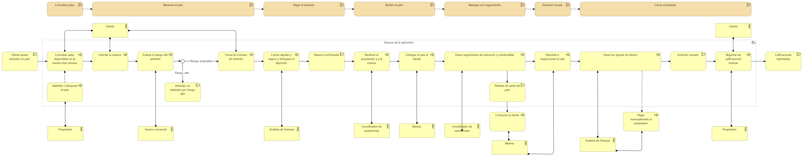

La V3 muestra dónde participa la aplicación. Arriba va el flujo de valor del arriendo en 7 etapas, vistas desde el cliente. Debajo de cada etapa van los procesos de punta a punta que la realizan, con el actor que hace cada paso y los eventos que inician, interrumpen o terminan el proceso. La agrupación "Alcance de la aplicación" delimita lo que apoya el software: 12 de los 14 pasos y 4 de los 6 eventos.

Para leerla: cada proceso está debajo de su etapa, y la etapa está en su propiedad `Etapa`, sin relación en el modelo (V3-DEC-02). La secuencia va con disparos y lo que no es secuencia va con flujos (V3-DEC-05). La unión "Nivel de riesgo" separa el riesgo aceptable del riesgo alto (V3-DEC-04). Cinco actores (Cliente, Propietario, Marina, Coordinador de operaciones y Analista de finanzas) hacen pasos en etapas lejanas entre sí y se dibujan una vez por zona, como en la V4.01, para que ninguna línea de asignación cruce la vista; es el mismo elemento del modelo, y el Asesor comercial aparece una sola vez.

Las 7 etapas, sus nombres y su orden los definió el equipo desde la perspectiva del cliente (V3-SUP-02, V3-SUP-03), a partir del orden del proceso que validó el experto (E2E-08):

| Etapa del flujo de valor | Fuente |
|---|---|
| Consultar yates | H-08; E2E-01, E2E-02 |
| Reservar el yate | H-07; E2E-01, E2E-03 |
| Pagar el arriendo | H-07, H-10; E2E-04 |
| Recibir el yate | H-07, H-13, H-17; E2E-01, E2E-03 |
| Navegar con seguimiento | H-12; E2E-05 |
| Devolver el yate | H-13, H-14; E2E-06 |
| Cerrar el arriendo | H-13, H-16; E2E-06, E2E-07 |

Los 14 pasos, los 6 eventos y la unión del proceso, y qué parte apoya la aplicación:

| Etapa | Paso o evento | Quién lo hace | Alcance | Lo apoya la aplicación | Fuente |
|---|---|---|---|---|---|
| - | Evento "Cliente quiere arrendar un yate" | - | - | No: es el evento de inicio, límite del proceso | E2E-01. Supuesto V3-SUP-01 |
| Consultar yates | "Consultar yates disponibles en la marina más cercana" | Cliente | A1 | Sí | H-08, H-17; E2E-02, E2E-08 |
| Consultar yates | "Habilitar o bloquear el yate" | Propietario | A1 | Sí | H-08, H-17; E2E-02, REG-02 |
| Reservar el yate | "Solicitar la reserva" | Cliente | A2 | Sí | H-07, H-09, H-19; ACT-01, E2E-01, E2E-03 |
| Reservar el yate | "Evaluar el riesgo del arriendo" | Asesor comercial | A2 | Sí | H-07; E2E-03, INT-RIE |
| Reservar el yate | Unión O "Nivel de riesgo" | - | - | Dibujada dentro del alcance, sin agregación (V3-DEC-04) | H-07; E2E-03, REG-01. Supuesto V3-SUP-06 |
| Reservar el yate | Evento "Arriendo no realizado por riesgo alto" | - | - | Sí: la aplicación lo detecta o registra | H-07; E2E-03, E2E-08, REG-01 |
| Reservar el yate | "Firmar el contrato de arriendo" | Cliente | A2 | Sí | H-07; E2E-03, INT-CON |
| Pagar el arriendo | "Cobrar alquiler y seguro y bloquear el depósito" | Analista de finanzas | A3 | Sí | H-07, H-10, H-17; E2E-04, INT-PAG |
| Pagar el arriendo | Evento "Reserva confirmada" | - | - | Sí: la aplicación lo detecta o registra | H-07, H-09; E2E-03, E2E-08, REG-01 |
| Recibir el yate | "Notificar al propietario y a la marina" | Coordinador de operaciones | A2 | Sí | H-07; E2E-03, INT-MAR |
| Recibir el yate | "Entregar el yate al cliente" | Marina | A2 | Sí | H-13, H-17; E2E-01, INT-MAR |
| Navegar con seguimiento | "Hacer seguimiento de ubicación y combustible" | Coordinador de operaciones | A4 | Sí | H-12; E2E-05, INT-GPS |
| Navegar con seguimiento | Evento "Pérdida de señal del yate" | - | - | Sí: la aplicación lo detecta o registra | H-12; E2E-05, EXC-01, INT-GPS |
| Navegar con seguimiento | "Contactar al cliente" | Marina | Fuera del alcance | No: lo hace la marina con sus propios medios cuando se pierde la señal | H-12; E2E-01, EXC-01 |
| Devolver el yate | "Devolver e inspeccionar el yate" | Marina | A5 | Sí | H-13, H-14; E2E-06 |
| Cerrar el arriendo | "Hacer los ajustes de dinero" | Analista de finanzas | A3 y A5 | Sí | H-10, H-13, H-14, H-15; E2E-04, E2E-06, EXC-02 |
| Cerrar el arriendo | Evento "Arriendo cerrado" | - | - | Sí: la aplicación lo detecta o registra | H-13, H-16; E2E-01, E2E-07. Supuesto V3-SUP-04 |
| Cerrar el arriendo | "Pagar mensualmente al propietario" | Analista de finanzas | Fuera del alcance | No: es un proceso interno de Finanzas al que solo se le envía lo de cada arriendo cerrado | H-11; CTX-01, E2E-04 |
| Cerrar el arriendo | "Registrar las calificaciones mutuas" | Cliente y Propietario | A6 | Sí | H-16; E2E-07 |
| - | Evento "Calificaciones registradas" | - | - | No: es el evento de fin, límite del proceso | H-16; E2E-07, E2E-08. Supuesto V3-SUP-05 |

Relaciones dibujadas de la V3 con su fuente (41)

| Relación | Origen | Destino | Fuente |
|---|---|---|---|
| Flujo | Consultar yates | Reservar el yate | Supuesto V3-SUP-03 |
| Flujo | Reservar el yate | Pagar el arriendo | Supuesto V3-SUP-03 |
| Flujo | Pagar el arriendo | Recibir el yate | Supuesto V3-SUP-03 |
| Flujo | Recibir el yate | Navegar con seguimiento | Supuesto V3-SUP-03 |
| Flujo | Navegar con seguimiento | Devolver el yate | Supuesto V3-SUP-03 |
| Flujo | Devolver el yate | Cerrar el arriendo | Supuesto V3-SUP-03 |
| Asignación | Cliente | Consultar yates disponibles en la marina más cercana | ACT-01, E2E-02 |
| Asignación | Cliente | Solicitar la reserva | ACT-01 |
| Asignación | Cliente | Firmar el contrato de arriendo | ACT-01, INT-CON |
| Asignación | Cliente | Registrar las calificaciones mutuas | H-16; E2E-07 |
| Asignación | Propietario | Habilitar o bloquear el yate | H-08; ACT-01, E2E-02 |
| Asignación | Propietario | Registrar las calificaciones mutuas | H-16; E2E-07 |
| Asignación | Asesor comercial | Evaluar el riesgo del arriendo | E2E-01, INT-RIE |
| Asignación | Coordinador de operaciones | Notificar al propietario y a la marina | ACT-01, CTX-02, E2E-03 |
| Asignación | Coordinador de operaciones | Hacer seguimiento de ubicación y combustible | ACT-01, CTX-02 |
| Asignación | Marina | Entregar el yate al cliente | ACT-01, INT-MAR |
| Asignación | Marina | Contactar al cliente | H-12; E2E-01, EXC-01 |
| Asignación | Marina | Devolver e inspeccionar el yate | H-13; ACT-01, E2E-06 |
| Asignación | Analista de finanzas | Cobrar alquiler y seguro y bloquear el depósito | ACT-01, CTX-02, E2E-04 |
| Asignación | Analista de finanzas | Hacer los ajustes de dinero | ACT-01, E2E-06 |
| Asignación | Analista de finanzas | Pagar mensualmente al propietario | H-11; ACT-01, E2E-04 |
| Disparo | Cliente quiere arrendar un yate | Consultar yates disponibles en la marina más cercana | E2E-01. Supuesto V3-SUP-01 |
| Disparo | Consultar yates disponibles en la marina más cercana | Solicitar la reserva | E2E-01, E2E-08 |
| Disparo | Solicitar la reserva | Evaluar el riesgo del arriendo | H-07; E2E-01, E2E-03 |
| Disparo | Evaluar el riesgo del arriendo | Nivel de riesgo | H-07; E2E-03 |
| Disparo, "Riesgo aceptable" | Nivel de riesgo | Firmar el contrato de arriendo | H-07; E2E-03. Supuesto V3-SUP-06 |
| Disparo, "Riesgo alto" | Nivel de riesgo | Arriendo no realizado por riesgo alto | H-07; E2E-03, E2E-08, REG-01 |
| Disparo | Firmar el contrato de arriendo | Cobrar alquiler y seguro y bloquear el depósito | H-07, H-10; E2E-01, E2E-04 |
| Disparo | Cobrar alquiler y seguro y bloquear el depósito | Reserva confirmada | H-07; E2E-03, REG-01 |
| Disparo | Reserva confirmada | Notificar al propietario y a la marina | H-07; E2E-03, E2E-08 |
| Disparo | Notificar al propietario y a la marina | Entregar el yate al cliente | E2E-01, E2E-03 |
| Disparo | Entregar el yate al cliente | Hacer seguimiento de ubicación y combustible | H-12; E2E-01, INT-GPS |
| Disparo | Hacer seguimiento de ubicación y combustible | Pérdida de señal del yate | H-12; E2E-05, EXC-01 |
| Disparo | Hacer seguimiento de ubicación y combustible | Devolver e inspeccionar el yate | E2E-01, E2E-06 |
| Disparo | Pérdida de señal del yate | Contactar al cliente | H-12; E2E-01, EXC-01 |
| Disparo | Devolver e inspeccionar el yate | Hacer los ajustes de dinero | H-13; E2E-06 |
| Disparo | Hacer los ajustes de dinero | Arriendo cerrado | E2E-01 |
| Disparo | Arriendo cerrado | Registrar las calificaciones mutuas | H-16; E2E-07 |
| Disparo | Registrar las calificaciones mutuas | Calificaciones registradas | E2E-08. Supuesto V3-SUP-05 |
| Flujo | Habilitar o bloquear el yate | Consultar yates disponibles en la marina más cercana | H-08; E2E-02 |
| Flujo | Hacer los ajustes de dinero | Pagar mensualmente al propietario | H-11; CTX-01, E2E-04 |

#### Decisiones de la V3

| ID | Qué se decidió | Por qué |
|---|---|---|
| V3-DEC-01 | El flujo de valor tiene 7 etapas, vistas desde el cliente y unidas con flujo. | Siguen el orden del proceso que el experto validó en E2E-08. Se nombran desde el cliente porque es quien recibe el valor del arriendo; el experto narró el proceso, no un flujo de valor (V3-SUP-02). |
| V3-DEC-02 | Cada proceso queda debajo de su etapa, sin relación en el modelo. | La etapa está en la propiedad `Etapa` y en la alineación de la vista. ArchiMate 3.2 permitiría una realización proceso --> etapa, pero la vista ya muestra la ubicación, y la trazabilidad vertical de la V10 no pasa por las etapas. |
| V3-DEC-03 | La agrupación "Alcance de la aplicación" delimita dónde está la aplicación. | Agrega los 12 procesos que apoya el software (A1 a A6) y los 4 eventos que detecta o registra. Quedan fuera los eventos de inicio y de fin, que marcan los límites del proceso, y los dos pasos que el software no apoya: "Contactar al cliente" (lo hace la marina) y "Pagar mensualmente al propietario" (proceso interno de Finanzas, H-11). |
| V3-DEC-04 | La unión O "Nivel de riesgo" separa el riesgo aceptable del riesgo alto. | Con riesgo aceptable el cliente firma el contrato y con riesgo alto el arriendo no se realiza (H-07, REG-01). Está dibujada dentro del alcance sin agregación, porque una unión conecta relaciones y no pertenece a una agrupación. Es el único objeto anidado sin relación en las vistas del modelo. |
| V3-DEC-05 | Disparo para la secuencia y flujo para lo que no es secuencia. | La secuencia sigue el orden que validó el experto (E2E-08). Dos relaciones son flujo porque no son un paso que sigue a otro: lo que decide el propietario alimenta la consulta, pero él decide cuando quiere (E2E-02); y los ajustes de dinero envían a Finanzas lo que le corresponde al propietario por cada arriendo cerrado (H-11). |

#### Supuestos de la V3

| ID | Supuesto | Por qué se asumió |
|---|---|---|
| V3-SUP-01 | Evento de inicio "Cliente quiere arrendar un yate". | El experto no lo nombró como evento; se deduce de su relato: "Un cliente nos escribe por WhatsApp porque quiere un yate para tres días" (E2E-01). |
| V3-SUP-02 | Las 7 etapas del flujo de valor y sus nombres. | El experto narró el proceso, no un flujo de valor. Las etapas y sus nombres los definió el equipo desde la perspectiva del cliente. |
| V3-SUP-03 | El orden de las etapas. | Lo definió el equipo a partir del orden del proceso que confirmó el experto (E2E-08). |
| V3-SUP-04 | "Arriendo cerrado" es un evento. | El experto dijo que con los ajustes "se cierra el arriendo" (E2E-01) y que las calificaciones van "una vez se cierra el arriendo" (E2E-07); nombrarlo como evento es decisión del equipo. |
| V3-SUP-05 | Evento de fin "Calificaciones registradas". | El experto no nombró un evento de fin; las calificaciones son el último paso del proceso que confirmó (E2E-08). |
| V3-SUP-06 | "Riesgo aceptable" es riesgo bajo o medio. | El experto solo dijo que con riesgo alto no se arrienda (REG-01). Desde la V4 este supuesto se cita como V4-SUP-02. |

Los 14 pasos de esta vista son la capa 1 de la descomposición de servicios de la V4, que dice qué servicio de plataforma apoya cada paso.

## 4. Descomposición de servicios

### V4 - Descomposición de servicios

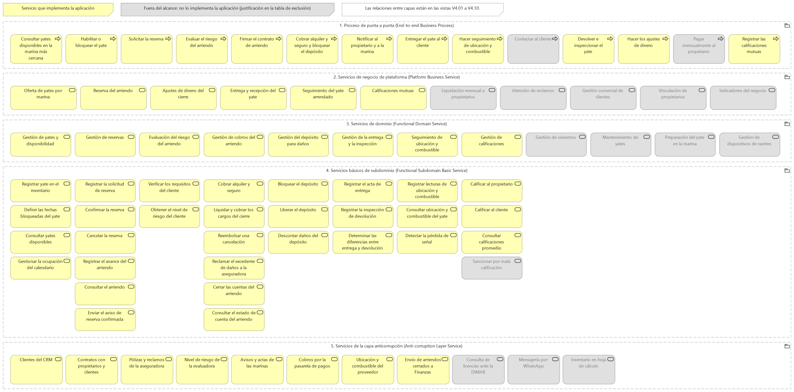

La V4 parte del proceso de punta a punta de la V3 y lo descompone en capas de servicio hasta llegar a servicios del tamaño sobre el que se construirá la aplicación. Muestra las cinco capas con lo que implementa la aplicación, en amarillo, y lo que queda fuera del alcance, en gris. Todos los servicios son servicios de negocio (Business Service) y se complementan con roles, actores, funciones y objetos de negocio, que se ven en las vistas de apoyo V4.01 a V4.10.

Para leerla: cada capa es una agrupación que agrega sus elementos, y en la vista eso se ve por anidamiento, sin líneas. Las relaciones entre capas están en las vistas de apoyo, como dice la leyenda de la vista. La capa de cada servicio también está en su propiedad `Capa`. La V4 es la vista principal; las vistas de apoyo muestran lo que no cabe de forma legible en una sola vista (V4-DEC-15).

La descomposición usa cinco capas (V4-DEC-01): las capas 1 a 4 bajan desde el proceso hasta las operaciones, y la 5 aísla la aplicación de lo externo. Las reglas para cortar los servicios están en V4-DEC-02 a V4-DEC-05.

| Capa | Qué contiene | Incluidos |
|---|---|---|
| 1. Proceso de punta a punta (End-to-end Business Process) | Los pasos del proceso de la V3. La aplicación apoya doce y dos no: "Contactar al cliente" y "Pagar mensualmente al propietario". | 12 pasos |
| 2. Servicios de negocio de plataforma (Platform Business Service) | Un servicio por tramo del proceso. Es lo que usan el cliente, el propietario, la marina y los empleados. | 6 |
| 3. Servicios de dominio (Functional Domain Service) | Un servicio por área funcional del arriendo, dueño de sus datos y sus reglas. | 8 |
| 4. Servicios básicos de subdominio (Functional Subdomain Basic Service) | Las operaciones de cada servicio de dominio. Es el tamaño sobre el que se construye la aplicación. | 30 |
| 5. Servicios de la capa anticorrupción (Anti-corruption Layer Service) | Un servicio por cada proceso interno, sistema o empresa con el que se intercambia información. | 8 |

Servicios de plataforma: qué pasos de la V3 apoyan, qué servicios de dominio coordinan y qué requerimiento de la V1 realizan. Cada uno coordina los servicios de dominio que necesita; los servicios de dominio no se llaman entre sí (V4-DEC-02).

| Código | Servicio | Qué hace | Pasos de la V3 que apoya | Coordina | Requerimientos de la V1 que realiza |
|---|---|---|---|---|---|
| SP-01 | Oferta de yates por marina | Pone a disposición del cliente los yates que puede arrendar en la marina más cercana y le permite al propietario bloquear o desbloquear fechas de su yate. | Consultar yates disponibles en la marina más cercana; Habilitar o bloquear el yate | SD-01 | Inventario de yates por marina, habilitados o bloqueados por el propietario |
| SP-02 | Reserva del arriendo | Lleva una solicitud de reserva hasta su confirmación y avisa al propietario y a la marina. Coordina los requisitos del cliente, la evaluación de riesgo, el contrato firmado, el apartado de las fechas y el cobro inicial. También atiende la cancelación: el reembolso y la liberación del depósito bloqueado (V4-SUP-09). | Solicitar la reserva; Evaluar el riesgo del arriendo; Firmar el contrato de arriendo; Cobrar alquiler y seguro y bloquear el depósito; Notificar al propietario y a la marina | SD-01, SD-02, SD-03, SD-04, SD-05 | Reserva confirmada y notificada al propietario y a la marina; Autorización del cliente para el tratamiento de sus datos; Pagos del arriendo: alquiler, depósito, seguro y combustible |
| SP-03 | Ajustes de dinero del cierre | Hace los ajustes de dinero cuando el yate vuelve: cobra el combustible y el tiempo adicional, libera o descuenta el depósito, reclama a la aseguradora lo que supere el depósito, cierra las cuentas y deja consultar el estado de cuenta. Cada cargo se apoya en la diferencia entre la entrega y la inspección. | Hacer los ajustes de dinero | SD-04, SD-05, SD-06 | Pagos del arriendo: alquiler, depósito, seguro y combustible; Cierre con devolución, inspección y ajustes de dinero |
| SP-04 | Entrega y recepción del yate | Registra lo que la marina reporta al entregar el yate y al recibirlo, y deja calculadas las diferencias que usan los ajustes de dinero. Marca el arriendo como en curso al entregar y como devuelto al recibir. | Entregar el yate al cliente; Devolver e inspeccionar el yate | SD-06, SD-02 | Cierre con devolución, inspección y ajustes de dinero |
| SP-05 | Seguimiento del yate arrendado | Muestra a la marina y al cliente la ubicación y el combustible del yate mientras está arrendado, y avisa cuando el dispositivo deja de enviar datos. | Hacer seguimiento de ubicación y combustible | SD-07 | Seguimiento en tiempo real de ubicación y combustible |
| SP-06 | Calificaciones mutuas | Permite que, al cerrar el arriendo, el cliente califique al propietario por su experiencia con el yate y el propietario califique el cuidado y la puntualidad del cliente. | Registrar las calificaciones mutuas | SD-08, SD-02 | Calificaciones mutuas entre clientes y propietarios |

Servicios de dominio: qué operaciones reúnen y qué capacidades de la V2 realizan. Las once capacidades impactadas de la V2 quedan realizadas por un servicio de dominio.

| Código | Servicio | Qué hace | Servicios básicos | Capacidades de la V2 que realiza | Sirve a |
|---|---|---|---|---|---|
| SD-01 | Gestión de yates y disponibilidad | Mantiene el inventario de yates por marina y el calendario de cada yate. Es el único servicio que decide si un yate está disponible en unas fechas, para que no haya dobles reservas. | SB-01, SB-03, SB-04, SB-05 | Gestión del inventario de yates por marina; Habilitación y bloqueo de yates | SP-01, SP-02 |
| SD-02 | Gestión de reservas | Lleva el estado del arriendo desde la solicitud de reserva hasta el cierre: la registra, la confirma cuando se cumplen las tres condiciones, envía el aviso de reserva confirmada, la cancela y registra cada avance. | SB-06, SB-07, SB-08, SB-09, SB-10, SB-31 | Gestión de reservas | SP-02, SP-04, SP-06 |
| SD-03 | Evaluación del riesgo del arriendo | Decide si el cliente puede arrendar: verifica la licencia de navegación vigente y la autorización de datos, y obtiene el nivel de riesgo de la empresa evaluadora. Con riesgo alto no se arrienda. | SB-11, SB-12 | Evaluación del riesgo del arriendo | SP-02 |
| SD-04 | Gestión de cobros del arriendo | Cobra el alquiler y el seguro, liquida y cobra los cargos del cierre con su evidencia, devuelve el dinero de las cancelaciones con anticipación, reclama a la aseguradora el daño que supera el depósito y cierra las cuentas del arriendo. | SB-13, SB-14, SB-15, SB-16, SB-17, SB-18 | Cobro del arriendo; Gestión del seguro del arriendo | SP-02, SP-03 |
| SD-05 | Gestión del depósito para daños | Maneja el depósito como garantía: lo bloquea en la tarjeta de crédito del cliente al reservar, lo libera si no hay daños o si la reserva se cancela (V4-SUP-09) y descuenta de él los daños con evidencia. Bloquear tiene aquí el sentido de Finanzas. | SB-19, SB-20, SB-21 | Gestión del depósito para daños | SP-02, SP-03 |
| SD-06 | Gestión de la entrega y la inspección | Registra lo que la marina reporta al entregar y al recibir el yate y compara ambos registros para obtener el combustible consumido, el tiempo adicional y los daños, con la evidencia que respalda cada cobro. | SB-22, SB-23, SB-24 | Coordinación de la preparación y entrega del yate al cliente; Gestión de la devolución y la inspección | SP-03, SP-04 |
| SD-07 | Seguimiento de ubicación y combustible | Recibe las lecturas del proveedor, las muestra a la marina y al cliente del arriendo en curso y avisa cuando el yate deja de enviar datos. | SB-25, SB-26, SB-27 | Seguimiento de ubicación y combustible | SP-05 |
| SD-08 | Gestión de calificaciones | Registra las calificaciones mutuas al cerrar el arriendo y calcula los promedios de cada propietario y de cada cliente. | SB-28, SB-29, SB-30 | Gestión de calificaciones mutuas | SP-06 |

#### Servicios que se implementan

Criterio de inclusión (V4-DEC-06): un servicio se implementa si lo pide uno de los puntos A1 a A6 o la solicitud general, o si otro servicio incluido lo necesita para cumplir su contrato. Queda fuera si es de otra área, de un tercero o de una capacidad no impactada de la V2, o si es una regla que el negocio no tiene.

| Código | Capa | Servicio | Por qué se implementa |
|---|---|---|---|
| SP-01 | 2 | Oferta de yates por marina | El alcance A1 pide que el cliente consulte por su cuenta los yates de la marina más cercana y que el propietario decida si su yate se arrienda. |
| SP-02 | 2 | Reserva del arriendo | El alcance A2 pide la reserva y su notificación, y la reserva solo se confirma con riesgo aceptable, contrato firmado y pagos hechos (H-07). |
| SP-03 | 2 | Ajustes de dinero del cierre | El alcance A5 pide los ajustes de dinero del cierre, y la V1 fija devolver el depósito en máximo 3 días. |
| SP-04 | 2 | Entrega y recepción del yate | La entrega (A2) y la devolución con inspección (A5) producen la evidencia de los cobros (H-13). |
| SP-05 | 2 | Seguimiento del yate arrendado | El alcance A4 pide que la marina y el cliente vean en tiempo real la ubicación y el combustible del yate. |
| SP-06 | 2 | Calificaciones mutuas | El alcance A6 pide las calificaciones mutuas entre clientes y propietarios. |
| SD-01 | 3 | Gestión de yates y disponibilidad | Concentra en un solo servicio la decisión de disponibilidad que exige cero dobles reservas (CIE-01). |
| SD-02 | 3 | Gestión de reservas | El alcance A2 necesita un responsable del estado del arriendo desde la solicitud hasta el cierre. |
| SD-03 | 3 | Evaluación del riesgo del arriendo | La solicitud general pide controlar el riesgo de entregar bienes ajenos, y la reserva no se confirma sin riesgo aceptable (H-07). |
| SD-04 | 3 | Gestión de cobros del arriendo | Los alcances A3 y A5 piden cobrar el alquiler, el seguro, el combustible y el tiempo adicional. |
| SD-05 | 3 | Gestión del depósito para daños | Los alcances A3 y A5 piden bloquear el depósito al reservar y liberarlo o retenerlo al cerrar. |
| SD-06 | 3 | Gestión de la entrega y la inspección | La entrega (A2) y el cierre (A5) necesitan las actas de la marina como evidencia (H-13). |
| SD-07 | 3 | Seguimiento de ubicación y combustible | El alcance A4 pide el seguimiento en tiempo real de la ubicación y el combustible. |
| SD-08 | 3 | Gestión de calificaciones | El alcance A6 pide las calificaciones mutuas. |
| SB-01 | 4 | Registrar yate en el inventario | Sin yates registrados no hay inventario por marina (A1). |
| SB-03 | 4 | Definir las fechas bloqueadas del yate | El alcance A1 dice que el propietario decide si su yate se arrienda: lo hace cerrando fechas, y hoy eso llega por WhatsApp y desactualiza la hoja de cálculo (E2E-02). |
| SB-04 | 4 | Consultar yates disponibles | El cliente debe poder consultar por su cuenta los yates de la marina más cercana (A1, E2E-02). |
| SB-05 | 4 | Gestionar la ocupación del calendario | Es donde se cumple la regla de cero dobles reservas (REG-01, CIE-01). |
| SB-06 | 4 | Registrar la solicitud de reserva | El alcance A2 empieza con la solicitud de reserva, que hoy llega por WhatsApp (E2E-01). |
| SB-07 | 4 | Confirmar la reserva | Es donde se cumple que ningún arriendo se confirma sin sus tres condiciones (REG-01, CIE-01). |
| SB-08 | 4 | Cancelar la reserva | Las cancelaciones son una situación frecuente y afectan los pagos (EXC-01, EXC-02). |
| SB-09 | 4 | Registrar el avance del arriendo | Los demás servicios necesitan saber si el arriendo está confirmado, en curso, devuelto o cerrado (E2E-08). |
| SB-10 | 4 | Consultar el arriendo | Cliente, propietario, marina y empleados necesitan ver el estado del arriendo sin preguntarlo por WhatsApp. El experto no lo pidió: se incluye como supuesto (V4-SUP-08). |
| SB-31 | 4 | Enviar el aviso de reserva confirmada | El alcance A2 pide notificar al propietario y a la marina; hoy el aviso por WhatsApp llega tarde o se pierde (E2E-03). |
| SB-11 | 4 | Verificar los requisitos del cliente | El cliente navega el yate y sus datos van a terceros, así que la licencia y la autorización son condición para reservar (H-09, H-19). |
| SB-12 | 4 | Obtener el nivel de riesgo del cliente | La reserva no se confirma sin riesgo aceptable, y ese nivel lo da la empresa evaluadora (H-07, INT-RIE). |
| SB-13 | 4 | Cobrar alquiler y seguro | El primer momento de pago es al reservar, antes de confirmar el arriendo (H-10, E2E-04). |
| SB-14 | 4 | Liquidar y cobrar los cargos del cierre | El cierre (A5) incluye cobrar el combustible consumido y el tiempo adicional (H-14). |
| SB-15 | 4 | Reembolsar una cancelación | La cancelación con anticipación obliga a devolver el dinero (EXC-02). |
| SB-16 | 4 | Reclamar el excedente de daños a la aseguradora | Si el daño supera el depósito, la diferencia se reclama a la aseguradora (REG-01, H-15). |
| SB-17 | 4 | Cerrar las cuentas del arriendo | Finanzas necesita lo de cada arriendo cerrado para pagarle al propietario cada mes (H-11). |
| SB-18 | 4 | Consultar el estado de cuenta del arriendo | La meta es que cada cobro sea claro para el cliente y tenga evidencia (MOT-03, E2E-06). |
| SB-19 | 4 | Bloquear el depósito | El depósito se bloquea al reservar y es condición para confirmar (H-07, H-10). |
| SB-20 | 4 | Liberar el depósito | Sin daños el depósito se libera, y hoy eso tarda unos 10 días (H-03, E2E-06). |
| SB-21 | 4 | Descontar daños del depósito | Si la inspección encuentra daños, se descuentan del depósito (REG-01). |
| SB-22 | 4 | Registrar el acta de entrega | El acta de entrega es la base contra la que se comparan la inspección y los cobros (H-13). |
| SB-23 | 4 | Registrar la inspección de devolución | El cierre (A5) incluye la recepción y la inspección del yate. |
| SB-24 | 4 | Determinar las diferencias entre entrega y devolución | Los cargos del cierre y la decisión del depósito necesitan la diferencia entre entrega y devolución como evidencia (H-13). |
| SB-25 | 4 | Registrar lecturas de ubicación y combustible | El seguimiento (A4) depende de las lecturas que envía el proveedor (INT-GPS). |
| SB-26 | 4 | Consultar ubicación y combustible del yate | El alcance A4 pide que la marina y el cliente vean el seguimiento (E2E-05). |
| SB-27 | 4 | Detectar la pérdida de señal | Cuando el dispositivo deja de enviar datos, la marina debe enterarse para contactar al cliente (H-12, EXC-01). |
| SB-28 | 4 | Calificar al propietario | El alcance A6 pide que el cliente califique al propietario por su experiencia con el yate (E2E-07). |
| SB-29 | 4 | Calificar al cliente | El alcance A6 pide que el propietario califique cómo el cliente trató su yate (E2E-07). |
| SB-30 | 4 | Consultar calificaciones promedio | La calificación promedio de un propietario o de un cliente es un indicador del negocio y da confianza a ambos lados (E2E-07, IND-01). |
| SA-01 | 5 | Clientes del CRM | El CRM ya guarda los datos de los clientes y sus solicitudes, y el experto confirmó el intercambio en ambas direcciones (INT-CRM). |
| SA-02 | 5 | Contratos con propietarios y clientes | Sin contrato firmado no se confirma la reserva, y los contratos se manejan fuera de la aplicación (INT-CON). |
| SA-03 | 5 | Pólizas y reclamos de la aseguradora | La póliza de cada arriendo y el reclamo por daños los atiende la aseguradora (INT-ASE). |
| SA-04 | 5 | Nivel de riesgo de la evaluadora | El nivel de riesgo lo da la empresa evaluadora antes del contrato (INT-RIE). |
| SA-05 | 5 | Avisos y actas de las marinas | Las marinas reciben el aviso de reserva y entregan las actas de entrega e inspección, y no cambiarán sus sistemas (INT-MAR, MOT-04). |
| SA-06 | 5 | Cobros por la pasarela de pagos | Todos los pagos del cliente pasan por la pasarela (E2E-04, INT-PAG). |
| SA-07 | 5 | Ubicación y combustible del proveedor | La ubicación y el combustible vienen del dispositivo del proveedor (INT-GPS). |
| SA-08 | 5 | Envío de arriendos cerrados a Finanzas | Finanzas paga cada mes al propietario lo de sus arriendos cerrados, descontando la comisión (H-11). |

#### Servicios que no se implementan

Las exclusiones coinciden con las capacidades no impactadas de la V2 (V2-DEC-04) y con los hallazgos descartados D-01 a D-06 (V4-DEC-06). Los códigos EX no son consecutivos porque un código retirado no se reutiliza (sección 11).

| Código | Capa | Servicio | Por qué no se implementa | Fuente |
|---|---|---|---|---|
| - | 1 | "Contactar al cliente" (paso de la V3) | Lo hace la marina con sus propios medios cuando se pierde la señal. La aplicación solo detecta la pérdida y avisa (SB-27). | H-12; EXC-01 |
| - | 1 | "Pagar mensualmente al propietario" (paso de la V3) | Es un proceso interno de Finanzas. La aplicación le envía lo de cada arriendo cerrado (SA-08). | H-11 |
| EX-01 | 2 | Liquidación mensual a propietarios | No es un pago del arriendo del punto A3: Finanzas suma cada mes los arriendos del propietario y le paga. La aplicación solo le envía lo de cada arriendo cerrado (SA-08). | H-11; V2-DEC-04 |
| EX-02 | 2 | Atención de reclamos | Servicio al cliente la seguirá llevando. Cuando atiende un reclamo, consulta el estado de cuenta del arriendo (SB-18). | EXC-01; V2-DEC-04 |
| EX-03 | 2 | Gestión comercial de clientes | La resuelve el CRM que ya existe. La aplicación se integra con él (SA-01). | H-20; INT-CRM |
| EX-04 | 2 | Vinculación de propietarios | El contrato con el propietario se firma una sola vez al comenzar la relación y no está en A1 a A6. | INT-CON; V2-DEC-04 |
| EX-05 | 2 | Indicadores del negocio | Los indicadores no están en A1 a A6. La aplicación guarda los datos con los que se calculan (ocupación, reclamos, días del depósito y calificaciones), pero no gestiona los indicadores. | H-18; IND-01 |
| EX-06 | 3 | Gestión de siniestros | Cómo la aseguradora evalúa y paga un reclamo es proceso de ella. | D-02; EXC-02 |
| EX-07 | 3 | Mantenimiento de yates | Es responsabilidad del propietario. | D-01; CIE-01 |
| EX-08 | 3 | Preparación del yate en la marina | La marina lo prepara con sus propios procesos. | D-02; E2E-03, CIE-01 |
| EX-09 | 3 | Gestión de dispositivos de rastreo | Los dispositivos son del proveedor; la aplicación solo usa sus datos. | D-01; E2E-05, CIE-01 |
| EX-10 | 4 | Sancionar por mala calificación | La empresa no tiene reglas sobre calificaciones. | D-04; E2E-07 |
| EX-11 | 5 | Consulta de licencias ante la DIMAR | No hay intercambio de información con la DIMAR en el proceso. La licencia se verifica con el documento del cliente (SB-11). | D-06; H-09 |
| EX-13 | 5 | Mensajería por WhatsApp | Es la forma de trabajar de hoy, no un sistema con el cual integrarse. La reemplazan el aviso de reserva confirmada (SB-31) y la alerta de pérdida de señal (SB-27). | D-05 |
| EX-14 | 5 | Inventario en hoja de cálculo | Es el sistema actual que se reemplaza. Sus datos se pasan una vez al inventario; no se mantiene un intercambio. | MOT-01, E2E-02, EXC-01 |

#### Capa anticorrupción de la V4

La capa anticorrupción aísla el dominio del arriendo de los sistemas y empresas de los que depende, para que su lenguaje y sus cambios no entren al dominio (diapositiva 25 de 9_DDD_Diseño). En YateGear importa por dos razones. Las marinas no van a cambiar sus sistemas (restricción de la V1), así que la aplicación tiene que adaptarse a ellas. Además, dos palabras ambiguas del negocio llegan desde afuera: para la marina "disponible" es listo para entregar, y la pasarela llama autorizar y capturar a lo que Finanzas llama bloquear y descontar el depósito (H-17).

Revisión de los servicios externos, por tipo:

| Tipo | Con interoperabilidad | Sin interoperabilidad |
|---|---|---|
| Otros procesos internos | SA-08 Envío de arriendos cerrados a Finanzas; SA-02 Contratos con propietarios y clientes | - |
| Sistemas legados | SA-01 Clientes del CRM | EX-14 Inventario en hoja de cálculo (se reemplaza); EX-13 Mensajería por WhatsApp |
| Proveedores y aliados | SA-03 Aseguradora; SA-04 Empresa evaluadora de riesgo; SA-05 Marinas; SA-06 Pasarela de pagos; SA-07 Proveedor de datos de ubicación y combustible | - |
| Entidades regulatorias | - | EX-11 DIMAR. La Ley 1581 y la licencia vigente quedan como reglas de SB-11. |
| Dispositivos | SA-07 Ubicación y combustible del proveedor: los datos del dispositivo llegan por el proveedor | EX-09 Gestión de dispositivos de rastreo |

Qué se intercambia, en qué dirección y en qué momento. La dirección se ve desde la aplicación: "sale" es lo que la aplicación envía y "entra" lo que recibe. En la V4.10 cada intercambio es un flujo con nombre, y la flecha marca la dirección.

| Servicio | Contraparte | Dirección | Sale | Entra | Momento | Lo usan | Qué traduce | Fuente |
|---|---|---|---|---|---|---|---|---|
| SA-01 Clientes del CRM | Gestión de clientes en el CRM (sistema interno de Comercial) | Ambas | Datos del cliente y su solicitud cuando consulta o reserva. | Datos de un cliente que ya existe cuando vuelve a pedir un arriendo. | Consulta y reserva. | SB-06 | El CRM identifica al cliente con su propio código y guarda más datos de los que el arriendo necesita; el servicio solo toma los datos del arriendo y guarda la referencia al CRM. | H-20; INT-CRM |
| SA-02 Contratos con propietarios y clientes | Gestión de contratos (proceso interno, hoy PDF por correo) | Ambas | Datos para el contrato del cliente (cliente, yate, fechas y valores) después del riesgo aceptable; datos para el contrato del propietario al vincularlo. | Contrato del cliente firmado con sus condiciones de cancelación; contrato del propietario firmado, una sola vez al comenzar la relación. | Reserva, después de la evaluación de riesgo; registro del yate. | SB-01, SB-07, SB-15 | Convierte el documento firmado en dos datos que usa el arriendo: la referencia del contrato firmado y sus condiciones de cancelación. | H-07, H-20; INT-CON, EXC-02 |
| SA-03 Pólizas y reclamos de la aseguradora | Aseguradora (proveedor externo) | Ambas | Al reservar: yate, cliente y fechas del arriendo. Al cerrar, solo si el daño supera el depósito: reclamo con la evidencia de la entrega y de la inspección. | Póliza del arriendo; respuesta de la aseguradora al reclamo. | Reserva y cierre. | SB-13, SB-16 | La aseguradora habla de pólizas y siniestros; el servicio lo traduce a seguro del arriendo y reclamo por el excedente de daños. | H-15, H-20; INT-ASE, EXC-02 |
| SA-04 Nivel de riesgo de la evaluadora | Empresa evaluadora de riesgo (proveedor externo) | Ambas | Datos del cliente que autorizó compartir. | Nivel de riesgo: bajo, medio o alto. | Reserva, antes del contrato. | SB-12 | Traduce la escala de la evaluadora a la decisión del negocio: aceptable o no se arrienda. | H-07, H-20; INT-RIE |
| SA-05 Avisos y actas de las marinas | Marina (aliado externo) | Ambas | Aviso de la reserva confirmada (yate, fechas y cliente) y alerta de pérdida de señal. La ubicación y el combustible durante el arriendo la marina los consulta en el servicio de seguimiento, sin cambiar sus sistemas. | En la entrega, acta y fotos. En la devolución, inspección con fotos, nivel de combustible y hora de regreso. | Todo el arriendo. | SB-22, SB-23, SB-27, SB-31 | Las marinas no cambian sus sistemas, así que el servicio recibe sus actas en el formato que ya usan. También separa los dos sentidos de las palabras: para la marina, disponible es listo para entregar y no fechas libres. | H-05, H-12, H-13, H-17, H-20; INT-MAR, MOT-04, VOC-01 |
| SA-06 Cobros por la pasarela de pagos | Pasarela de pagos (proveedor externo) | Ambas | Órdenes de cobro (alquiler, seguro, combustible y tiempo adicional), bloqueo del depósito, liberación o descuento del depósito y reembolsos. | Confirmación o rechazo de cada orden, código de autorización y vencimiento del bloqueo. | Reserva, cancelación y cierre. | SB-13, SB-14, SB-15, SB-19, SB-20, SB-21 | La pasarela habla de autorizar, capturar y anular; el servicio lo traduce a bloquear, descontar y liberar el depósito, que es como lo dice Finanzas. | H-10, H-17, H-20; INT-PAG |
| SA-07 Ubicación y combustible del proveedor | Proveedor de datos de ubicación y combustible (proveedor externo, dispositivo) | Entra | Nada. | Lecturas del dispositivo de cada yate: posición, nivel de combustible y hora, sobre todo desde la entrega hasta la devolución. | Desde la entrega hasta la devolución. | SB-25 | Convierte el identificador del dispositivo en el yate del inventario y descarta los datos que el arriendo no usa. | H-12, H-20; INT-GPS, E2E-05 |
| SA-08 Envío de arriendos cerrados a Finanzas | Pagar mensualmente al propietario (proceso interno de Finanzas) | Sale | Por cada arriendo cerrado: propietario, yate, valor del alquiler, comisión de YateGear y valor que le corresponde al propietario. | Nada. | Cierre del arriendo. | SB-17 | Entrega a Finanzas un registro por arriendo; la suma mensual y el pago siguen en su proceso. | H-11; CTX-01, E2E-04 |

Las siete interoperabilidades que confirmó el experto (H-20) son SA-01 a SA-07. SA-08 sale de H-11.

#### Contratos de servicio (Contract First)

Cada servicio incluido tiene un objeto Contract asociado, con nombre "Contrato de servicio: <servicio>": en total, 52 contratos. Cada contrato tiene tres partes (V4-DEC-14). La entrada es lo que recibe el servicio y la salida, lo que devuelve. Las reglas solo llevan lo que tiene fuente (REG, CIE, H-xx, un principio o resultado de la V1, o un supuesto vigente) y dicen cuándo se rechaza la operación; si un servicio no tiene regla con fuente, el campo queda vacío. El contrato es de negocio: quién usa cada servicio está en las relaciones del modelo, y el formato técnico y el protocolo no se fijan en este diseño (V9-DEC-05). "Contrato de servicio" no es el contrato de arriendo que firma el cliente; por eso todos llevan ese prefijo.

Los 52 contratos de servicio

| Código | Servicio | Entrada | Salida | Reglas |
|---|---|---|---|---|
| SP-01 | Oferta de yates por marina | Consulta: ubicación del cliente o marina elegida, fecha de inicio y fecha de fin. Propietario: yate y rango de fechas a bloquear o desbloquear. | Consulta: yates disponibles con su marina y su precio por día. Propietario: calendario del yate actualizado. | No se muestra un yate con esas fechas bloqueadas o con otra reserva (H-08). Se rechaza el bloqueo de fechas que ya tienen una reserva confirmada (REG-02). |
| SP-02 | Reserva del arriendo | Solicitud: cliente, yate, fecha de inicio y de fin, licencia de navegación (número y vigencia), autorización para el tratamiento de datos y medio de pago. Cancelación: arriendo y fecha de la cancelación. | Arriendo con su estado (reserva solicitada, reserva confirmada, no realizado por riesgo alto o cancelado), comprobantes del alquiler y del seguro, depósito bloqueado y aviso enviado al propietario y a la marina. En la cancelación, el valor devuelto o la razón por la que no se devuelve, y el depósito liberado si estaba bloqueado (V4-SUP-09). | No se confirma sin riesgo aceptable, contrato firmado y alquiler, seguro y depósito pagados o bloqueados (REG-01, H-07); si falta uno, se rechaza indicando cuál. Con riesgo alto el arriendo no se realiza (REG-01). El aviso al propietario y a la marina no sale antes de confirmar (H-07). La cancelación cercana a la fecha no se reembolsa; el plazo está en el contrato con el cliente (EXC-02). |
| SP-03 | Ajustes de dinero del cierre | Arriendo devuelto y diferencias entre la entrega y la inspección: combustible consumido, horas adicionales y daños con su evidencia. | Cargos del cierre cobrados con su comprobante, depósito liberado o descontado, reclamo a la aseguradora cuando aplica, estado de cuenta con la evidencia de cada cargo y cuentas del arriendo cerradas. | Se rechaza todo cargo sin evidencia (principio "Todo cobro va con evidencia", V1). El combustible consumido siempre lo paga el cliente (REG-01). El depósito se libera o se descuenta en máximo 3 días después de la devolución (resultado de la V1). |
| SP-04 | Entrega y recepción del yate | Entrega: arriendo, fotos, nivel de combustible y hora. Devolución: arriendo, fotos, nivel de combustible, hora de regreso y daños encontrados. | Acta de entrega o acta de inspección registrada; diferencias calculadas; arriendo en curso o devuelto. | No se registra la entrega de un yate sin riesgo aceptable, contrato firmado y pagos completos (CIE-01). Se rechaza un acta sin fotos (H-13). |
| SP-05 | Seguimiento del yate arrendado | Arriendo en curso. | Última ubicación, nivel de combustible y hora de la lectura, y el recorrido del arriendo; alerta cuando se pierde la señal. | Solo lo consultan el cliente del arriendo y la marina que guarda el yate (V4-SUP-05). Los datos solo se reciben del proveedor (H-12). |
| SP-06 | Calificaciones mutuas | Arriendo cerrado, quién califica y la calificación. | Calificación registrada y promedio actualizado. | Una calificación por cada parte y arriendo, al cerrar el arriendo (E2E-07); se rechaza si el arriendo no está cerrado o si esa parte ya calificó. |
| SD-01 | Gestión de yates y disponibilidad | La de cada operación que reúne: SB-01, SB-03, SB-04, SB-05. | La de cada operación. | Regla principal: un yate no puede tener dos arriendos en las mismas fechas (REG-01). |
| SD-02 | Gestión de reservas | La de cada operación que reúne: SB-06, SB-07, SB-08, SB-09, SB-10, SB-31. | La de cada operación. | Regla principal: no se confirma ningún arriendo sin riesgo aceptable, contrato firmado y pagos realizados (REG-01). |
| SD-03 | Evaluación del riesgo del arriendo | La de cada operación que reúne: SB-11, SB-12. | La de cada operación. | Regla principal: si el riesgo es alto, no se arrienda (REG-01). |
| SD-04 | Gestión de cobros del arriendo | La de cada operación que reúne: SB-13, SB-14, SB-15, SB-16, SB-17, SB-18. | La de cada operación. | Regla principal: todo cobro va con evidencia (principio de la V1). |
| SD-05 | Gestión del depósito para daños | La de cada operación que reúne: SB-19, SB-20, SB-21. | La de cada operación. | Regla principal: el depósito se libera o se descuenta en máximo 3 días después de la devolución (resultado de la V1). |
| SD-06 | Gestión de la entrega y la inspección | La de cada operación que reúne: SB-22, SB-23, SB-24. | La de cada operación. | Regla principal: todo cobro debe poder respaldarse con las fotos y el acta (H-13). |
| SD-07 | Seguimiento de ubicación y combustible | La de cada operación que reúne: SB-25, SB-26, SB-27. | La de cada operación. | Regla principal: los datos solo se reciben del proveedor (H-12). |
| SD-08 | Gestión de calificaciones | La de cada operación que reúne: SB-28, SB-29, SB-30. | La de cada operación. | Regla principal: una calificación por cada parte y arriendo, al cerrar el arriendo (E2E-07). |
| SB-01 | Registrar yate en el inventario | Propietario, marina, datos del yate (nombre, matrícula y capacidad), precio por día, documentos ante la DIMAR al día y contrato firmado con el propietario. | Yate registrado con su identificador. | Se rechaza si el propietario no tiene contrato firmado (INT-CON) o si los documentos del yate ante la DIMAR no están al día (NOR-01). |
| SB-03 | Definir las fechas bloqueadas del yate | Yate, fecha de inicio, fecha de fin y acción (bloquear o desbloquear). | Calendario del yate actualizado. | Se rechaza si quien hace el cambio no es el propietario del yate (E2E-02). Se rechaza el bloqueo de fechas que ya tienen una reserva confirmada (REG-02). |
| SB-04 | Consultar yates disponibles | Ubicación del cliente o marina elegida, fecha de inicio y fecha de fin. | Lista de yates disponibles con su marina y su precio por día. Puede venir vacía. | No se muestra un yate con esas fechas bloqueadas por el propietario o con otra reserva: disponible es sin bloqueo y sin otra reserva en esas fechas (H-08). |
| SB-05 | Gestionar la ocupación del calendario | Yate, fechas, arriendo y acción: apartar, ocupar o soltar. | Calendario con las fechas apartadas, ocupadas o libres. | Se rechaza apartar u ocupar fechas que ya tiene otro arriendo o que bloqueó el propietario: un yate no puede tener dos arriendos en las mismas fechas (REG-01). Las fechas se apartan al pedir la reserva y se ocupan al confirmarla (V4-SUP-01). |
| SB-06 | Registrar la solicitud de reserva | Cliente, yate, fecha de inicio, fecha de fin, licencia de navegación (número y vigencia) y autorización para el tratamiento de datos. | Arriendo con su número, en estado reserva solicitada, y ficha del cliente actualizada. | - |
| SB-07 | Confirmar la reserva | Arriendo, evaluación de riesgo aceptable, referencia del contrato firmado, comprobantes del alquiler y del seguro y autorización del bloqueo del depósito. | Arriendo en estado reserva confirmada. | No se confirma sin riesgo aceptable, contrato firmado y pagos completos (REG-01); si falta uno, se rechaza indicando cuál. |
| SB-08 | Cancelar la reserva | Arriendo, quién cancela y fecha de la cancelación. | Arriendo cancelado y días de anticipación frente a la fecha de inicio. | Se rechaza si el arriendo ya empezó: la cancelación es antes de la fecha del arriendo (EXC-02). La anticipación que da derecho a reembolso está en el contrato con el cliente (D-03). |
| SB-09 | Registrar el avance del arriendo | Arriendo, nuevo estado y fecha y hora del cambio. | Arriendo con el estado actualizado. | Se rechaza cerrar el arriendo antes de terminar los ajustes de dinero, porque con ellos se cierra (E2E-01). |
| SB-10 | Consultar el arriendo | Número de arriendo. | Cliente, yate, marina, fechas y estado del arriendo. | Se rechaza si quien consulta no participa en el arriendo, porque son datos personales del cliente (Ley 1581, H-19). |
| SB-31 | Enviar el aviso de reserva confirmada | Arriendo con la reserva confirmada. | Aviso enviado al propietario y a la marina con el yate, las fechas y el cliente. | Se rechaza si la reserva no está confirmada: el aviso sale solo después de confirmar (H-07). |
| SB-11 | Verificar los requisitos del cliente | Cliente, número y vigencia de la licencia de navegación y autorización de datos (fecha y terceros autorizados: evaluadora, aseguradora y pasarela). | Cumple o no cumple, con el motivo. | Se rechaza sin licencia de navegación vigente (H-09, NOR-01) o sin autorización del cliente para compartir sus datos con terceros (Ley 1581, H-19). |
| SB-12 | Obtener el nivel de riesgo del cliente | Arriendo y datos del cliente que autorizó compartir. | Nivel de riesgo (bajo, medio o alto) y decisión: aceptable o no se arrienda. | Con riesgo alto el arriendo no se realiza (REG-01); aceptable es bajo o medio (V4-SUP-02). No se envían datos a la evaluadora sin la autorización del cliente (H-19). |
| SB-13 | Cobrar alquiler y seguro | Arriendo, días, precio por día, valor del seguro y medio de pago del cliente. | Comprobantes del alquiler y del seguro y número de la póliza. | - |
| SB-14 | Liquidar y cobrar los cargos del cierre | Arriendo, combustible consumido, horas adicionales y evidencia (actas y fotos de entrega e inspección). | Cargos cobrados con su comprobante y la evidencia que los respalda. | Se rechaza un cargo sin evidencia (principio "Todo cobro va con evidencia", V1). El combustible consumido siempre lo paga el cliente (REG-01). |
| SB-15 | Reembolsar una cancelación | Arriendo cancelado, días de anticipación y condiciones de cancelación del contrato con el cliente. | Valor devuelto con su comprobante, o la razón por la que no hay devolución. | No se reembolsa la cancelación hecha muy cerca de la fecha; el plazo lo fija el contrato con el cliente (EXC-02, D-03). |
| SB-16 | Reclamar el excedente de daños a la aseguradora | Arriendo, número de póliza, valor de los daños, valor descontado del depósito y evidencia. | Reclamo enviado con su número y, cuando llegue, la respuesta de la aseguradora. | Se rechaza si el daño no supera el depósito (REG-01) o si falta la evidencia de la entrega y de la inspección (EXC-02). |
| SB-17 | Cerrar las cuentas del arriendo | Arriendo devuelto, sus cobros y la decisión sobre el depósito. | Cuentas cerradas con el valor del alquiler, la comisión y el valor del propietario, enviados a Finanzas. | Se rechaza mientras falte un cargo del cierre o la decisión sobre el depósito, porque con los ajustes se cierra el arriendo (E2E-01). |
| SB-18 | Consultar el estado de cuenta del arriendo | Número de arriendo. | Lista de movimientos con fecha, concepto, valor y evidencia. | Se rechaza si quien consulta no es el cliente del arriendo ni un empleado de YateGear, porque son datos de pago (Ley 1581, H-19). |
| SB-19 | Bloquear el depósito | Arriendo, valor del depósito y tarjeta de crédito del cliente. | Depósito bloqueado con su código de autorización y la fecha en que vence el bloqueo. | Se rechaza si el bloqueo vencería antes del cierre: la autorización en tarjeta de crédito dura 28 días (V4-SUP-07, contraste de H-10). En la práctica, la fecha de fin del arriendo no puede pasar de unos 25 días después de reservar. |
| SB-20 | Liberar el depósito | Arriendo e inspección sin daños, o arriendo cancelado con el depósito bloqueado. | Depósito liberado y fecha de la liberación. | Se rechaza si la inspección registró daños (REG-01). Se libera en máximo 3 días después de la devolución (resultado de la V1). Si la reserva se cancela, se libera al cancelar, sin inspección (V4-SUP-09). |
| SB-21 | Descontar daños del depósito | Arriendo, valor de los daños y evidencia. | Valor descontado, saldo liberado y valor que excede el depósito, si lo hay. | Se rechaza un descuento sin evidencia (principio "Todo cobro va con evidencia", V1). Se hace en máximo 3 días después de la devolución (resultado de la V1). El valor de los daños llega con la inspección (V4-SUP-03). |
| SB-22 | Registrar el acta de entrega | Arriendo, identificador del yate, fotos, nivel de combustible, hora de entrega y observaciones. | Acta de entrega registrada. | Se rechaza si el arriendo no tiene la reserva confirmada (CIE-01) o si el acta no trae fotos (H-13). |
| SB-23 | Registrar la inspección de devolución | Arriendo, fotos, nivel de combustible, hora de regreso y daños encontrados con su valor. | Acta de inspección registrada. | Se rechaza una inspección sin fotos (H-13). El valor de los daños llega con la inspección (V4-SUP-03). |
| SB-24 | Determinar las diferencias entre entrega y devolución | Arriendo y fecha y hora de fin acordadas. | Combustible consumido, horas adicionales y daños, con la evidencia de cada uno. | Se rechaza si falta el acta de entrega o la de inspección, porque la comparación de las dos es la evidencia (H-13). |
| SB-25 | Registrar lecturas de ubicación y combustible | Yate, posición, nivel de combustible y hora de la lectura. | Lectura guardada. | - |
| SB-26 | Consultar ubicación y combustible del yate | Arriendo en curso y quién consulta. | Última posición, nivel de combustible, hora y recorrido. | Se rechaza si quien consulta no es el cliente del arriendo ni la marina que guarda el yate (V4-SUP-05). |
| SB-27 | Detectar la pérdida de señal | Arriendo en curso y tiempo máximo sin lecturas. | Alerta de pérdida de señal con la última lectura conocida. | El tiempo sin lecturas que dispara la alerta lo fija Operaciones (V4-SUP-04). Contactar al cliente lo hace la marina; el software solo detecta y avisa (EXC-01). |
| SB-28 | Calificar al propietario | Arriendo cerrado y calificación. | Calificación registrada. | Una calificación por cada parte y arriendo, al cerrar el arriendo (E2E-07); se rechaza si el arriendo no está cerrado o si el cliente ya calificó. |
| SB-29 | Calificar al cliente | Arriendo cerrado y calificación. | Calificación registrada. | Una calificación por cada parte y arriendo, al cerrar el arriendo (E2E-07); se rechaza si el arriendo no está cerrado o si el propietario ya calificó. |
| SB-30 | Consultar calificaciones promedio | Propietario o cliente. | Calificación promedio y número de calificaciones. | - |
| SA-01 | Clientes del CRM | Identificación del cliente, o datos del cliente y de su solicitud. | Datos del cliente con su referencia en el CRM, o confirmación del registro. | - |
| SA-02 | Contratos con propietarios y clientes | Datos del arriendo o del propietario para el contrato, o número de contrato a consultar. | Estado del contrato (enviado o firmado), fecha de firma, condiciones de cancelación y, si está firmado, la referencia del contrato firmado. | El contrato del cliente no se envía antes de que el riesgo salga aceptable (INT-CON). |
| SA-03 | Pólizas y reclamos de la aseguradora | Datos del arriendo, o datos del reclamo con su evidencia. | Número y valor de la póliza, o número y estado del reclamo. | No se envía un reclamo si el daño no supera el depósito (INT-ASE). |
| SA-04 | Nivel de riesgo de la evaluadora | Datos del cliente autorizados. | Nivel de riesgo y fecha de la evaluación. | Bajo y medio se traducen a aceptable y alto a no se arrienda (REG-01, V4-SUP-02). |
| SA-05 | Avisos y actas de las marinas | Aviso o alerta para la marina; o acta recibida de la marina. | Constancia de que el aviso llegó; o acta traducida al formato del arriendo. | Las actas se reciben en el formato que ya usa cada marina, porque las marinas no cambian sus sistemas (MOT-04, INT-MAR). |
| SA-06 | Cobros por la pasarela de pagos | Tipo de orden, arriendo, valor y medio de pago. | Orden aprobada o rechazada, con su comprobante o código de autorización. | Una orden sin confirmación de la pasarela no cuenta como pago hecho (INT-PAG). |
| SA-07 | Ubicación y combustible del proveedor | Lectura del proveedor. | Lectura asociada a un yate del inventario. | Solo se reciben datos; no se envía nada al proveedor (INT-GPS). |
| SA-08 | Envío de arriendos cerrados a Finanzas | Cuentas cerradas del arriendo. | Registro recibido por el proceso de pago mensual al propietario. | - |

#### Roles, actores, funciones y objetos de negocio

Los actores son los de la V3. Cada actor desempeña un rol, y el rol se asigna a la función que hace el trabajo. Se separan porque el rol dice qué papel cumple alguien en el arriendo: el cliente actúa como arrendatario y el asesor comercial como gestor de reservas. Hay una función por servicio de dominio, que realiza ese servicio, y sus nombres son distintos de los de los servicios y las capacidades (V4-DEC-13).

| Rol | Actor (V3) | Qué hace en el arriendo | Funciones a las que se asigna |
|---|---|---|---|
| Arrendatario | Cliente | Consulta yates, pide la reserva, firma el contrato, paga, navega el yate con su licencia vigente, lo devuelve y califica al propietario (ACT-01). | Registro de calificaciones |
| Propietario del yate | Propietario | Fija el precio por día, bloquea o desbloquea fechas de su yate y califica al cliente (ACT-01, E2E-02, E2E-07). | Administración de yates y calendario; Registro de calificaciones |
| Marina custodia | Marina | Guarda el yate, lo prepara, lo entrega con acta, fotos y tanque lleno, lo recibe y hace la inspección (ACT-01, INT-MAR). | Control de entrega y devolución |
| Gestor de reservas | Asesor comercial | Atiende al cliente, ofrece los yates, registra los yates en el inventario (V4-SUP-06) y lleva la reserva hasta el contrato (ACT-01, CTX-02). | Administración de yates y calendario; Atención de reservas; Control del riesgo del arriendo |
| Gestor de cobros | Analista de finanzas | Hace los cobros, maneja el depósito y cierra las cuentas de cada arriendo (ACT-01, E2E-04). | Recaudo del arriendo; Custodia del depósito |
| Gestor de operación del arriendo | Coordinador de operaciones | Está pendiente de la entrega, el seguimiento y la devolución del yate (ACT-01). | Control de entrega y devolución; Monitoreo de yates arrendados |

| Función | Servicio de dominio que realiza |
|---|---|
| Administración de yates y calendario | SD-01 Gestión de yates y disponibilidad |
| Atención de reservas | SD-02 Gestión de reservas |
| Control del riesgo del arriendo | SD-03 Evaluación del riesgo del arriendo |
| Recaudo del arriendo | SD-04 Gestión de cobros del arriendo |
| Custodia del depósito | SD-05 Gestión del depósito para daños |
| Control de entrega y devolución | SD-06 Gestión de la entrega y la inspección |
| Monitoreo de yates arrendados | SD-07 Seguimiento de ubicación y combustible |
| Registro de calificaciones | SD-08 Gestión de calificaciones |

Las contrapartes de la capa anticorrupción son actores de negocio cuando son empresas. El CRM y la gestión de contratos se modelan como funciones de negocio, porque en la capa de negocio interesa lo que hacen; el CRM como sistema aparece en la V8. La contraparte de SA-08 es el proceso "Pagar mensualmente al propietario" de la V3 (V4-DEC-08).

Los 14 objetos de negocio son los objetos pasivos que leen o escriben los servicios básicos. Su definición está en el glosario de la V7; aquí va qué servicios los usan.

Objetos de negocio y servicios básicos que los usan (14)

| Objeto de negocio | Lo usan | Fuente |
|---|---|---|
| Yate | SB-01 (escribe), SB-04 (lee) | H-01, H-08; CTX-01, E2E-02 |
| Calendario del yate | SB-03 y SB-05 (leen y escriben), SB-04 (lee) | H-08, H-17; E2E-02, REG-02 |
| Arriendo | SB-06 (escribe), SB-07, SB-08 y SB-09 (leen y escriben), SB-10 y SB-31 (leen) | H-07; E2E-01, E2E-08 |
| Evaluación de riesgo | SB-12 (escribe) | H-07; INT-RIE |
| Cobro | SB-13, SB-14 y SB-15 (escriben), SB-17 y SB-18 (leen) | H-10, H-14; E2E-04, INT-PAG |
| Póliza del arriendo | SB-13 (escribe) | H-15; INT-ASE |
| Reclamo a la aseguradora | SB-16 (escribe) | H-15; EXC-02, INT-ASE |
| Depósito para daños | SB-19 (escribe), SB-20 y SB-21 (leen y escriben) | H-10, H-17; E2E-04, VOC-01 |
| Acta de entrega | SB-22 (escribe), SB-24 (lee) | H-13; E2E-01, INT-MAR |
| Acta de inspección | SB-23 (escribe), SB-24 (lee) | H-13, H-14; E2E-06, INT-MAR |
| Lectura de ubicación y combustible | SB-25 (escribe), SB-26 y SB-27 (leen) | H-12; INT-GPS |
| Calificación | SB-28 y SB-29 (escriben), SB-30 (lee) | H-16, H-18; E2E-07, IND-01 |
| Ficha de la marina | SB-04 (lee) | CTX-03, E2E-02 |
| Ficha del cliente | SB-06 (escribe), SB-11 (lee) | H-09, H-19; INT-CRM, NOR-01 |

#### Relaciones de la V4

Todas se validaron contra la tabla de relaciones de ArchiMate 3.2 que aplica Archi. Con esta tabla se leen las vistas de apoyo.

| Relación | Tipo | Significado |
|---|---|---|
| Servicio de plataforma --> paso del proceso (V3) | Servicio | El servicio apoya ese paso. |
| Servicio de dominio --> servicio de plataforma | Servicio | El servicio de plataforma lo coordina. |
| Servicio de dominio --> servicio básico | Agregación | El básico es una operación del dominio. |
| Servicio de la capa anticorrupción --> servicio básico | Servicio | El servicio básico usa la información que llega o sale por la capa anticorrupción. |
| Entre la capa anticorrupción y la contraparte | Flujo, con nombre | Información que se intercambia; la flecha marca la dirección. |
| Contrato y servicio | Asociación | El contrato especifica el servicio. |
| Servicio básico --> objeto de negocio | Acceso (lectura, escritura o ambas) | Datos que usa la operación. |
| Función --> servicio de dominio | Realización | La función hace el trabajo que ofrece el servicio. |
| Rol --> función; actor --> rol | Asignación | Quién hace el trabajo. |
| Servicio de plataforma --> requerimiento de la V1 | Realización | Trazabilidad hacia la motivación. |
| Servicio de dominio --> capacidad de la V2 | Realización | Trazabilidad hacia el mapa de capacidades. |
| SB-11 y SA-05 --> requerimiento o restricción de la V1 | Realización | El servicio cumple ese requerimiento o restricción. |
| Agrupación de cada capa --> sus elementos | Agregación | Pertenencia a la capa; en la V4 se ve por anidamiento. |

#### Decisiones de la V4

Valen para la V4 y sus vistas de apoyo.

| ID | Qué se decidió | Por qué |
|---|---|---|
| V4-DEC-01 | Cinco capas: el proceso de punta a punta y cuatro capas de servicio (plataforma, dominio, básicos y anticorrupción). | Cada capa tiene un papel distinto: el proceso de punta a punta; los servicios de plataforma coordinan; los de dominio son dueños de los datos y las reglas de su dominio (V4-DEC-02); los básicos son las operaciones (V4-DEC-05), y la anticorrupción aísla la aplicación de lo externo. No hay capa de datos maestros, porque cada servicio de dominio es dueño de sus datos. Tampoco hay capa de infraestructura: lo técnico (identidad, permisos y auditoría) se diseña en la capa de aplicación. |
| V4-DEC-02 | Los servicios de dominio son dueños de sus datos y reglas y no se llaman entre sí. | Así ningún dominio depende de otro. Si una operación necesita varios dominios, como confirmar la reserva, la coordina el servicio de plataforma. |
| V4-DEC-03 | El calendario del yate está en "Gestión de yates y disponibilidad", no en "Gestión de reservas". | Las dos reglas que evitan la doble reserva (REG-01 y REG-02) cambian el mismo dato. Un solo servicio decide la disponibilidad, que es lo que pide CIE-01. |
| V4-DEC-04 | El depósito es un dominio aparte de los cobros. | Tiene su propio ciclo (bloqueado, liberado o descontado), su propio resultado medible (máximo 3 días) y su propio sentido de "bloquear" (H-17). Junto con los cobros se mezclarían dos significados de la misma palabra. |
| V4-DEC-05 | Criterio de granularidad: un servicio básico es una operación con un solo actor, una sola intención, las mismas reglas y un mismo resultado; si cambia alguno, son dos servicios. | Con este criterio, "Liquidar y cobrar los cargos del cierre" junta combustible y tiempo adicional, y "Liberar el depósito" y "Descontar daños del depósito" siguen separados; la decisión entre los dos la toma SP-03 con las diferencias de SB-24. Una decisión entre dos operaciones la toma el servicio de plataforma que las coordina. |
| V4-DEC-06 | Criterio de inclusión. | Se implementa lo que piden A1 a A6 o la solicitud general, y lo que otro servicio incluido necesita para cumplir su contrato. Las exclusiones coinciden con las capacidades no impactadas de la V2 (V2-DEC-04) y con los hallazgos descartados D-01 a D-06. |
| V4-DEC-07 | Un objeto Contract por servicio incluido, asociado con el servicio. | La asociación es la única relación que ArchiMate 3.2 permite desde un contrato hacia un servicio. |
| V4-DEC-08 | Contrapartes de la anticorrupción: empresas como actor, el CRM y la gestión de contratos como función, y la contraparte de SA-08 como el proceso de la V3. | En la capa de negocio se modela lo que hace cada contraparte; los sistemas como componentes van en la capa de aplicación. |
| V4-DEC-09 | La dirección de la información se modela con flujos con nombre. | Un flujo de salida y otro de entrada por cada intercambio en ambas direcciones; SA-07 solo tiene entrada (INT-GPS) y SA-08 solo salida (H-11). |
| V4-DEC-10 | Trazabilidad hacia la V1 y la V2. | Cada servicio de plataforma realiza los requerimientos de la V1 de su tramo y cada servicio de dominio realiza las capacidades impactadas de la V2. SB-11 realiza "Autorización del cliente para el tratamiento de sus datos" y la restricción de licencia vigente, y SA-05 la restricción de las marinas. Esto alimenta la V10. |
| V4-DEC-11 | El aviso al propietario y a la marina es un servicio básico (SB-31) de "Gestión de reservas". | El alcance A2 es reserva y notificación; si el aviso queda dentro de un servicio técnico, el punto A2 no se ve en la descomposición. SB-31 se llama distinto del paso de la V3 que apoya. |
| V4-DEC-12 | El cobro inicial lo coordina SP-02 "Reserva del arriendo"; SP-03 queda solo para los ajustes de dinero del cierre. | La reserva solo se confirma con los pagos hechos (H-07), así que el cobro inicial es parte de la reserva. |
| V4-DEC-13 | Ningún elemento de la Fase 2 se llama igual que otro elemento del modelo de distinto tipo. | Un mismo nombre en dos tipos confunde al leer las vistas. Excepciones deliberadas: un servicio de dominio puede llevar el nombre de la capacidad de la V2 que realiza, y un servicio excluido el de una capacidad no impactada; el nombre igual muestra la traza con la V2. |
| V4-DEC-14 | Los contratos tienen tres partes: entrada, salida y reglas. | Contract First pide acordar qué recibe y qué devuelve cada servicio antes de implementarlo. Las reglas solo llevan lo que tiene fuente y dicen cuándo se rechaza la operación. El contrato de cada servicio de dominio es una línea con sus operaciones y su regla principal. |
| V4-DEC-15 | La V4 es la vista principal; las demás son vistas de apoyo. | La V4 muestra las capas y lo que entra o no en la aplicación. Las vistas de apoyo muestran el resto del diseño de los servicios (funciones, roles y actores, objetos de negocio, contratos e intercambio con externos), que no cabe de forma legible en una sola vista. |
| V4-DEC-16 | "Servicio de dominio" no es un dominio DDD. | Es una capa de la descomposición de servicios de la V4. Los dominios, su clasificación y sus clusters se definen en la V5; los 8 servicios de dominio son una entrada para esa extracción, no su resultado. |
| V4-DEC-17 | El propietario controla la disponibilidad de su yate con un solo mecanismo: bloquear fechas, en SB-03. | El experto describe un solo mecanismo (E2E-02). Un estado del yate aparte sería una segunda fuente de verdad. "Habilitado" y "bloqueado" se leen sobre el "Calendario del yate"; el objeto "Yate" no tiene estado habilitado o bloqueado. |

#### Supuestos de la V4

| ID | Supuesto | Por qué se asumió | Dónde se usa |
|---|---|---|---|
| V4-SUP-01 | Las fechas se apartan desde la solicitud de reserva y se ocupan al confirmar; si la reserva no sigue, se sueltan. | El experto exige cero dobles reservas (REG-01, CIE-01), pero no dijo qué pasa con las fechas mientras se evalúa el riesgo, se firma y se paga. Sin apartarlas, dos clientes podrían pagar por las mismas fechas. | SB-05 |
| V4-SUP-02 | Riesgo aceptable es bajo o medio. | El experto solo dijo que con riesgo alto no se arrienda (REG-01). Se mantiene el supuesto de la V3. | SB-12 |
| V4-SUP-03 | El valor de los daños llega con la inspección de la marina. | El experto dijo que los daños se descuentan del depósito, pero no quién les pone precio. | SB-21, SB-23 |
| V4-SUP-04 | El tiempo sin lecturas que dispara la alerta de pérdida de señal es un parámetro que fija Operaciones. | El experto no dio una cifra (INT-GPS). | SB-27 |
| V4-SUP-05 | El cliente ve solo el yate de su arriendo en curso y la marina solo los yates que guarda. | El experto pidió que la marina y el cliente vean el seguimiento (E2E-05); limitar a quién se muestra sale de la Ley 1581 (H-19). | SP-05, SB-26 |
| V4-SUP-06 | Comercial registra el yate en el inventario cuando el propietario firma su contrato con YateGear. | El experto no dijo quién lo hace; hoy los asesores de Comercial manejan la hoja de cálculo de yates (CTX-02). | Rol "Gestor de reservas", SB-01 |
| V4-SUP-07 | La autorización del depósito en tarjeta de crédito dura 28 días. Por eso la fecha de fin del arriendo no puede pasar de unos 25 días después de reservar: el bloqueo tiene que durar hasta el cierre, que es como máximo 3 días después de la devolución. | El experto dijo que el depósito se bloquea al reservar (E2E-04), pero no cuánto dura el bloqueo. Los 28 días salen del contraste de H-10 con la documentación de Kushki. El límite de unos 25 días es su efecto, y el experto no lo validó. | SB-19 |
| V4-SUP-08 | Cliente, propietario, marina y empleados consultan en la aplicación los datos y el estado del arriendo en el que participan. | El experto no lo pidió: en E2E-01 y E2E-02 habla de que el cliente consulte por sí mismo los yates, no el arriendo. Se incluye para que el estado de la reserva se vea sin preguntarlo por WhatsApp. Quién puede consultar sale de la Ley 1581 (H-19). | SB-10 |
| V4-SUP-09 | Si el cliente cancela la reserva con el depósito ya bloqueado, el depósito se libera al cancelar, sin inspección. | El experto dijo qué pasa con el dinero pagado cuando se cancela (E2E-04, EXC-02, INT-PAG), pero no con el depósito bloqueado. Sin entrega no hay daños que cubrir, y sin este supuesto ningún servicio liberaría el depósito. | SB-20, SP-02, SD-05 |

### V4.01 - Servicios de plataforma y proceso E2E

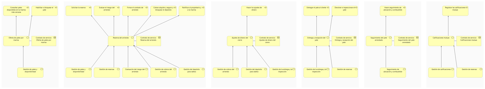

Cada columna es un servicio de plataforma con su contrato: arriba, los pasos del proceso de la V3 que apoya; abajo, los servicios de dominio que coordina. Un servicio de dominio que coordinan varios servicios de plataforma aparece una vez por columna, para que ninguna línea cruce a otra columna; es el mismo elemento del modelo.

### V4.02 - Detalle: Gestión de yates y disponibilidad

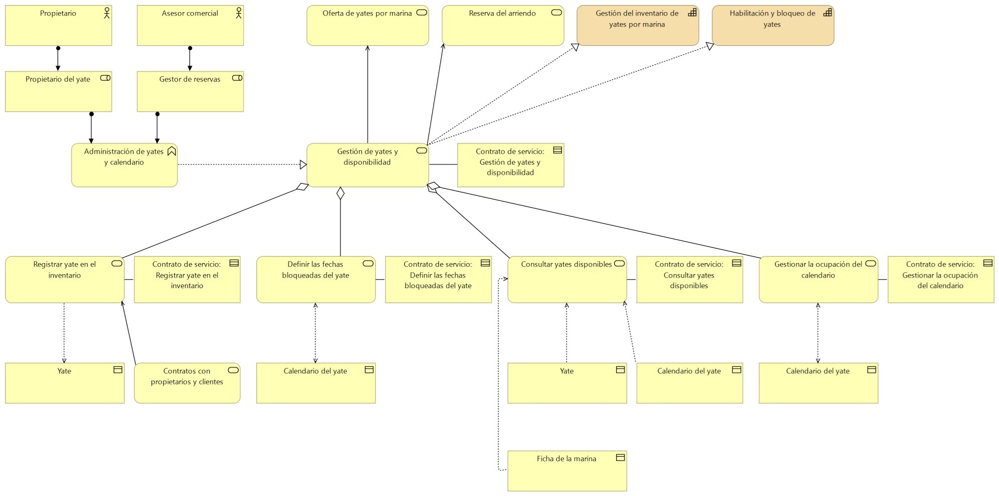

Detalle de SD-01: sus servicios básicos con su contrato, los servicios de plataforma a los que sirve, las capacidades de la V2 que realiza, la función "Administración de yates y calendario" con sus roles y actores, los objetos de negocio que usa cada servicio básico y los servicios de la capa anticorrupción de los que depende. Un objeto o un servicio de la capa anticorrupción se repite bajo cada servicio básico que lo usa; es el mismo elemento del modelo. Las vistas V4.03 a V4.09 siguen el mismo formato.

### V4.03 - Detalle: Gestión de reservas

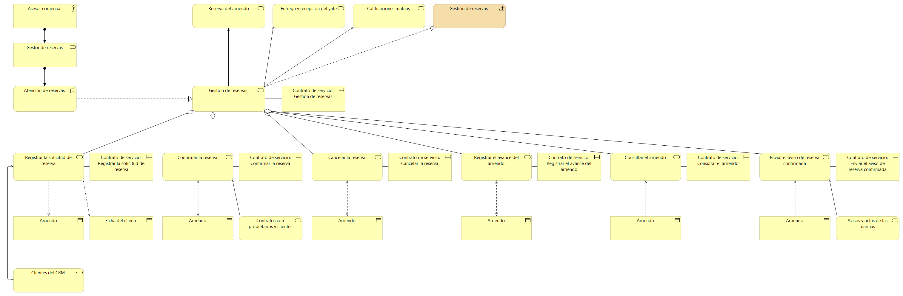

Detalle de SD-02: los servicios básicos SB-06 a SB-10 y SB-31, la función "Atención de reservas" con el rol "Gestor de reservas", los objetos "Arriendo" y "Ficha del cliente", y los servicios SA-01, SA-02 y SA-05 de la capa anticorrupción.

### V4.04 - Detalle: Evaluación del riesgo del arriendo

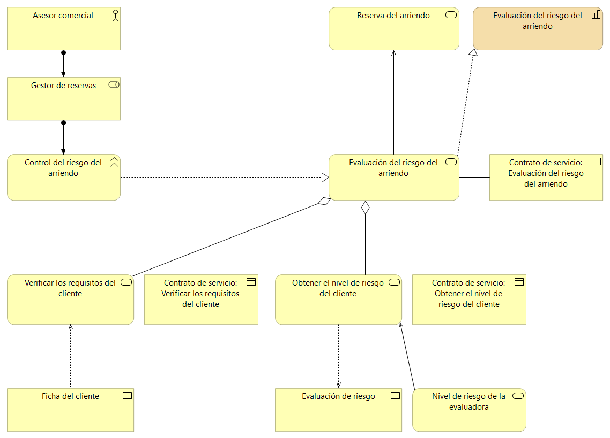

Detalle de SD-03: los servicios básicos SB-11 y SB-12, la función "Control del riesgo del arriendo" con el rol "Gestor de reservas", los objetos "Ficha del cliente" y "Evaluación de riesgo", y el servicio SA-04 de la capa anticorrupción.

### V4.05 - Detalle: Gestión de cobros del arriendo

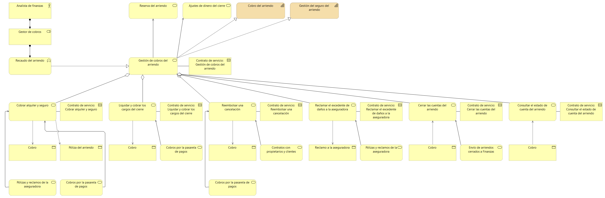

Detalle de SD-04: los servicios básicos SB-13 a SB-18, la función "Recaudo del arriendo" con el rol "Gestor de cobros", los objetos "Cobro", "Póliza del arriendo" y "Reclamo a la aseguradora", y los servicios SA-02, SA-03, SA-06 y SA-08 de la capa anticorrupción.

### V4.06 - Detalle: Gestión del depósito para daños

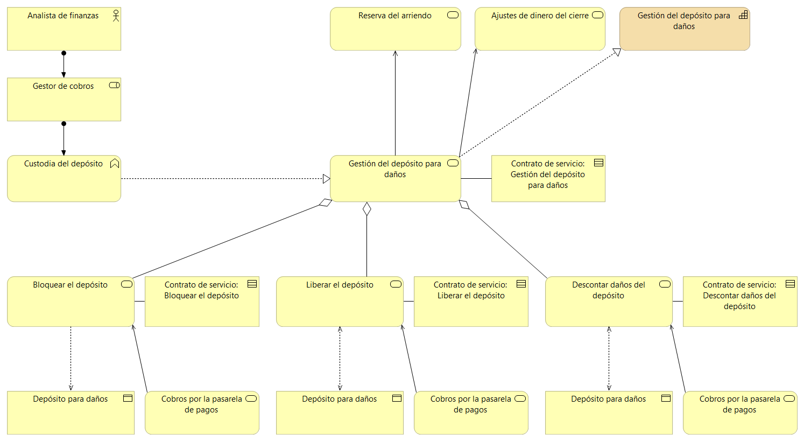

Detalle de SD-05: los servicios básicos SB-19, SB-20 y SB-21, la función "Custodia del depósito" con el rol "Gestor de cobros", el objeto "Depósito para daños" y el servicio SA-06 de la capa anticorrupción.

### V4.07 - Detalle: Gestión de la entrega y la inspección

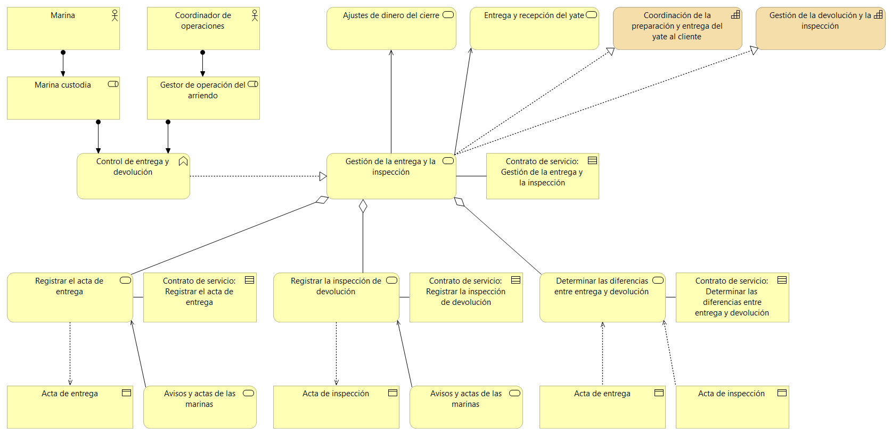

Detalle de SD-06: los servicios básicos SB-22, SB-23 y SB-24, la función "Control de entrega y devolución" con los roles "Marina custodia" y "Gestor de operación del arriendo", los objetos "Acta de entrega" y "Acta de inspección", y el servicio SA-05 de la capa anticorrupción.

### V4.08 - Detalle: Seguimiento de ubicación y combustible

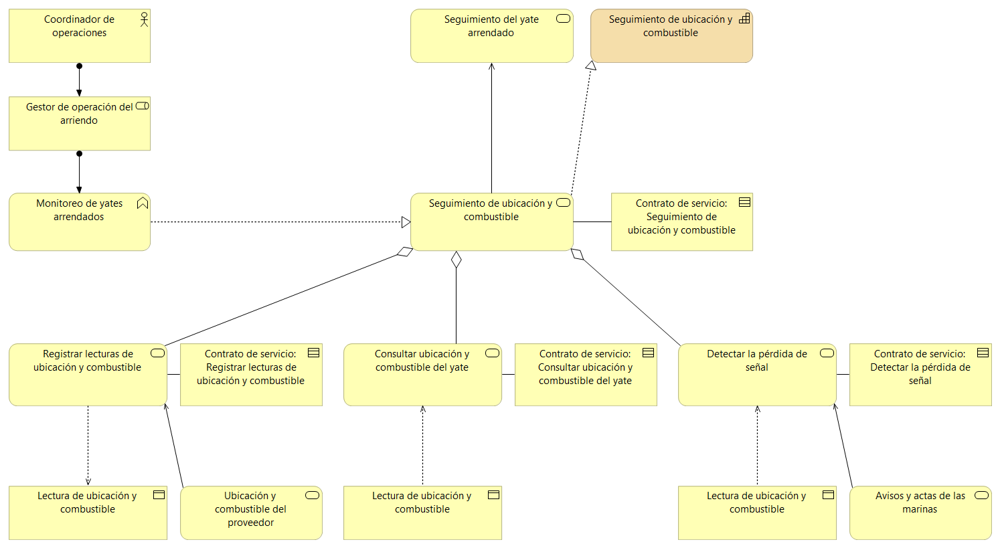

Detalle de SD-07: los servicios básicos SB-25, SB-26 y SB-27, la función "Monitoreo de yates arrendados" con el rol "Gestor de operación del arriendo", el objeto "Lectura de ubicación y combustible" y los servicios SA-05 y SA-07 de la capa anticorrupción.

### V4.09 - Detalle: Gestión de calificaciones

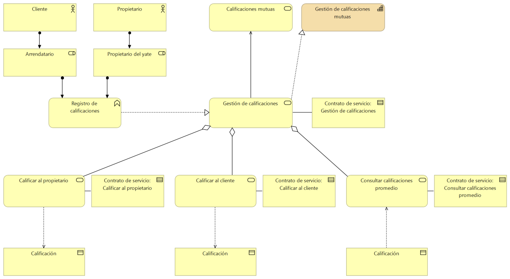

Detalle de SD-08: los servicios básicos SB-28, SB-29 y SB-30, la función "Registro de calificaciones" con los roles "Arrendatario" y "Propietario del yate", y el objeto "Calificación". No depende de la capa anticorrupción.

### V4.10 - Capa anticorrupción

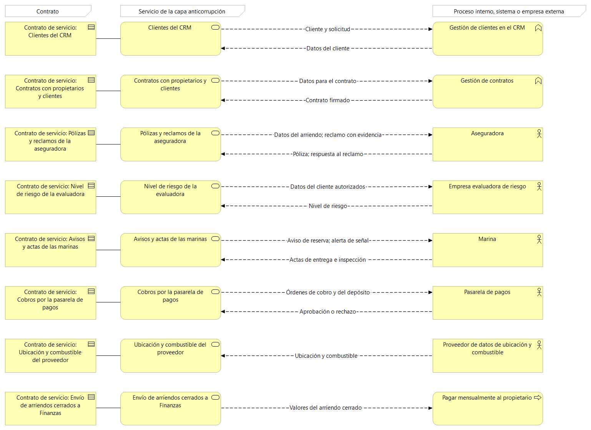

Cada servicio de la capa anticorrupción con su contrato y la contraparte con la que intercambia información. Cada flujo dice qué información pasa y la flecha marca la dirección: son 14 flujos, 7 de entrada y 7 de salida.

Los 8 servicios de dominio son la entrada de la extracción de dominios de la V5 (V4-DEC-16), y la capa anticorrupción pasa a la capa de aplicación en la V8 y la V9.

## 5. Dominios y lenguaje ubicuo

### V5 - Dominios

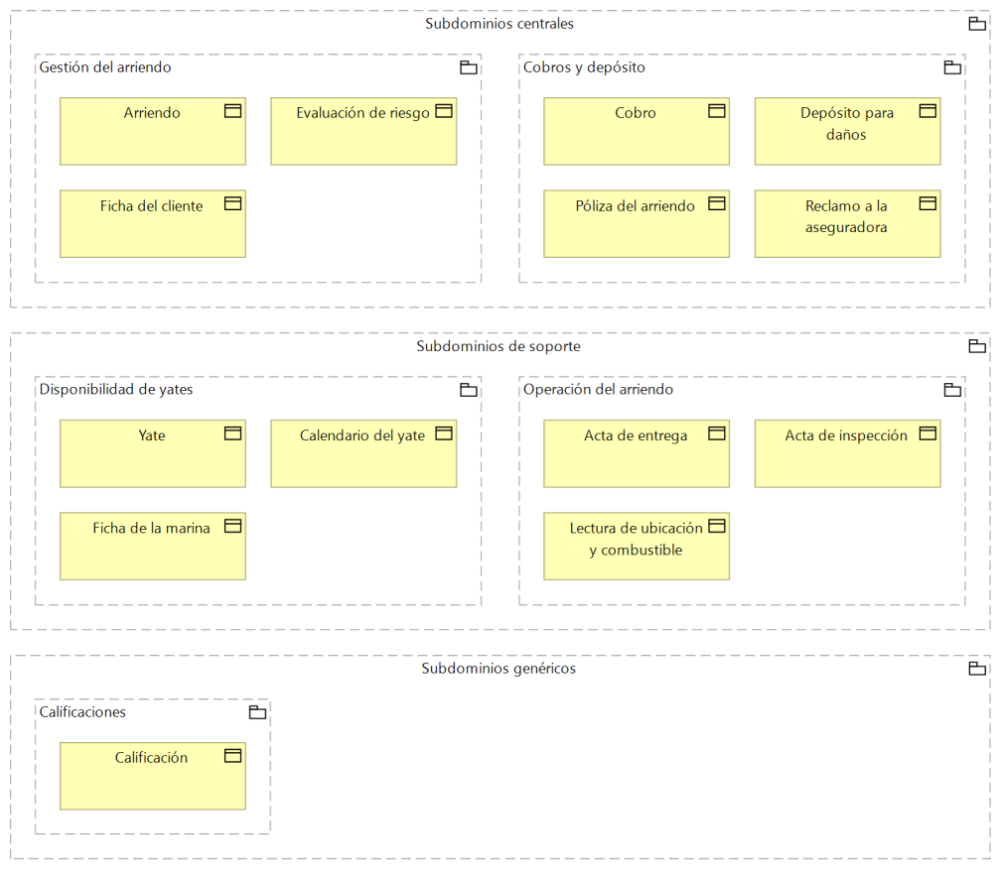

La V5 aplica el análisis estratégico de DDD. Parte del proceso detallado, identifica los dominios del negocio y los clasifica como centrales, de soporte o genéricos. El resultado son cinco dominios en tres clasificaciones: subdominios centrales (Gestión del arriendo y Cobros y depósito), de soporte (Disponibilidad de yates y Operación del arriendo) y genéricos (Calificaciones). Cada dominio es dueño de los objetos de negocio que escribe en la V4 (V5-DEC-02).

Para leerla: la vista tiene tres franjas, de arriba abajo: subdominios centrales, de soporte y genéricos. Cada dominio está anidado en su franja, y cada objeto de negocio en su dominio; cada anidamiento es una de las 19 agregaciones del modelo (sección 11). Se usan agrupación y objeto de negocio; los objetos de datos aparecen en la V6 y los componentes en la V8 (V5-DEC-03).

#### Análisis del ecosistema

Quién y qué rodea la aplicación, y cómo se relaciona con ella. Nada de esto es un dominio de la V5 (V5-DEC-04).

| Actor, sistema o norma | Qué es | Relación con la aplicación | Fuente |
|---|---|---|---|
| Cliente | Quien arrienda el yate | Usuario: consulta, reserva, paga, ve el seguimiento de su arriendo y califica al propietario | ACT-01, E2E-02, E2E-07 |
| Propietario | Dueño del yate | Usuario: bloquea fechas de su yate y califica al cliente | CTX-01, E2E-02, E2E-07 |
| Empleados de YateGear | Comercial, Operaciones, Finanzas y Servicio al cliente | Usuarios internos | H-02; CTX-02 |
| Marinas aliadas (tres en el Caribe) | Guardan, preparan, entregan y reciben los yates | SA-05, en ambas direcciones: reciben el aviso de reserva y la alerta de pérdida de señal, y envían las actas. Consultan el seguimiento | CTX-03, INT-MAR |
| CRM | Sistema interno de Comercial | SA-01, en ambas direcciones: datos del cliente y su solicitud | H-20; INT-CRM |
| Gestión de contratos | Proceso interno (hoy PDF por correo) | SA-02, en ambas direcciones: contrato del cliente y del propietario | H-07, H-20; INT-CON |
| Aseguradora | Proveedor | SA-03, en ambas direcciones: póliza del arriendo y reclamo por el excedente de daños | H-15, H-20; INT-ASE |
| Empresa evaluadora de riesgo | Proveedor | SA-04, en ambas direcciones: nivel de riesgo del cliente | H-07, H-20; INT-RIE |
| Pasarela de pagos | Proveedor | SA-06, en ambas direcciones: cobros, bloqueo y liberación del depósito, reembolsos | H-10, H-20; INT-PAG |
| Proveedor de datos de ubicación y combustible | Proveedor del dispositivo de cada yate | SA-07, solo entra: lecturas de posición, combustible y hora | H-12, H-20; INT-GPS |
| Pago mensual al propietario | Proceso interno de Finanzas | SA-08, solo sale: lo que le corresponde al propietario por cada arriendo cerrado | H-11; CTX-01, E2E-04 |
| DIMAR | Entidad regulatoria | Sin interoperabilidad. La licencia de navegación vigente del cliente es una restricción de la V1 | H-09, D-06; NOR-01 |
| Ley 1581 de 2012 | Norma de datos personales | Restricción de la V1: el cliente debe autorizar que sus datos se compartan con terceros | H-19; NOR-01 |
| Hoja de cálculo y WhatsApp | Forma actual de trabajar | Sin interoperabilidad: la aplicación los reemplaza (EX-14 y EX-13 de la V4) | D-05; CTX-02, MOT-01 |

Las restricciones de la V1 que marcan este ecosistema son cuatro: presupuesto moderado, marinas que no cambian sus sistemas, Ley 1581 de 2012 y licencia de navegación vigente del cliente.

#### Extracción de los dominios

Se sigue el método de las diapositivas 8 a 10 de 9_DDD_Diseño: entender la estructura organizacional, recorrer el proceso detallado con sus acciones y eventos, e identificar los puntos donde cambian el área responsable, el significado de una palabra o el dueño de un objeto de negocio; esos puntos separan el proceso en dominios.

| Área (V2) | Qué hace en el arriendo | Fuente |
|---|---|---|
| Comercial | Atiende al cliente, revisa qué yates hay en la marina más cercana, confirma con el propietario y lleva la reserva hasta que se firma el contrato. Usa el CRM. | H-02; CTX-02 |
| Operaciones | Coordina con las marinas: les avisa cuando la reserva está confirmada y está pendiente de la entrega, el seguimiento y la devolución con su inspección. | H-02; CTX-02 |
| Finanzas | Cobra el alquiler y el seguro, bloquea el depósito, cobra el combustible al final, decide con la evidencia si el depósito se devuelve o se retiene y paga cada mes al propietario. | H-02; CTX-02 |
| Servicio al cliente | Atiende los reclamos, sobre todo por cobros de combustible o daños. En la V2 también lleva las calificaciones mutuas (V2-SUP-07). | H-02; CTX-02 |
| Gerencia | No participa en el día a día del arriendo. Mantiene la alianza con las marinas (V2-SUP-06). | H-04; MOT-02, CTX-03 |
| Apoyo corporativo | No participa en el arriendo: asesoría jurídica, talento humano y TI (V2-SUP-05). | V2 |

Pasos del proceso de la V3 y dominio donde cae cada uno

| Paso del E2E (V3) | Quién lo hace (V3) | Qué ocurre | Dominio |
|---|---|---|---|
| Evento: Cliente quiere arrendar un yate | Cliente | Un cliente escribe porque quiere un yate para unas fechas. | Inicio del proceso (límite) |
| Habilitar o bloquear el yate | Propietario | El propietario cierra o abre fechas de su yate; no puede bloquear fechas con reserva confirmada. | Disponibilidad de yates (SB-03) |
| Consultar yates disponibles en la marina más cercana | Cliente | El cliente ve los yates de la marina más cercana que están libres en sus fechas. | Disponibilidad de yates (SB-04) |
| Solicitar la reserva | Cliente | El cliente pide el yate para sus fechas, con su licencia y su autorización de datos. | Gestión del arriendo (SB-06). Las fechas las aparta Disponibilidad (SB-05) |
| Evaluar el riesgo del arriendo | Asesor comercial | Se verifican la licencia y la autorización, y la evaluadora dice si el riesgo es bajo, medio o alto. | Gestión del arriendo (SB-11, SB-12) |
| Evento: Arriendo no realizado por riesgo alto | - | Con riesgo alto no se arrienda. | Gestión del arriendo |
| Firmar el contrato de arriendo | Cliente | Con riesgo aceptable el cliente firma el contrato con YateGear. | Gestión del arriendo (la referencia del contrato firmado llega por SA-02) |
| Cobrar alquiler y seguro y bloquear el depósito | Analista de finanzas | Se cobran el alquiler y el seguro y se bloquea el depósito en la tarjeta de crédito. | Cobros y depósito (SB-13, SB-19) |
| Evento: Reserva confirmada | - | Con riesgo aceptable, contrato firmado y pagos completos, la reserva se confirma. | Gestión del arriendo (SB-07) |
| Notificar al propietario y a la marina | Coordinador de operaciones | Se avisa al propietario y a la marina para que preparen el yate. | Gestión del arriendo (SB-31) |
| Entregar el yate al cliente | Marina | La marina entrega el yate con acta, fotos y tanque lleno. | Operación del arriendo (SB-22) |
| Hacer seguimiento de ubicación y combustible | Coordinador de operaciones | Llegan las lecturas del dispositivo; la marina y el cliente las ven. | Operación del arriendo (SB-25, SB-26) |
| Evento: Pérdida de señal del yate | - | El dispositivo deja de enviar datos. | Operación del arriendo (SB-27) |
| Contactar al cliente | Marina | La marina intenta comunicarse con el cliente. | Fuera de la aplicación (operación de la marina) |
| Devolver e inspeccionar el yate | Marina | La marina recibe el yate y hace la inspección con fotos, combustible y hora de regreso; se calculan las diferencias con la entrega. | Operación del arriendo (SB-23, SB-24) |
| Hacer los ajustes de dinero | Analista de finanzas | Se cobran el combustible y el tiempo adicional, se libera o descuenta el depósito, se reclama a la aseguradora si hace falta y se cierran las cuentas. | Cobros y depósito (SB-14, SB-16, SB-17, SB-20, SB-21) |
| Evento: Arriendo cerrado | - | Con los ajustes de dinero se cierra el arriendo. | Gestión del arriendo (SB-09) |
| Pagar mensualmente al propietario | Analista de finanzas | Finanzas le paga al propietario lo que le corresponde. | Fuera de la aplicación (proceso interno, SA-08) |
| Registrar las calificaciones mutuas | Cliente y propietario | Cada uno califica al otro al cerrar el arriendo. | Calificaciones (SB-28, SB-29) |
| Evento: Calificaciones registradas | - | Termina el proceso. | Fin del proceso (límite) |

Un corte separa dos dominios cuando cambia alguna de estas tres cosas:

1. El área responsable (CTX-02, V2). Comercial lleva Gestión del arriendo y Disponibilidad de yates, que separa el punto 3; Operaciones separa Operación del arriendo; Finanzas, Cobros y depósito; Servicio al cliente, Calificaciones.
2. El significado de una palabra (H-17, VOC-01). "Bloqueo" son las fechas que cierra el propietario (Disponibilidad de yates) o el depósito retenido en la tarjeta de crédito (Cobros y depósito). "Disponible" es el yate habilitado y sin reserva en esas fechas (Disponibilidad de yates) o, para la marina, listo para entregar (Operación del arriendo). "Entrega" es la de la marina al cliente (Operación del arriendo); la del propietario a YateGear queda fuera del alcance.
3. El dueño del objeto de negocio, es decir, quién lo escribe en la V4 (V5-DEC-02).

Los dos primeros son indicios y el que decide es el tercero. Gestión del arriendo y Disponibilidad de yates comparten área, y las separa el dueño del calendario del yate (V4-DEC-03). "Notificar al propietario y a la marina" lo hace Operaciones en la V3, pero cae en Gestión del arriendo, porque el aviso sale del arriendo confirmado (SB-31 está en SD-02) y no escribe ningún objeto de Operación.

#### Clasificación de los dominios

| Dominio | Tipo | Descripción | Argumento | Fuente |
|---|---|---|---|---|
| Gestión del arriendo | Central | Lleva cada arriendo desde la solicitud de reserva hasta su cierre: registra los datos del cliente, obtiene el nivel de riesgo y confirma la reserva solo con sus tres condiciones. | Aquí YateGear decide si entrega un yate que no es suyo: no se confirma sin riesgo aceptable, contrato firmado y pagos completos, y con riesgo alto no se arrienda. Son reglas propias de YateGear. Cumple una de las cuatro prioridades que el experto llamó "el corazón" (CIE-01) y aplica el principio "Ante la duda, se protege el yate del propietario". | H-01, H-07, H-21; CTX-03, REG-01, MOT-04, CIE-01 |
| Cobros y depósito | Central | Maneja el dinero del arriendo: cobros, reembolsos, depósito para daños y reclamo a la aseguradora. | El experto lo dijo así: "Nosotros cobramos todo el dinero, manejamos el depósito, le pagamos después al propietario y respondemos ante él si algo le pasa a su yate" (CTX-03). Aquí YateGear controla el bien ajeno después de la entrega: todo cargo va con evidencia, el depósito se resuelve en máximo 3 días y el excedente de daños se reclama a la aseguradora. Cumple dos de las cuatro prioridades. No es genérico: lo genérico es procesar pagos, y eso lo hace la pasarela, fuera de la aplicación. | H-01, H-10, H-13, H-15, H-21; CTX-03, E2E-04, E2E-06, INT-PAG, CIE-01 |
| Disponibilidad de yates | Soporte | Mantiene el inventario de yates por marina y el calendario de cada yate, y responde qué yates están disponibles en unas fechas. | Es crítico, pero no diferenciador. Cero dobles reservas es la primera de las cuatro prioridades, porque hoy la hoja de cálculo no siempre está al día; pero un calendario sin cruces es un problema conocido, y el inventario existe para servir al arriendo. No es genérico, porque tiene reglas propias: el propietario decide sus fechas y no puede bloquear fechas confirmadas. | H-08, H-21; MOT-01, E2E-02, REG-02, CIE-01 |
| Operación del arriendo | Soporte | Registra lo que pasa con el yate durante el arriendo: acta de entrega, lecturas de ubicación y combustible, pérdida de señal e inspección de devolución. | Es propio del negocio de yates y aporta la evidencia que usan los cobros, pero no decide el arriendo. La operación física es de las marinas, que no van a cambiar sus sistemas. El experto quiere el seguimiento visible, pero no lo incluye entre las cuatro prioridades. | H-12, H-13, H-14; E2E-05, E2E-06, INT-MAR, INT-GPS, MOT-04, CIE-01 |
| Calificaciones | Genérico | Registra las calificaciones mutuas al cerrar el arriendo y calcula los promedios. | Calificar después de un servicio es un mecanismo común a muchas plataformas. Solo tiene la regla común de una calificación por parte al cierre; la empresa no tiene reglas propias, como sanciones por mala calificación. El experto la quiere, pero no la incluye entre las cuatro prioridades. | H-16, H-21; E2E-07, CIE-01; D-04 |

El experto dijo en CIE-01: "Lo más importante es lo que hoy más nos duele" y "esos cuatro son el corazón". Así queda cada una de esas cuatro prioridades:

| Lo que el experto llamó "el corazón" | Dónde se cumple | Clasificación |
|---|---|---|
| 1. Acabar con las dobles reservas | Disponibilidad de yates (SB-05, V4-DEC-03) | Soporte: crítico, pero no diferenciador (V5-DEC-05) |
| 2. Que todo cobro vaya con evidencia | Cobros y depósito; la evidencia la aporta Operación del arriendo | Central |
| 3. No entregar ningún yate sin riesgo aceptable, contrato firmado y pagos completos | Gestión del arriendo (SB-07) | Central |
| 4. Devolver el depósito en máximo 3 días | Cobros y depósito (SB-20, SB-21) | Central |

Dueño de cada objeto de negocio

| Dominio | Servicios de dominio (V4) | Objeto de negocio | Lo escribe en la V4 |
|---|---|---|---|
| Gestión del arriendo | SD-02, SD-03 | Arriendo | SB-06, SB-07, SB-08, SB-09 |
| Gestión del arriendo | SD-02, SD-03 | Evaluación de riesgo | SB-12 |
| Gestión del arriendo | SD-02, SD-03 | Ficha del cliente | SB-06 |
| Cobros y depósito | SD-04, SD-05 | Cobro | SB-13, SB-14, SB-15 |
| Cobros y depósito | SD-04, SD-05 | Póliza del arriendo | SB-13 |
| Cobros y depósito | SD-04, SD-05 | Reclamo a la aseguradora | SB-16 |
| Cobros y depósito | SD-04, SD-05 | Depósito para daños | SB-19, SB-20, SB-21 |
| Disponibilidad de yates | SD-01 | Yate | SB-01 |
| Disponibilidad de yates | SD-01 | Calendario del yate | SB-03, SB-05 |
| Disponibilidad de yates | SD-01 | Ficha de la marina | Ninguno: solo la lee SB-04 (excepción de V5-DEC-02) |
| Operación del arriendo | SD-06, SD-07 | Acta de entrega | SB-22 |
| Operación del arriendo | SD-06, SD-07 | Acta de inspección | SB-23 |
| Operación del arriendo | SD-06, SD-07 | Lectura de ubicación y combustible | SB-25 |
| Calificaciones | SD-08 | Calificación | SB-28, SB-29 |

Cada objeto está en un solo dominio. Los demás dominios solo lo leen, y esas lecturas entre dominios son tema de la V8.

#### Decisiones de la V5

| ID | Qué se decidió | Por qué |
|---|---|---|
| V5-DEC-01 | Cinco dominios, no ocho. | Los 8 servicios de dominio de la V4 son una entrada, no el resultado (V4-DEC-16). Se agrupan donde coinciden el área y el lenguaje: SD-02 y SD-03 (Comercial: la reserva y su riesgo llevan a una sola decisión, confirmar); SD-04 y SD-05 (Finanzas, con su sentido de "bloquear"); SD-06 y SD-07 (Operaciones: lo que pasa con el yate, con el sentido de "disponible" de la marina). La separación del depósito de V4-DEC-04 se conserva en la V6, porque un dominio puede tener varios agregados. |
| V5-DEC-02 | Regla de dueño: cada objeto de negocio pertenece a un solo dominio, el que lo escribe en la V4. | Así cada dato tiene un solo responsable de sus reglas, y las lecturas entre dominios van a la V8. Excepción: "Ficha de la marina" no la escribe ningún servicio y solo la lee SB-04, así que queda en el único dominio que la usa, Disponibilidad de yates. |
| V5-DEC-03 | Se usan agrupación y objeto de negocio. | La V5 define el problema: qué dominios hay y qué datos son de cada uno. Los objetos de datos y los componentes de aplicación son parte de la solución: llegan en la V6 y la V8. |
| V5-DEC-04 | Los sistemas y las empresas externas no son dominios. | El CRM, la gestión de contratos, la aseguradora, la evaluadora, la pasarela, el proveedor de ubicación, las marinas y el pago mensual de Finanzas son contrapartes de la capa anticorrupción. Van en el análisis del ecosistema, la V8 y la V9. |
| V5-DEC-05 | Criterio de "central": donde YateGear controla el riesgo de entregar un bien ajeno, antes y después de la entrega. | El impulsor principal de la V1 es responder por bienes ajenos (H-01, CTX-03). Antes de la entrega ese control está en Gestión del arriendo; después, en Cobros y depósito. Crítico no es lo mismo que diferenciador. Con este criterio, tres de las cuatro prioridades del "corazón" quedan en los subdominios centrales. |
| V5-DEC-06 | Nombres: "Gestión del arriendo" y "Subdominios centrales". | "Gestión del arriendo" evita que el dominio se llame igual que el objeto de negocio "Arriendo" (V4-DEC-13). "Subdominios centrales" hace que las tres franjas sigan el mismo patrón: subdominios centrales, de soporte y genéricos. |

#### Supuestos de la V5

La V5 no agrega supuestos. Usa V2-SUP-07, que pone "Gestión de calificaciones mutuas" en Servicio al cliente y da el área de Calificaciones.

La V7 da el lenguaje de cada uno de estos dominios, y la V6 diseña sus agregados.

### V7 - Lenguaje ubicuo

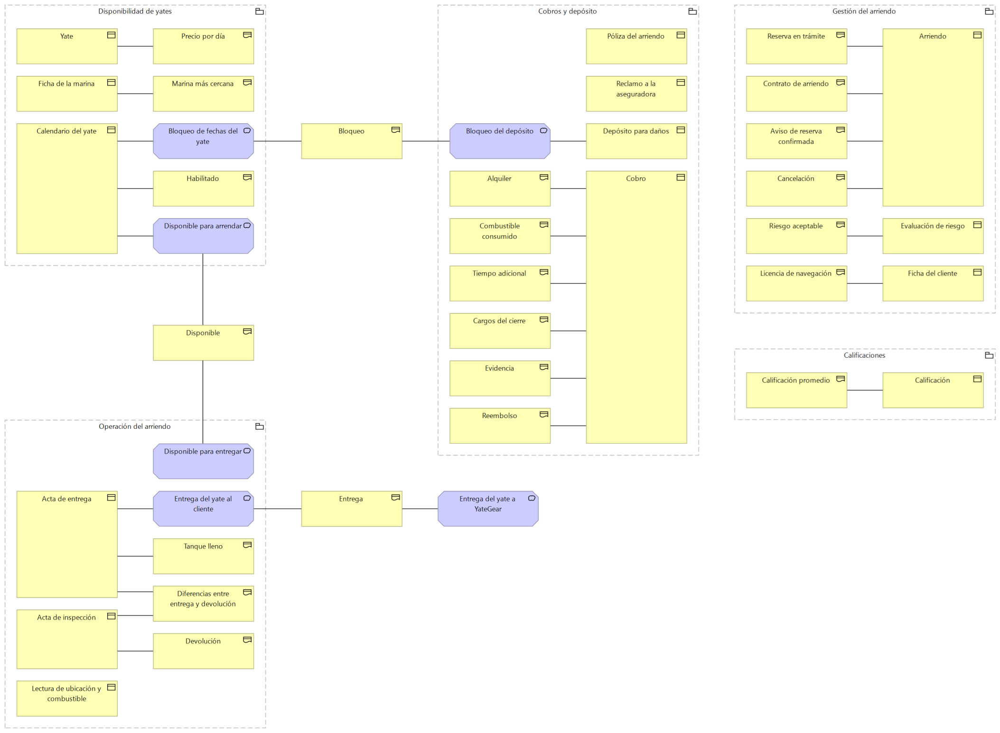

La V7 es el lenguaje ubicuo: el glosario de los términos del proceso y su entorno, con definición, dominio y ejemplo, y las palabras que cambian de sentido según quién las use. Son 33 términos con elemento propio en los cinco dominios de la V5 (14 objetos de negocio y 19 representaciones), 11 términos más que ya existen en el modelo con otro elemento, y tres palabras con dos sentidos: "bloqueo", "disponible" y "entrega".

Cómo se modela un término:

| Qué es | Elemento ArchiMate | Ejemplo |
|---|---|---|
| Un dato del negocio que la aplicación guarda | Objeto de negocio, reutilizado de la V4 | Arriendo, Cobro, Calendario del yate |
| Una palabra del negocio que no es un dato propio: un estado, una condición, una parte de un dato | Representación | Habilitado, Riesgo aceptable, Tiempo adicional |
| Una palabra con dos sentidos | Representación, fuera de los dominios | Bloqueo |
| Cada sentido de una palabra ambigua | Significado, dentro del dominio donde vale | Bloqueo de fechas del yate, Bloqueo del depósito |

Para leerla: los cinco dominios son cajas. Dentro de cada uno hay una columna con sus objetos de negocio y otra con sus términos, y cada término está a la altura del objeto al que se refiere. "Bloqueo" queda entre Disponibilidad de yates y Cobros y depósito; "Disponible", entre Disponibilidad de yates y Operación del arriendo; "Entrega", al lado de Operación del arriendo, con el sentido del propietario fuera de todo dominio. Las agregaciones dominio --> término se ven por anidamiento. Cada representación y cada significado llevan en el modelo su definición y su fuente en la documentación, y las propiedades `Dominio` y `Ejemplo`.

#### Glosario

Disponibilidad de yates (subdominio de soporte): 6 términos

| Término | Tipo | Definición | Ejemplo | Fuente |
|---|---|---|---|---|
| Yate | Objeto de negocio | Embarcación de un propietario, guardada en una marina aliada, que YateGear ofrece en arriendo, con su precio por día. | Un propietario particular guarda su yate en una marina del Caribe y firma con YateGear un contrato que la autoriza a ofrecerlo en arriendo. | H-01, H-08; CTX-01, E2E-02 |
| Calendario del yate | Objeto de negocio | Fechas de un yate: libres, bloqueadas por el propietario, apartadas por una reserva en trámite u ocupadas por una reserva confirmada. | Si un cliente ya tiene el yate confirmado para unos días, ningún otro cliente puede tenerlo esos mismos días y el propietario no puede bloquearlos. | H-08, H-17; E2E-02, REG-02 |
| Ficha de la marina | Objeto de negocio | Datos de una marina aliada: nombre, ubicación y a quién se le envían los avisos. | YateGear trabaja con tres marinas aliadas en el Caribe, y al cliente se le muestran los yates de la que le queda más cerca. | CTX-03, E2E-02 |
| Habilitado | Representación | Se dice de las fechas de un yate que su propietario no ha bloqueado; en ellas se puede arrendar. El yate no tiene estado habilitado o bloqueado (V4-DEC-17): el paso de la V3 "Habilitar o bloquear el yate" usa este sentido, el propietario abre o cierra fechas. | El propietario bloquea un fin de semana para usar el yate con su familia; el resto del tiempo queda habilitado para arrendar. | H-08; E2E-02; V4-DEC-17 |
| Marina más cercana | Representación | Marina aliada más próxima al cliente, cuyos yates se le muestran al consultar. La marina no decide si un yate se puede arrendar. | A un cliente en Cartagena se le muestran los yates de la marina aliada de Cartagena. | H-08; E2E-02, E2E-08 |
| Precio por día | Representación | Valor del alquiler diario de un yate, que fija su propietario. | El propietario fija cuánto cobra por cada día de uso de su yate. | CTX-01, ACT-01 |

Gestión del arriendo (subdominio central): 9 términos

| Término | Tipo | Definición | Ejemplo | Fuente |
|---|---|---|---|---|
| Arriendo | Objeto de negocio | Uso de un yate por un cliente en unas fechas, desde la solicitud de reserva hasta el cierre. | Un cliente escribe porque quiere un yate para tres días; desde esa solicitud hasta que se cierra con los ajustes de dinero, es el mismo arriendo. | H-07; E2E-01, E2E-08 |
| Evaluación de riesgo | Objeto de negocio | Respuesta de la empresa evaluadora para un arriendo: nivel bajo, medio o alto, y la decisión que se toma con él. | Se envían los datos del cliente a la empresa evaluadora, que responde si el riesgo es bajo, medio o alto; si es alto, ahí se detiene el arriendo. | H-07; INT-RIE |
| Ficha del cliente | Objeto de negocio | Datos del cliente que necesita el arriendo: referencia en el CRM, licencia de navegación con su vigencia y autorización para el tratamiento de sus datos. | Los datos del cliente se registran cuando consulta y se vuelven a consultar cuando pide otro arriendo. | H-09, H-19; INT-CRM, NOR-01 |
| Reserva en trámite | Representación | Reserva solicitada a la que todavía le falta alguna de las tres condiciones para confirmarse. | El riesgo salió aceptable y el contrato está firmado, pero falta el pago: la reserva sigue en trámite y no se avisa a la marina. | H-07; E2E-03, E2E-08 |
| Riesgo aceptable | Representación | Nivel de riesgo con el que sí se arrienda. Con riesgo alto no se arrienda. | La empresa evaluadora responde "medio": el cliente puede firmar el contrato. | H-07; E2E-03, REG-01 |
| Licencia de navegación | Representación | Documento vigente que debe tener el cliente, porque es él quien navega el yate. | Antes de confirmar la reserva se verifica que la licencia esté vigente. | H-09; E2E-03, NOR-01 |
| Contrato de arriendo | Representación | Contrato que el cliente firma con YateGear por cada arriendo, después de que el riesgo sale aceptable. | Hoy es un PDF que se envía por correo para que el cliente lo firme. | H-07; E2E-03, INT-CON |
| Aviso de reserva confirmada | Representación | Mensaje que reciben el propietario y la marina cuando la reserva queda confirmada: qué yate está arrendado, para qué fechas y a qué cliente se le entrega. Sale solo después de confirmar. | Con la reserva confirmada, se le avisa al propietario y a la marina qué yate está arrendado, para qué fechas y a qué cliente se le va a entregar, para que lo tengan listo con el tanque lleno el día de la entrega. | H-07; E2E-03, INT-MAR |
| Cancelación | Representación | El cliente desiste del arriendo antes de la fecha de inicio. Si cancela con anticipación se le reembolsa el dinero; si cancela muy cerca de la fecha, no. El plazo lo fija el contrato con el cliente. | Si el cliente cancela con anticipación, se le devuelve el dinero; si cancela muy cerca de la fecha del arriendo, no. | E2E-04, EXC-01, EXC-02; D-03 |

Cobros y depósito (subdominio central): 10 términos

| Término | Tipo | Definición | Ejemplo | Fuente |
|---|---|---|---|---|
| Cobro | Objeto de negocio | Cada cargo o devolución de dinero de un arriendo, con su comprobante de la pasarela y su evidencia cuando es del cierre. | Al reservar se cobran el alquiler y el seguro; al cierre, el combustible consumido y el tiempo adicional, si lo hay. | H-10, H-14; E2E-04, INT-PAG |
| Depósito para daños | Objeto de negocio | Garantía que se bloquea en la tarjeta de crédito del cliente al reservar y que al cierre se libera o se descuenta. | Al reservar se bloquea el depósito en la tarjeta de crédito del cliente: no se le cobra todavía, solo queda retenido como garantía. | H-10, H-17; E2E-04, VOC-01 |
| Póliza del arriendo | Objeto de negocio | Seguro que emite la aseguradora para un arriendo, con el yate, el cliente y las fechas. | Al reservar se le envían a la aseguradora el yate, el cliente y las fechas, y ella devuelve la póliza de ese arriendo. | H-15; INT-ASE |
| Reclamo a la aseguradora | Objeto de negocio | Solicitud a la aseguradora por la parte del daño que supera el depósito, con la evidencia. | Si el daño cuesta más que el depósito, la diferencia se le reclama a la aseguradora con las fotos y el acta de la entrega y de la inspección. | H-15; EXC-02, INT-ASE |
| Alquiler | Representación | Valor de los días que el cliente va a usar el yate. Se cobra al reservar. | Tres días de uso por el precio por día del yate. | H-10; E2E-04, INT-PAG |
| Combustible consumido | Representación | Diferencia entre el tanque lleno de la entrega y el nivel que registra la inspección. Siempre lo paga el cliente. | El yate salió con tanque lleno y volvió a medio tanque: se cobra medio tanque. | H-10, H-13; E2E-04, E2E-06, REG-01 |
| Tiempo adicional | Representación | Cargo por devolver el yate más tarde de lo acordado. | El cliente devuelve el yate después de la hora acordada y se le cobra ese tiempo. | H-14; E2E-06, EXC-01 |
| Cargos del cierre | Representación | Cobros que se hacen al cerrar el arriendo, cuando el yate ya volvió y la marina hizo la inspección: el combustible consumido y, si el yate se devolvió tarde, el tiempo adicional. Cada uno va con su evidencia. | Cuando el yate ya volvió y la marina hizo la inspección, se le cobra al cliente el combustible consumido y, si devolvió el yate tarde, también el tiempo adicional. | H-10, H-14; E2E-04, E2E-06 |
| Evidencia | Representación | Fotos y actas de la entrega y de la inspección que respaldan un cobro. | Las fotos de la inspección comparadas con las de la entrega muestran un daño nuevo. | H-05, H-13; MOT-04, E2E-06 |
| Reembolso | Representación | Dinero que se le reintegra al cliente cuando cancela con la anticipación que fija su contrato. Pasa por la pasarela de pagos. No se confunde con "Devolución" (regreso del yate) ni con liberar el depósito, que el experto llama "devolver el depósito" (MOT-01). | Un cliente cancela con anticipación y se le devuelve el dinero que pagó por el arriendo. | E2E-04, EXC-02, MOT-01; D-03 |

Operación del arriendo (subdominio de soporte): 6 términos

| Término | Tipo | Definición | Ejemplo | Fuente |
|---|---|---|---|---|
| Acta de entrega | Objeto de negocio | Registro de la marina al entregar el yate: fotos, nivel de combustible y hora. | El día acordado la marina le entrega el yate al cliente con un acta, fotos y el tanque lleno. | H-13; E2E-01, INT-MAR |
| Acta de inspección | Objeto de negocio | Registro de la marina al recibir el yate: fotos, nivel de combustible, hora de regreso y daños encontrados. | Cuando el cliente devuelve el yate, la marina toma fotos de su estado, revisa cuánto combustible tiene y registra la hora en que volvió. | H-13, H-14; E2E-06, INT-MAR |
| Lectura de ubicación y combustible | Objeto de negocio | Dato que envía el dispositivo de un yate por medio del proveedor: posición, nivel de combustible y hora. | El dispositivo de cada yate envía la ubicación y el nivel de combustible, sobre todo desde la entrega hasta la devolución. | H-12; INT-GPS |
| Tanque lleno | Representación | Condición de combustible con la que la marina entrega el yate al cliente. | El acta de entrega registra el tanque lleno; contra ese nivel se mide el combustible consumido. | H-13; E2E-01, E2E-06 |
| Diferencias entre entrega y devolución | Representación | Lo que cambió en el yate al comparar el acta y las fotos de la entrega con las de la inspección: combustible consumido, horas adicionales y daños nuevos. Son la base de los cargos del cierre y de la decisión sobre el depósito. El nombre viene de SB-24 de la V4; el experto habla de comparar las fotos. | Las fotos de la inspección se comparan con las que se tomaron en la entrega, cuando el yate salió con el tanque lleno: así se ve si hay algún daño nuevo y cuánto combustible se consumió. | H-13, H-14; E2E-06; SB-24 (V4) |
| Devolución | Representación | Regreso del yate a la marina al final del arriendo. La marina lo recibe y hace la inspección. No se confunde con "Reembolso" (dinero que se le reintegra al cliente por una cancelación) ni con liberar el depósito, que el experto llama "devolver el depósito" (MOT-01). | Al final de los tres días el cliente lleva el yate a la marina. | H-13, H-14; E2E-06, MOT-01 |

Calificaciones (subdominio genérico): 2 términos

| Término | Tipo | Definición | Ejemplo | Fuente |
|---|---|---|---|---|
| Calificación | Objeto de negocio | Calificación que se dan cliente y propietario al cerrar un arriendo. | Al cerrar el arriendo, el cliente califica si el yate estaba en buen estado y el propietario califica si se lo devolvieron cuidado y a tiempo. | H-16, H-18; E2E-07, IND-01 |
| Calificación promedio | Representación | Promedio de las calificaciones de un cliente o de un propietario. Es uno de los cuatro indicadores del negocio. | El cliente ve qué tan bien les ha ido a otros con ese propietario. | H-16, H-18; E2E-07, IND-01 |

Términos que no tienen elemento propio en la V7: 11

Son parte del lenguaje, pero no se crean como representación porque ya existen en el modelo con otro tipo de elemento o como núcleo de su nombre, son un valor dentro de otro elemento o son vocabulario del equipo (V7-DEC-03, V7-DEC-05 y V7-DEC-09). Los cuatro últimos son sinónimos: dos nombres para lo mismo.

| Término | Dónde está en el modelo | Dominio | Definición | Ejemplo | Fuente |
|---|---|---|---|---|---|
| Reserva confirmada | Evento de la V3 | Gestión del arriendo | La reserva queda confirmada con riesgo aceptable, contrato firmado y pagos hechos. | Con el riesgo aceptable, el contrato firmado y el alquiler, el seguro y el depósito pagados, la reserva queda confirmada y se avisa al propietario y a la marina. | H-07; E2E-03, REG-01 |
| Pérdida de señal | Evento de la V3 ("Pérdida de señal del yate") | Operación del arriendo | El dispositivo del yate deja de enviar datos mientras está arrendado. | Si el dispositivo deja de enviar datos en el mar, la marina intenta contactar al cliente para saber cómo está el yate. | H-12; E2E-05, EXC-01 |
| Arriendo cerrado | Evento de la V3 | Gestión del arriendo | El arriendo se cierra cuando terminan los ajustes de dinero. | Cuando Finanzas cobra el combustible y decide sobre el depósito, se cierra el arriendo; hoy eso tarda unos 10 días. | E2E-01, E2E-07 |
| Comisión | Campo de la raíz "Cuenta del arriendo" (V6) | Cobros y depósito | Parte del alquiler con la que se queda YateGear; el resto se le paga al propietario cada mes. La aplicación la calcula al cerrar las cuentas del arriendo (SB-17) y la envía a Finanzas (SA-08); el pago mensual al propietario queda fuera del alcance. | Si un cliente arrienda un yate por tres días, YateGear cobra el total del alquiler, se queda con su comisión y el resto es para el propietario. | H-11; CTX-01; SB-17, SA-08 (V4) |
| Contrato de servicio | Elementos Contract de la V4 | Ninguno: vocabulario del equipo | Especificación de un servicio de la arquitectura. Es vocabulario del equipo, no del negocio: no se debe confundir con el "Contrato de arriendo". | El contrato de SB-07 "Confirmar la reserva" dice qué recibe el servicio, qué entrega y qué reglas cumple. | V4, contratos de servicio |
| Cuenta del arriendo | Objeto de datos "Cuenta del arriendo" (V6), raíz de su agregado | Cobros y depósito | Los cobros de un arriendo, desde el alquiler y el seguro al reservar hasta los cargos del cierre y el reembolso. Se cierra cuando están todos los cargos y la decisión sobre el depósito, y lo que le corresponde al propietario pasa a Finanzas. | Todos los pagos del cliente pasan por la pasarela en dos momentos, al reservar y al cierre; la cuenta del arriendo los reúne y se cierra cuando ya están todos. | E2E-04; SB-17, SB-18 (V4); V6-DEC-05 |
| Ajustes de dinero | Núcleo del nombre del proceso "Hacer los ajustes de dinero" (V3) y del servicio SP-03 "Ajustes de dinero del cierre" (V4) | Cobros y depósito | Lo que se hace con el dinero cuando el yate vuelve y la marina hizo la inspección: cobrar los cargos del cierre, liberar el depósito o descontar de él los daños y, si el daño supera el depósito, reclamar a la aseguradora. Con ellos se cierra el arriendo. | Con lo que reporta la marina, Finanzas hace los ajustes por la pasarela de pagos: siempre se cobra el combustible consumido y, con el depósito, si no hay daños, se libera. | H-10, H-13, H-15; E2E-01, E2E-06 |
| Cliente / Arrendatario | Actor "Cliente" (V3) y rol "Arrendatario" (V4) | Gestión del arriendo | Es la misma persona: "Cliente" es el actor y "Arrendatario" es su papel en un arriendo. Consulta, reserva, firma el contrato, paga, navega el yate con su licencia vigente y lo devuelve. | El cliente que escribe porque quiere un yate para tres días es el arrendatario de ese arriendo. | ACT-01, E2E-01; V3; V4 |
| Propietario / Propietario del yate | Actor "Propietario" (V3) y rol "Propietario del yate" (V4) | Disponibilidad de yates | Es la misma persona, el dueño del yate. "Propietario del yate" es su papel frente a YateGear: fija el precio por día, bloquea o desbloquea fechas de su yate y califica al cliente. | El propietario firma con YateGear un contrato que la autoriza a ofrecer su yate y recibe cada mes lo que le corresponde de sus arriendos. | CTX-01, ACT-01, E2E-02; V3; V4 |
| Marina / Marina custodia | Actor "Marina" (V3) y rol "Marina custodia" (V4) | Operación del arriendo | Es la misma marina aliada. "Marina custodia" es su papel en el arriendo: guarda el yate, lo prepara, lo entrega con acta, fotos y tanque lleno, lo recibe y hace la inspección. | La marina recibe el aviso de la reserva confirmada y el día acordado le entrega el yate al cliente. | CTX-03, ACT-01, INT-MAR; V3; V4 |
| Reserva | Objeto de negocio "Arriendo" (V4) y representación "Reserva en trámite" (V7) | Gestión del arriendo | Así se llama el arriendo desde que se solicita hasta que se confirma. No es un dato aparte: es el "Arriendo" en sus estados de reserva solicitada y reserva confirmada; mientras le falta alguna de las tres condiciones, es una "Reserva en trámite". | Mientras se hacen la evaluación de riesgo, el contrato y los pagos, la reserva todavía no está confirmada. | H-07; E2E-08, REG-02 |

Los ejemplos salen de la conversación con el experto, salvo el de "Marina más cercana" (Cartagena) y el de "Disponible para arrendar" (fechas del 10 al 12), que son ilustraciones del equipo, y el de "Contrato de servicio", que se toma de la V4 porque es vocabulario del equipo.

#### Palabras con dos significados

El experto las señaló en VOC-01 y el análisis las recoge en H-17. Cada palabra es una representación fuera de los dominios, asociada a sus dos significados. Cada significado está dentro del dominio donde vale y, cuando existe, se asocia con el objeto de negocio al que se refiere. En las vistas anteriores cada palabra ya se usaba en un solo sentido, declarado en la documentación del elemento; la V7 es la vista donde los dos sentidos se ven juntos.

| Palabra | Significado | Quién lo usa | Dominio | Objeto de negocio | Ejemplo |
|---|---|---|---|---|---|
| Bloqueo | Bloqueo de fechas del yate: cerrar fechas para que no se arriende | Propietario | Disponibilidad de yates | Calendario del yate | El propietario bloquea un fin de semana para usar el yate con su familia. |
| Bloqueo | Bloqueo del depósito: retener el depósito en la tarjeta de crédito del cliente sin cobrarlo | Finanzas | Cobros y depósito | Depósito para daños | Al reservar se bloquea el depósito; si no hay daños, se libera al cierre. |
| Disponible | Disponible para arrendar: yate con fechas que su propietario no ha bloqueado y sin otra reserva en esas fechas; se le puede ofrecer al cliente (E2E-02: "se puede ofrecer cuando el propietario lo tiene habilitado y no tiene otra reserva en esas fechas") | Comercial | Disponibilidad de yates | Calendario del yate | El propietario no ha bloqueado las fechas del 10 al 12 y el yate no tiene otra reserva en ellas: se le puede ofrecer al cliente. |
| Disponible | Disponible para entregar: yate preparado y con el tanque lleno | Marina | Operación del arriendo | - | La marina tiene el yate listo el día de la entrega. |
| Entrega | Entrega del yate al cliente, al inicio del arriendo | Marina | Operación del arriendo | Acta de entrega | El día acordado la marina entrega el yate con acta, fotos y tanque lleno. |
| Entrega | Entrega del yate a YateGear, al firmar el contrato del propietario | Propietario | Ninguno: fuera del alcance | - | El propietario dice que "entrega" su yate cuando firma para que YateGear lo ofrezca. |

"Devolver" tiene tres sentidos en la conversación. No es una de las palabras ambiguas que señaló el experto (H-17), así que no lleva significados propios: cada sentido tiene su término, y las definiciones de "Devolución" y "Reembolso" aclaran la diferencia.

| Lo que dice el experto | Sentido | Término del glosario | Dónde |
|---|---|---|---|
| "el cliente devuelve el yate" | El yate regresa a la marina al final del arriendo | Devolución | E2E-01 |
| "se le devuelve el dinero" | Se le reintegra el dinero al cliente que cancela con anticipación | Reembolso | E2E-04, EXC-02 |
| "devolver el depósito" | Se libera el depósito bloqueado en la tarjeta de crédito; es el sentido del resultado de la V1 "Depósito devuelto en máximo 3 días" | Bloqueo del depósito (se libera) | MOT-01 |

#### Decisiones de la V7

| ID | Qué se decidió | Por qué |
|---|---|---|
| V7-DEC-01 | El término es una representación; el significado se usa solo para las palabras ambiguas. | La representación permite modelar como elemento cada palabra del negocio que no es un dato propio: un estado, una condición o una parte de un dato. El significado de ArchiMate es la interpretación que se le da a un concepto en un contexto, que es lo que pasa con "bloqueo", "disponible" y "entrega". Para los términos de un solo sentido, la definición va en la documentación. |
| V7-DEC-02 | Los 14 objetos de negocio de la V4 son términos del glosario tal como están. | Ya tienen nombre, definición y dominio (V5-DEC-02). Una representación por cada uno daría 14 elementos con el mismo nombre que su objeto, contra la regla de nombres V4-DEC-13. |
| V7-DEC-03 | "Reserva confirmada", "Pérdida de señal", "Arriendo cerrado" y "Cuenta del arriendo" no se crean como representación. | Ya existen en el modelo con ese nombre: los tres primeros como eventos de la V3 y "Cuenta del arriendo" como objeto de datos de la V6. Van en la tabla de términos sin elemento propio, apuntando a ese elemento. La regla vale solo con el nombre exacto. |
| V7-DEC-04 | La relación término --> objeto de negocio es una asociación, no una realización. | La realización dice que la representación es la forma perceptible del objeto (un PDF realiza un contrato). Aquí el término es un estado, una condición o una parte del dato; la asociación no afirma más de lo que se sabe. |
| V7-DEC-05 | "Comisión", "Ajustes de dinero" y "Contrato de servicio" no llevan representación. | La comisión es un valor que la aplicación calcula al cerrar las cuentas (SB-17) y envía a Finanzas (SA-08); en la V6 es un campo de la raíz Cuenta del arriendo y ningún comando ni evento la nombra. "Ajustes de dinero" ya está en el modelo como núcleo de dos nombres. "Contrato de servicio" es vocabulario de arquitectura y se anota para no confundirlo con el "Contrato de arriendo". |
| V7-DEC-06 | Cada término pertenece a un solo dominio. | Es la misma regla de dueño de la V5 (V5-DEC-02): un término va en el dominio del objeto de negocio al que se refiere. Solo las palabras ambiguas aparecen en dos dominios, con un significado distinto en cada uno. |
| V7-DEC-07 | "Entrega del yate a YateGear" queda fuera de los dominios. | Ese sentido corresponde a la vinculación del propietario, que no está en A1 a A6 (V2-DEC-04). Se muestra para que la ambigüedad quede explícita. |
| V7-DEC-08 | "Disponible para entregar" no se asocia con ningún objeto de negocio. | Que el yate esté preparado es operación interna de la marina (D-01, D-02). La aplicación no guarda ese estado; el acta de entrega registra la entrega, no la preparación. |
| V7-DEC-09 | Los pares actor y rol, y "Reserva", van en el glosario como sinónimos, sin elementos nuevos. | La V3 nombra a las personas como actores y la V4 les da un rol en el arriendo; son las mismas personas. "Reserva" es el nombre del arriendo hasta que se confirma (E2E-08, REG-02). Esos nombres ya existen en el modelo (V4-DEC-13, V7-DEC-03). |

#### Supuestos de la V7

La V7 no agrega supuestos. Usa V4-SUP-02 ("Riesgo aceptable" es riesgo bajo o medio) en la definición de "Riesgo aceptable".

Los nombres de los comandos y eventos de la V6 usan estos términos. Cinco de ellos los hizo explícitos la V6 y van como representaciones en el dominio de su objeto de negocio: "Cancelación", "Aviso de reserva confirmada", "Reembolso", "Cargos del cierre" y "Diferencias entre entrega y devolución", que se asocia con las dos actas porque sale de compararlas.

## 6. Agregados, comandos y eventos

La V6 es el DDD táctico: para cada dominio de la V5, sus entidades y objetos de valor, y sus agregados con la raíz, el límite y los invariantes que protegen, cada uno con su gráfico de comandos y eventos (diapositivas 16 a 24 de 9_DDD_Diseño). Son 10 agregados en los 5 dominios, con 24 comandos y 31 eventos, dibujados en 5 vistas, una por dominio.

Cómo se modela:

| Concepto DDD | Elemento ArchiMate | Relaciones |
|---|---|---|
| Dominio | Agrupación de la V5, reutilizada | Agrega sus agregados (V6-DEC-01). |
| Agregado | Agrupación "Agregado <raíz>" | Agrega su raíz, sus entidades, sus objetos de valor, sus comandos y sus eventos. |
| Raíz y entidad | Objeto de datos, con la propiedad `Tipo DDD` = Raíz o Entidad | La raíz compone las demás entidades. Cada objeto de datos realiza su objeto de negocio de la V4. |
| Objeto de valor | Objeto de datos, con la propiedad `Tipo DDD` = Objeto de valor, si tiene nombre propio y varias partes. Si es un solo dato, es un campo de su raíz o entidad (V6-DEC-16). | La raíz lo compone, con la propiedad `Cardinalidad`, y el agregado lo agrega. En la vista va dentro de su raíz. Si tiene objeto de negocio en la V4, lo realiza (V6-DEC-06). |
| Campo | Propiedad `Campo: <nombre>` de la raíz, la entidad o el objeto de valor, con su tipo como valor (V6-DEC-17). | - |
| Comando | Proceso de aplicación, con la propiedad `Servicio básico V4` | Accede a la raíz de su agregado: escritura si cambia su estado y lectura si solo decide o avisa (V6-DEC-09). Realiza su servicio básico de la V4; esa relación está en el modelo, no en la vista (V6-DEC-02). |
| Evento | Evento de aplicación, en participio pasado | El comando lo dispara. Si la V3 tiene el mismo hecho, lo realiza. |
| Política del dominio | - | Evento --> dispara --> comando del mismo dominio (V6-DEC-14). |

Los objetos de valor con elemento en el modelo son nueve: Fechas del arriendo, Yate del arriendo, Ficha del cliente, Evaluación de riesgo, Pruebas de pago, Póliza del arriendo, Datos del yate, Rango de fechas y Daño encontrado. Las filas "Campo" de las tablas de esta sección son campos de su raíz, de su entidad o de un objeto de valor (V6-DEC-16).

Tres reglas guían la V6. Un servicio básico es comando si cambia el estado de un agregado o si produce un hecho al que otro comando o un tercero reacciona (V6-DEC-03). Un invariante es lo que el agregado puede validar solo, con sus propios datos, en una transacción (diapositiva 19); lo que depende de otro agregado, de otro dominio o de quién ejecuta el comando es una regla de comando o una política (V6-DEC-04). Se mantiene la regla de no repetir nombres, con una excepción: un elemento se llama igual que otro de otra capa cuando lo realiza (V6-DEC-02).

Para leer las vistas: cada vista muestra el dominio con sus agregados. Cada agregado tiene tres columnas, como la diapositiva 23: entidades, comandos y eventos. Los objetos de valor van dentro de su raíz. Debajo, dentro del dominio, van los objetos de negocio que se realizan; fuera, a la derecha, los eventos de la V3 que se realizan. Los agregados y sus elementos se ven por anidamiento.

### V6.1 - Gestión del arriendo

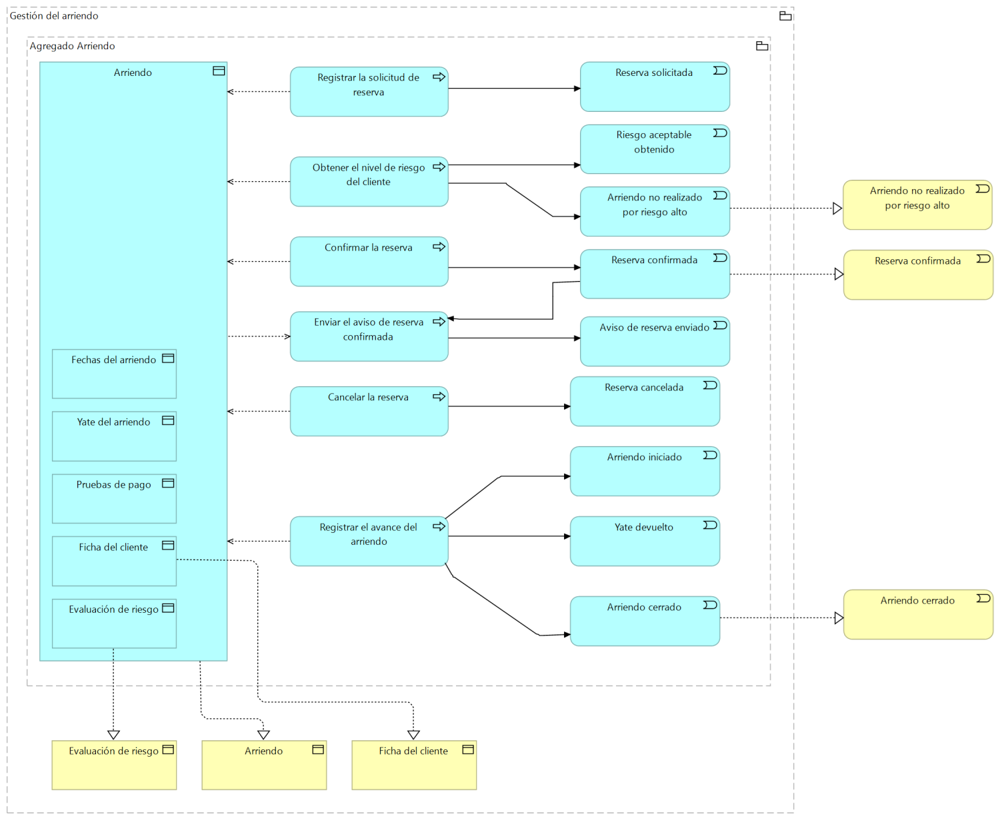

El dominio Gestión del arriendo tiene un agregado, "Agregado Arriendo", con 6 comandos y 9 eventos. Tres de sus eventos realizan eventos de negocio de la V3, y una política interna hace que "Reserva confirmada" dispare el aviso.

#### Agregado Arriendo

| Parte | Elemento | Descripción |
|---|---|---|
| Límite | Agregado Arriendo | Confirmar necesita juntos el riesgo, la licencia, la autorización y las pruebas de pago en una sola transacción, y SB-06 escribe el arriendo y la ficha del cliente en una sola operación. |
| Raíz | Arriendo | Uso de un yate por un cliente en unas fechas, desde la solicitud de reserva hasta el cierre. Identidad: número del arriendo. Estados: reserva solicitada, reserva confirmada, no realizado por riesgo alto, cancelado, en curso, devuelto y cerrado. Realiza "Arriendo" (V4). |
| Objeto de valor | Fechas del arriendo | Inicio y fin. Fuente: SB-06. |
| Objeto de valor | Yate del arriendo | Identificador del yate, su propietario, su precio por día y la marina donde está guardado, copiados del inventario al registrar la solicitud. Es la copia propia de cada contexto (V8-DEC-04). Fuente: SB-06. |
| Objeto de valor | Ficha del cliente | Referencia al CRM, licencia de navegación (número y vigencia) y autorización de datos (fecha y terceros autorizados). No tiene identidad propia: es la copia que guarda cada arriendo (V6-SUP-01). Fuente: SB-06, SB-11, SA-01. Realiza "Ficha del cliente" (V4). |
| Objeto de valor | Evaluación de riesgo | Nivel (bajo, medio o alto) y fecha. Nadie la modifica después de recibirla. Fuente: SB-12, SA-04. Realiza "Evaluación de riesgo" (V4). |
| Campo | Referencia del contrato firmado | El contrato del cliente vive en Gestión de contratos; el arriendo guarda su referencia. Fuente: SB-07, SA-02. |
| Objeto de valor | Pruebas de pago | Comprobantes del alquiler y del seguro y autorización del bloqueo del depósito. Fuente: SB-07. |

Invariantes del agregado:

- No se confirma sin riesgo aceptable, contrato firmado y pagos completos (REG-01, H-07).
- Con riesgo alto no se arrienda, y aceptable es bajo o medio (REG-01, V4-SUP-02).
- No se confirma sin licencia vigente y autorización del cliente (H-09, H-19).
- Solo se cancela antes de la fecha de inicio (SB-08, EXC-02).

Reglas de comando y políticas:

- SB-12 no envía datos a la evaluadora sin la autorización del cliente (H-19).
- SB-31 sale solo después de confirmar (H-07), y "Reserva confirmada" lo dispara.
- SB-09 cierra el arriendo solo cuando terminan los ajustes de dinero, es decir, cuando llega "Cuenta del arriendo cerrada" de Cobros y depósito (E2E-01).

Fuente: H-07, H-09, H-19; REG-01, E2E-01, E2E-03, EXC-02; contratos de SB-06 a SB-09, SB-12 y SB-31.

| Comando | SB | Acceso a la raíz | Eventos | Evento de la V3 que realiza |
|---|---|---|---|---|
| Registrar la solicitud de reserva | SB-06 | Escritura | Reserva solicitada | - |
| Obtener el nivel de riesgo del cliente | SB-12 | Escritura | Riesgo aceptable obtenido; Arriendo no realizado por riesgo alto | Arriendo no realizado por riesgo alto |
| Confirmar la reserva | SB-07 | Escritura | Reserva confirmada | Reserva confirmada |
| Enviar el aviso de reserva confirmada | SB-31 | Lectura | Aviso de reserva enviado | - |
| Cancelar la reserva | SB-08 | Escritura | Reserva cancelada | - |
| Registrar el avance del arriendo | SB-09 | Escritura | Arriendo iniciado; Yate devuelto; Arriendo cerrado | Arriendo cerrado |

### V6.2 - Cobros y depósito

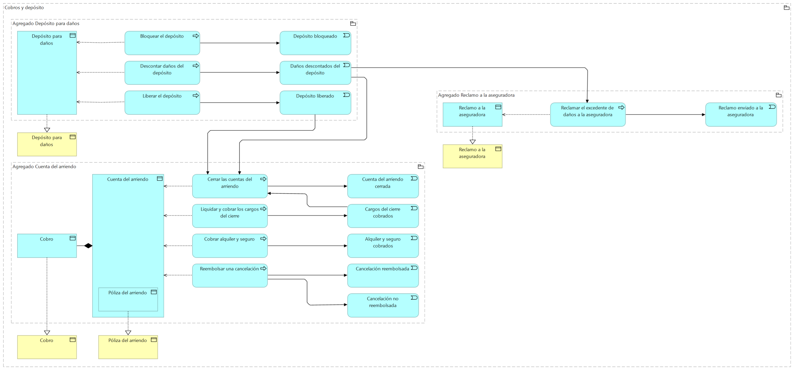

El dominio Cobros y depósito tiene tres agregados: "Agregado Depósito para daños", "Agregado Cuenta del arriendo", con la entidad "Cobro", y "Agregado Reclamo a la aseguradora". Tiene 8 comandos, 9 eventos y dos políticas internas. El Depósito va arriba de la Cuenta para que sus eventos lleguen a SB-17, y el Reclamo va a la derecha.

#### Agregado Depósito para daños

| Parte | Elemento | Descripción |
|---|---|---|
| Límite | Agregado Depósito para daños | Tiene su propio ciclo (bloqueado, y luego liberado o descontado) y su propio resultado medible (V4-DEC-04). |
| Raíz | Depósito para daños | Garantía que se bloquea en la tarjeta de crédito del cliente al reservar y que al cierre se libera o se descuenta; si la reserva se cancela, se libera al cancelar (V4-SUP-09). Identidad: la del arriendo. Estados: bloqueado, liberado y descontado. Realiza "Depósito para daños" (V4). |
| Campo | Valor del depósito | Fuente: SB-19. |
| Campo | Código de autorización de la pasarela | Fuente: SB-19, SA-06. |
| Campo | Fecha de vencimiento del bloqueo | La autorización en tarjeta de crédito dura 28 días (V4-SUP-07). Fuente: SB-19; contraste de H-10. |
| Campo | Evidencia del descuento | Las fotos y actas que respaldan el descuento. Fuente: SB-21, H-13. |

Invariantes del agregado:

- Termina en un solo estado final, liberado o descontado; si se descuenta, lo que sobra se libera en la misma operación (H-10, SB-21).
- El descuento exige evidencia, que la raíz guarda en su campo "evidencia del descuento" (H-13).

Reglas de comando y políticas:

- SB-20 libera el depósito solo si la inspección no registró daños (REG-01) o si la reserva se canceló (V4-SUP-09). La inspección está en Operación del arriendo y la cancelación en Gestión del arriendo.
- SB-19 rechaza el bloqueo si vencería antes del cierre: la autorización en tarjeta de crédito dura 28 días, así que la fecha de fin del arriendo no puede pasar de unos 25 días después de reservar (V4-SUP-07). La fecha de fin está en el agregado Arriendo.
- Se libera o se descuenta en máximo 3 días después de la devolución (resultado de la V1).

Fuente: H-10, H-13; E2E-04, E2E-06; contratos de SB-19, SB-20 y SB-21; V4-SUP-07, V4-SUP-09.

#### Agregado Cuenta del arriendo

| Parte | Elemento | Descripción |
|---|---|---|
| Límite | Agregado Cuenta del arriendo | SB-13 escribe en una sola operación el cobro del alquiler, el del seguro y la póliza, y SB-17 cierra la cuenta cuando ya están todos los cargos: los cobros de un arriendo se cambian juntos. La cuenta usa el mismo identificador que el arriendo (V6-DEC-05). |
| Raíz | Cuenta del arriendo | Los cobros de un arriendo, desde el alquiler y el seguro al reservar hasta los cargos del cierre y el reembolso. Identidad: la misma del arriendo. Estados: abierta y cerrada. |
| Entidad | Cobro | Cada cargo o devolución de dinero del arriendo (alquiler, seguro, combustible consumido, tiempo adicional o reembolso). Identidad: su comprobante de la pasarela. Estado: orden aprobada o rechazada por la pasarela. Realiza "Cobro" (V4). |
| Objeto de valor | Póliza del arriendo | Número y valor que emite la aseguradora. Fuente: SB-13, SA-03. Realiza "Póliza del arriendo" (V4). |
| Campo | Concepto, valor, comprobante y evidencia de cada cobro | Van dentro de la entidad Cobro. La evidencia aplica a los cargos del cierre. Fuente: SB-13, SB-14, SB-15, SA-06. |
| Campo | Identificador del yate y propietario | Llegan con el contrato del cliente firmado (SB-13) y se envían a Finanzas con el arriendo cerrado (SA-08). Fuente: SA-08, H-11; discrepancia 10 del generador. |
| Campo | Comisión y valor del propietario | Los calcula SB-17 al cerrar la cuenta y se envían a Finanzas (SA-08). Fuente: SB-17, H-11, CTX-01. |

Invariantes del agregado:

- Todo cargo del cierre va con evidencia (principio de la V1).
- El combustible consumido siempre lo paga el cliente (REG-01).
- Un cobro sin confirmación de la pasarela no cuenta como pagado (INT-PAG).
- La cuenta no se cierra mientras falte un cargo del cierre (SB-17).

Reglas de comando y políticas:

- SB-14 cobra el tiempo adicional solo si el yate se devolvió tarde; ese dato llega con las diferencias de Operación del arriendo (H-14).
- SB-15 reembolsa solo una cancelación hecha con anticipación, según las condiciones del contrato con el cliente (EXC-02, D-03).
- SB-17 lo disparan "Cargos del cierre cobrados" y la decisión sobre el depósito ("Depósito liberado" o "Daños descontados del depósito"); su regla lo rechaza mientras falte la decisión sobre el depósito, que está en el agregado Depósito para daños (V6-DEC-11).

Fuente: H-10, H-11, H-14; CTX-01, E2E-04, INT-PAG, EXC-02; contratos de SB-13, SB-14, SB-15 y SB-17.

#### Agregado Reclamo a la aseguradora

| Parte | Elemento | Descripción |
|---|---|---|
| Límite | Agregado Reclamo a la aseguradora | Tiene identidad propia (el número de reclamo) y SB-16 no escribe el depósito. |
| Raíz | Reclamo a la aseguradora | Solicitud a la aseguradora por la parte del daño que supera el depósito. Identidad: número de reclamo. Realiza "Reclamo a la aseguradora" (V4). |
| Campo | Identificador del arriendo | El arriendo al que pertenece el reclamo. Fuente: SB-16. |
| Campo | Número de póliza; valor de los daños; valor descontado del depósito | Fuente: SB-16. |
| Campo | Evidencia de la entrega y de la inspección | Fuente: SB-16, H-15. |

Invariante del agregado: solo se envía si el daño supera el depósito, y con la evidencia de la entrega y de la inspección (H-15, EXC-02). No tiene reglas de comando ni políticas. Fuente: H-15; EXC-02, INT-ASE; contrato de SB-16.

| Agregado | Comando | SB | Acceso a la raíz | Eventos |
|---|---|---|---|---|
| Depósito para daños | Bloquear el depósito | SB-19 | Escritura | Depósito bloqueado |
| Depósito para daños | Descontar daños del depósito | SB-21 | Escritura | Daños descontados del depósito |
| Depósito para daños | Liberar el depósito | SB-20 | Escritura | Depósito liberado |
| Cuenta del arriendo | Cerrar las cuentas del arriendo | SB-17 | Escritura | Cuenta del arriendo cerrada |
| Cuenta del arriendo | Liquidar y cobrar los cargos del cierre | SB-14 | Escritura | Cargos del cierre cobrados |
| Cuenta del arriendo | Cobrar alquiler y seguro | SB-13 | Escritura | Alquiler y seguro cobrados |
| Cuenta del arriendo | Reembolsar una cancelación | SB-15 | Escritura | Cancelación reembolsada; Cancelación no reembolsada |
| Reclamo a la aseguradora | Reclamar el excedente de daños a la aseguradora | SB-16 | Escritura; lee también la raíz de la Cuenta del arriendo, que guarda el número de la póliza | Reclamo enviado a la aseguradora |

Ningún evento de este dominio realiza un evento de la V3.

### V6.3 - Disponibilidad de yates

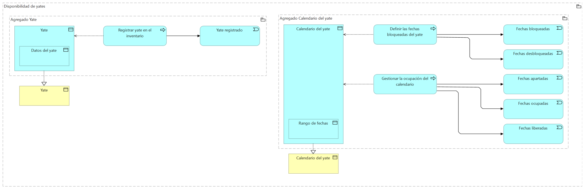

El dominio Disponibilidad de yates tiene dos agregados, "Agregado Yate" y "Agregado Calendario del yate", con 3 comandos y 6 eventos.

#### Agregado Yate

| Parte | Elemento | Descripción |
|---|---|---|
| Límite | Agregado Yate | El yate se registra una vez y cambia poco; sus fechas van en el agregado Calendario del yate, que tiene sus propias reglas (V4-DEC-03). |
| Raíz | Yate | Embarcación de un propietario, guardada en una marina aliada, que YateGear ofrece en arriendo. Identidad: identificador del yate en el inventario. Realiza "Yate" (V4). |
| Objeto de valor | Datos del yate | Nombre, matrícula y capacidad. Fuente: SB-01. |
| Campo | Propietario | Gestión del arriendo lo copia al registrar la solicitud (V8-DEC-04). Fuente: SB-01. |
| Campo | Precio por día | Fuente: SB-01, CTX-01. |
| Campo | Documentos al día ante la DIMAR | Fuente: SB-01, NOR-01. |
| Campo | Referencia del contrato del propietario | El contrato del propietario vive en Gestión de contratos; el yate guarda su referencia. Fuente: SB-01, SA-02, INT-CON. |
| Campo | Identificador de la marina | La ficha de la marina es un dato de referencia (V6-DEC-07). Fuente: SB-01. |

Invariante del agregado: se registra solo con el contrato del propietario firmado y los documentos al día ante la DIMAR (SB-01). No tiene reglas de comando ni políticas. Fuente: contrato de SB-01; INT-CON, NOR-01.

#### Agregado Calendario del yate

| Parte | Elemento | Descripción |
|---|---|---|
| Límite | Agregado Calendario del yate | Es el límite de "cero dobles reservas": solo lo escriben SB-03 y SB-05, y un solo agregado decide la disponibilidad (V4-DEC-03). |
| Raíz | Calendario del yate | Fechas de un yate. Identidad: la del yate. Realiza "Calendario del yate" (V4). |
| Objeto de valor | Rango de fechas | Inicio, fin, estado de la fecha y, si está apartado u ocupado, el número del arriendo. Una fecha que no está en ningún rango está libre (V6-SUP-03). Fuente: SB-03, SB-05. |
| Campo | Estado de la fecha | Bloqueada por el propietario, apartada por una reserva en trámite u ocupada por una reserva confirmada. Va en cada rango de fechas (V6-SUP-03). Fuente: SB-03, SB-05. |

Invariantes del agregado:

- Una fecha apartada u ocupada no se aparta ni se ocupa para otro arriendo, porque un yate no tiene dos arriendos en las mismas fechas (REG-01).
- No se bloquean fechas con reserva confirmada (REG-02).

Reglas de comando y políticas:

- Solo el propietario del yate ejecuta SB-03 (E2E-02).
- Las fechas se apartan al solicitar la reserva, se ocupan al confirmarla y se liberan si la reserva no sigue (V4-SUP-01), con eventos de Gestión del arriendo (V8).

Fuente: H-08; REG-01, REG-02, E2E-02, CIE-01; contratos de SB-03 y SB-05.

| Agregado | Comando | SB | Acceso a la raíz | Eventos |
|---|---|---|---|---|
| Yate | Registrar yate en el inventario | SB-01 | Escritura | Yate registrado |
| Calendario del yate | Definir las fechas bloqueadas del yate | SB-03 | Escritura | Fechas bloqueadas; Fechas desbloqueadas |
| Calendario del yate | Gestionar la ocupación del calendario | SB-05 | Escritura | Fechas apartadas; Fechas ocupadas; Fechas liberadas |

### V6.4 - Operación del arriendo

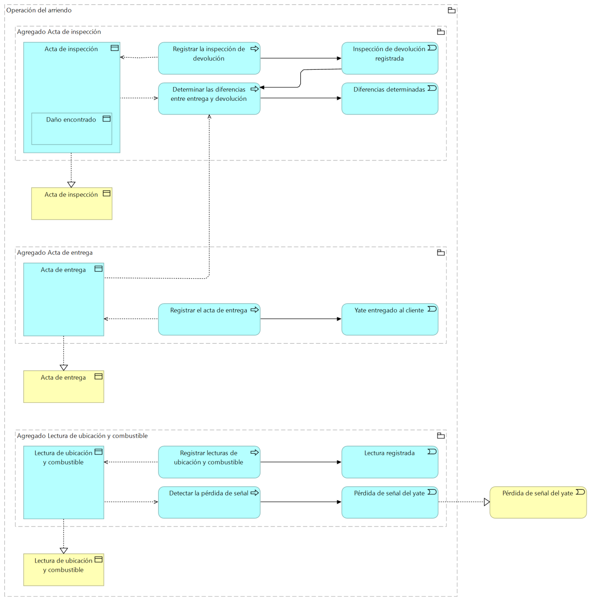

El dominio Operación del arriendo tiene tres agregados: "Agregado Acta de entrega", "Agregado Acta de inspección" y "Agregado Lectura de ubicación y combustible", con 5 comandos y 5 eventos. Los agregados van apilados (Inspección, Entrega, Lectura) para que la vista no sea una tira, y "Registrar el acta de entrega" va en la segunda fila para que la lectura de SB-24 baje recta.

#### Agregado Acta de entrega

| Parte | Elemento | Descripción |
|---|---|---|
| Límite | Agregado Acta de entrega | La registra la marina al entregar el yate al cliente (SB-22) y no cambia después. |
| Raíz | Acta de entrega | Registro de la marina al entregar el yate. Identidad: la del arriendo. Realiza "Acta de entrega" (V4). |
| Campo | Fotos | Fuente: SB-22, H-13. |
| Campo | Nivel de combustible | Tanque lleno. Fuente: SB-22. |
| Campo | Hora de entrega; observaciones | Fuente: SB-22. |
| Campo | Identificador del yate | Une el yate con su arriendo: con él, Operación sabe qué yate tiene un arriendo en curso (SB-26, SB-27). Fuente: SB-22. |

Invariante del agregado: no se registra sin fotos (H-13). Regla de comando: SB-22 rechaza el acta si el arriendo no tiene la reserva confirmada (CIE-01), porque ese estado está en el agregado Arriendo. Fuente: H-13; E2E-01, INT-MAR, CIE-01; contrato de SB-22.

#### Agregado Acta de inspección

| Parte | Elemento | Descripción |
|---|---|---|
| Límite | Agregado Acta de inspección | La registra la marina al recibir el yate (SB-23); es la otra mitad de la evidencia del cierre. |
| Raíz | Acta de inspección | Registro de la marina al recibir el yate. Identidad: la del arriendo. Realiza "Acta de inspección" (V4). |
| Campo | Fotos | Fuente: SB-23, H-13. |
| Campo | Nivel de combustible | Fuente: SB-23. |
| Campo | Hora de regreso | Fuente: SB-23, H-14. |
| Objeto de valor | Daño encontrado | Cada daño encontrado en la inspección, con su descripción y su valor (V6-SUP-04). Fuente: SB-23, V4-SUP-03. |

Invariante del agregado: no se registra sin fotos (H-13). Regla de comando: SB-24 necesita las dos actas, porque su comparación es la evidencia (H-13); por eso lee también la raíz del agregado Acta de entrega (V6-DEC-09). Política: "Inspección de devolución registrada" dispara SB-24. Fuente: H-13, H-14; E2E-06, INT-MAR; contratos de SB-23 y SB-24.

#### Agregado Lectura de ubicación y combustible

| Parte | Elemento | Descripción |
|---|---|---|
| Límite | Agregado Lectura de ubicación y combustible | Cada lectura llega del proveedor por SA-07 y no se modifica (SB-25). |
| Raíz | Lectura de ubicación y combustible | Dato que envía el dispositivo de un yate por medio del proveedor. Identidad: el yate y la hora de la lectura. Realiza "Lectura de ubicación y combustible" (V4). |
| Campo | Posición; nivel de combustible; hora de la lectura | Fuente: SB-25. |

Invariante del agregado: una lectura no se modifica. Reglas de comando: SB-25 asocia la lectura a un yate del inventario, que está en otro agregado (SA-07); SB-27 declara la pérdida de señal según el tiempo sin lecturas, un parámetro que fija Operaciones (V4-SUP-04), y solo con un arriendo en curso. Fuente: H-12; INT-GPS, E2E-05; contratos de SB-25 y SB-27.

| Agregado | Comando | SB | Acceso a la raíz | Eventos | Evento de la V3 que realiza |
|---|---|---|---|---|---|
| Acta de entrega | Registrar el acta de entrega | SB-22 | Escritura | Yate entregado al cliente | - |
| Acta de inspección | Registrar la inspección de devolución | SB-23 | Escritura | Inspección de devolución registrada | - |
| Acta de inspección | Determinar las diferencias entre entrega y devolución | SB-24 | Lectura; lee también la raíz del Acta de entrega | Diferencias determinadas | - |
| Lectura de ubicación y combustible | Registrar lecturas de ubicación y combustible | SB-25 | Escritura | Lectura registrada | - |
| Lectura de ubicación y combustible | Detectar la pérdida de señal | SB-27 | Lectura; lee también las raíces del Acta de entrega y del Acta de inspección, para saber qué arriendos están en curso | Pérdida de señal del yate | Pérdida de señal del yate |

La consulta SB-26 lee, además de las lecturas, las raíces del Acta de entrega y del Acta de inspección: SB-26 y SB-27 solo actúan con un arriendo en curso (V8), y un arriendo está en curso si tiene acta de entrega y todavía no tiene acta de inspección.

### V6.5 - Calificaciones

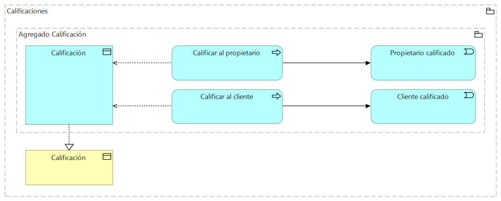

El dominio Calificaciones tiene un agregado, "Agregado Calificación", con 2 comandos y 2 eventos.

#### Agregado Calificación

| Parte | Elemento | Descripción |
|---|---|---|
| Límite | Agregado Calificación | Cada calificación la da una parte y no cambia después. |
| Raíz | Calificación | La que se dan cliente y propietario al cerrar un arriendo. Identidad: el arriendo y quién califica. Realiza "Calificación" (V4). |
| Campo | Quién califica | Cliente o propietario. Fuente: SB-28, SB-29. |
| Campo | Calificación dada | Fuente: SB-28, SB-29, SP-06. |
| Campo | Calificado | Quien recibe la calificación: la referencia al CRM del cliente o el identificador del propietario, según quién califica. SB-30 promedia por este campo. Fuente: SB-28, SB-29, SB-30. |

Invariante del agregado: una calificación por cada parte y arriendo; lo garantiza su identidad, formada por el arriendo y quien califica (E2E-07, V6-DEC-15). Regla de comando: SB-28 y SB-29 solo se ejecutan con el arriendo cerrado (E2E-07), estado que está en el agregado Arriendo. Fuente: H-16; E2E-07; contratos de SB-28 y SB-29.

| Comando | SB | Acceso a la raíz | Eventos |
|---|---|---|---|
| Calificar al propietario | SB-28 | Escritura | Propietario calificado |
| Calificar al cliente | SB-29 | Escritura | Cliente calificado |

"Calificaciones registradas" de la V3 queda sin realizar: ocurre cuando ya están las dos calificaciones, y cada evento es solo la mitad (V6-DEC-13).

#### Políticas y eventos entre dominios

Las políticas del mismo dominio se dibujan en su vista como un disparo del evento al comando (V6-DEC-14). Son cuatro políticas con seis relaciones:

| Dominio | Evento | Comando que dispara | Condición |
|---|---|---|---|
| Gestión del arriendo | Reserva confirmada | Enviar el aviso de reserva confirmada (SB-31) | El aviso sale solo después de confirmar (H-07). |
| Operación del arriendo | Inspección de devolución registrada | Determinar las diferencias entre entrega y devolución (SB-24) | Necesita las dos actas (H-13). |
| Cobros y depósito | Daños descontados del depósito | Reclamar el excedente de daños a la aseguradora (SB-16) | Solo si el daño supera el depósito (H-15). |
| Cobros y depósito | Cargos del cierre cobrados; Depósito liberado o Daños descontados del depósito | Cerrar las cuentas del arriendo (SB-17) | Recibe varios disparos; su invariante lo rechaza mientras falte un cargo del cierre, y su regla mientras falte la decisión sobre el depósito (V6-DEC-11). |

Los eventos que escuchan otros dominios no se dibujan en la V6: son la entrada de la V8. Cada fila se verificó contra el contrato de la V4 del comando que dispara.

| Evento (dominio) | Comando que dispara (dominio) | Contrato de la V4 |
|---|---|---|
| Reserva solicitada (Gestión del arriendo) | SB-05, aparta las fechas (Disponibilidad de yates) | SB-05; V4-SUP-01 |
| Reserva confirmada (Gestión del arriendo) | SB-05, ocupa las fechas (Disponibilidad de yates) | SB-05 |
| Reserva cancelada; Arriendo no realizado por riesgo alto (Gestión del arriendo) | SB-05, libera las fechas (Disponibilidad de yates) | SB-05; V4-SUP-01 |
| Reserva cancelada (Gestión del arriendo) | SB-15, reembolso (Cobros y depósito) | SB-15 |
| Reserva cancelada (Gestión del arriendo) | SB-20, libera el depósito si estaba bloqueado (Cobros y depósito) | SB-20; V4-SUP-09 |
| Riesgo aceptable obtenido (Gestión del arriendo) | SA-02 envía el contrato al cliente (capa anticorrupción, V9) | SA-02: el contrato del cliente no se envía antes de que el riesgo salga aceptable |
| Alquiler y seguro cobrados y Depósito bloqueado (Cobros y depósito) | SB-07, confirmar la reserva (Gestión del arriendo) | SB-07: recibe los comprobantes y la autorización del depósito |
| Yate entregado al cliente (Operación del arriendo) | SB-09, "Arriendo iniciado" (Gestión del arriendo) | SB-09 |
| Inspección de devolución registrada (Operación del arriendo) | SB-09, "Yate devuelto" (Gestión del arriendo) | SB-09 |
| Diferencias determinadas (Operación del arriendo) | SB-14, y SB-20 o SB-21 (Cobros y depósito) | SB-14, SB-20, SB-21 |
| Cuenta del arriendo cerrada (Cobros y depósito) | SB-09, "Arriendo cerrado" (Gestión del arriendo) | SB-09 |

Los comandos que inicia una persona o un sistema externo aparecen en la vista sin evento de entrada. El cliente inicia SB-06, SB-08 y SB-28; el propietario, SB-03 y SB-29; Comercial, SB-01 (V4-SUP-06). La marina inicia SB-22 y SB-23, y el proveedor de seguimiento inicia SB-25 (SA-07). El contrato del cliente firmado, que llega por SA-02, dispara SB-13 y SB-19. SB-12 sigue a la solicitud de reserva dentro del flujo de la V8, y SB-27 se dispara por el tiempo sin lecturas (V4-SUP-04).

#### Servicios básicos que no son comandos

De los 30 servicios básicos de la V4, 24 son comandos y 6 no lo son (V6-DEC-03). Los seis tienen su servicio de aplicación en la V8 (V8-DEC-10).

| SB | Servicio | Por qué no es comando |
|---|---|---|
| SB-04 | Consultar yates disponibles | Consulta: no cambia nada. Lee el calendario de varios yates. |
| SB-10 | Consultar el arriendo | Consulta: devuelve el estado del arriendo a quien participa en él. |
| SB-18 | Consultar el estado de cuenta del arriendo | Consulta: muestra los movimientos de la cuenta y el descuento del depósito, con su evidencia. Lee la Cuenta del arriendo y la raíz del Depósito para daños, que guarda la evidencia del descuento (V8-DEC-10). |
| SB-26 | Consultar ubicación y combustible del yate | Consulta: muestra la última lectura y el recorrido (V4-SUP-05). |
| SB-30 | Consultar calificaciones promedio | Consulta: calcula un promedio sin cambiar ninguna calificación. |
| SB-11 | Verificar los requisitos del cliente | Solo valida, y su resultado no lo escucha nadie. Su regla pasa a ser un invariante del agregado Arriendo: no se confirma sin licencia vigente y autorización del cliente (H-09, H-19). |

#### Decisiones de la V6

| ID | Qué se decidió | Por qué |
|---|---|---|
| V6-DEC-01 | El dominio de la V5 agrupa sus agregados, y cada agregado es una agrupación "Agregado <raíz>". | ArchiMate no tiene un elemento "agregado". La agrupación reúne la raíz, sus entidades, sus comandos y sus eventos, y el anidamiento muestra el límite. Así hay una vista por dominio, con todos sus agregados. |
| V6-DEC-02 | Un elemento se llama igual que otro de otra capa cuando lo realiza. | Excepción a V4-DEC-13 para objeto de datos --> objeto de negocio, evento de aplicación --> evento de negocio de la V3 y comando --> servicio básico. Mantiene el lenguaje ubicuo de punta a punta. Las 24 realizaciones comando --> servicio básico están en el modelo, no en la vista, para trazar cada comando hasta su contrato. |
| V6-DEC-03 | Solo los servicios básicos que cambian estado o producen un hecho son comandos. | Las consultas no cambian nada, y SB-11 solo valida sin que nadie escuche su resultado. |
| V6-DEC-04 | Los invariantes del agregado van separados de las reglas de comando y políticas. | El agregado valida sus propias reglas. Lo que depende de otro agregado, de otro dominio, de varias instancias o de quién ejecuta el comando no lo puede proteger el agregado solo. |
| V6-DEC-05 | Agregado "Cuenta del arriendo", con la entidad Cobro. | SB-13 escribe en una sola operación el cobro del alquiler, el del seguro y la póliza, y SB-17 cierra la cuenta cuando están todos los cargos: los cobros de un arriendo se cambian juntos. La cuenta usa el identificador del arriendo. |
| V6-DEC-06 | Evaluación de riesgo, Ficha del cliente y Póliza del arriendo son objetos de valor; cada uno es un objeto de datos que realiza su objeto de negocio de la V4. | Nadie les cambia el estado después de crearlos y no tienen identidad propia. Como son objetos de datos (V6-DEC-16), cada uno realiza su objeto de negocio, y la traza con la V4 se mantiene sin excepción a V6-DEC-02. |
| V6-DEC-07 | "Ficha de la marina" no es parte de ningún agregado. | Ningún servicio básico la escribe: es un dato de referencia que el Yate cita por su identificador. Es el único objeto de negocio de la V4 que no se realiza en la V6. |
| V6-DEC-08 | Un evento por cada resultado distinto del contrato del comando. | Así lo muestran SB-12, con "Riesgo aceptable obtenido" y "Arriendo no realizado por riesgo alto", y SB-15, con "Cancelación reembolsada" y "Cancelación no reembolsada". |
| V6-DEC-09 | Cada comando escribe solo en la raíz de su agregado y solo accede a raíces. | La raíz es el único punto de acceso al agregado. Hay 21 accesos de escritura y 3 de lectura (SB-31, SB-24 y SB-27). SB-24 lee además la raíz del Acta de entrega, porque su regla exige las dos actas; SB-27, las dos actas, para saber qué arriendos están en curso; y SB-16, la Cuenta del arriendo, porque el reclamo lleva el número de la póliza. Leer no cambia el otro agregado. |
| V6-DEC-10 | "Arriendo no realizado por riesgo alto" lo dispara SB-12. | La decisión está en la respuesta de riesgo, no en el avance del arriendo (SB-09). |
| V6-DEC-11 | SB-17 recibe varios disparos. | Lo disparan "Cargos del cierre cobrados" y la decisión sobre el depósito. Su invariante y su regla lo rechazan mientras falte algo, así que el orden en que lleguen no importa. |
| V6-DEC-12 | "Pérdida de señal del yate" conserva su nombre de la V3. | No es un participio, pero el evento de aplicación realiza el evento de negocio de la V3 y por V6-DEC-02 lleva su mismo nombre. |
| V6-DEC-13 | "Calificaciones registradas" de la V3 queda sin realizar. | Ocurre cuando ya están las dos calificaciones, y ningún evento por separado es ese hecho. |
| V6-DEC-14 | Solo las políticas del mismo dominio se dibujan. | Los disparos entre dominios son la entrada de la V8 y van en la tabla de eventos entre dominios, para no mezclar dominios en un diagrama que es por dominio. |
| V6-DEC-15 | Una calificación por cada parte y arriendo se garantiza con su identidad. | La identidad de la Calificación es el arriendo y quién califica (E2E-07); una segunda calificación de la misma parte para el mismo arriendo tendría la misma identidad. |
| V6-DEC-16 | Los objetos de valor con nombre propio y varias partes son objetos de datos con `Tipo DDD` = Objeto de valor. Su raíz los compone, con la propiedad `Cardinalidad` (Uno, Cero o uno o Muchos), el agregado los agrega y en la vista van dentro de su raíz. Los que son un solo dato quedan como campos de su raíz o entidad. | El generador de código crea una clase por cada objeto de valor y la propiedad que lo contiene en la raíz. ArchiMate no dice cuántos hay de cada uno; la propiedad `Cardinalidad` lo dice. Un dato suelto no necesita su propia clase. |
| V6-DEC-17 | Los campos de raíces, entidades y objetos de valor son propiedades `Campo: <nombre>` con su tipo, en el orden en que se leen. Tipos permitidos: `string`, `int`, `decimal`, `bool`, `DateOnly`, `DateTime`, `List<tipo>`, el sufijo `?` para un campo opcional y `enum <Nombre>(valores)`. | ArchiMate no tiene atributos con tipo; las propiedades son su forma de agregar datos a un elemento, y el generador las lee del modelo. Una lista cerrada de tipos evita errores al generar. |

#### Supuestos de la V6

| ID | Supuesto | Por qué se asumió | Dónde se usa |
|---|---|---|---|
| V6-SUP-01 | La ficha del cliente es la copia que cada arriendo guarda de los datos del cliente que necesita: referencia al CRM, licencia de navegación y autorización de datos. El dato compartido entre arriendos es la referencia al CRM. | Así lo plantea SA-01 ("solo toma los datos del arriendo"), y cada contexto guarda su propia copia de los datos que necesita de otro (V8-DEC-04). | Objeto de valor "Ficha del cliente" del agregado Arriendo |
| V6-SUP-02 | Los tipos de dato de los campos los elige el equipo. Las referencias a otros agregados o sistemas (yate, propietario, marina, CRM, contratos, comprobantes, póliza) son texto con su identificador; las fotos y las evidencias, una lista de referencias a archivos; el nivel de combustible, un número decimal; la posición de una lectura, latitud y longitud; la calificación dada, un número entero. | La entrevista y los contratos de la V4 dicen qué datos hay, pero no su formato. | Campos de la V6 |
| V6-SUP-03 | El calendario guarda rangos de fechas. Cada rango tiene su estado (bloqueada, apartada u ocupada) y, si está apartado u ocupado, el arriendo. Una fecha sin rango está libre. | SB-03 y SB-05 reciben rangos de fechas, y SB-05 recibe el arriendo para apartar, ocupar o soltar. | Objeto de valor "Rango de fechas" del agregado Calendario del yate |
| V6-SUP-04 | Cada daño encontrado lleva una descripción, además de su valor. | SB-23 dice "daños encontrados con su valor"; sin descripción no se puede respaldar el cargo (principio "Todo cobro va con evidencia"). | Objeto de valor "Daño encontrado" del agregado Acta de inspección |

La V6 usa además V4-SUP-01, V4-SUP-02, V4-SUP-03, V4-SUP-04, V4-SUP-05, V4-SUP-06, V4-SUP-07 y V4-SUP-09. La V8 toma los eventos entre dominios de esta sección para elegir el patrón de cada relación entre contextos.

## 7. Mapa de contextos e interoperabilidad

### V8 - Mapa de contextos

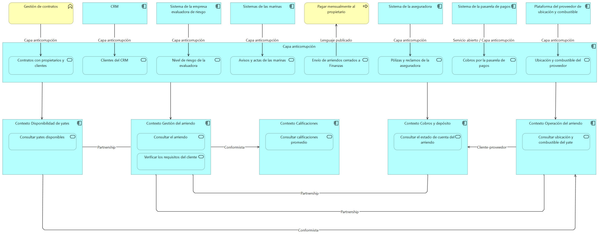

La V8 es el mapa de contextos delimitados, con los patrones de relación entre ellos y con los sistemas externos, en correspondencia con la capa anticorrupción de la V4. Hay cinco contextos, uno por dominio de la V5, con seis relaciones entre ellos (tres Partnership, un cliente-proveedor y dos conformistas), y ocho relaciones con el exterior por medio de la capa anticorrupción: siete con capa anticorrupción, una de ellas frente al servicio abierto de la pasarela, y una con lenguaje publicado.

Para leerla: arriba van las ocho contrapartes externas; en el medio, la capa anticorrupción con sus ocho servicios anidados, cada uno debajo de su contraparte; abajo, los cinco contextos con sus servicios de consulta anidados. La relación de servicio va de upstream a downstream: el upstream es el contexto cuyo modelo o cuyos hechos usa el otro. La asociación sin dirección une a los dos contextos de un Partnership. El nombre de cada línea es su patrón, y las propiedades `Patrón`, `Upstream` y `Downstream` lo repiten en el modelo (V8-DEC-07). Las relaciones entre contextos que no están uno al lado del otro pasan por debajo de la fila de contextos.

Cómo se modela: cada contexto es un componente de aplicación "Contexto <dominio>" que realiza su dominio de la V5, se asigna a los comandos de sus agregados y realiza sus servicios de consulta (V8-DEC-02). La capa anticorrupción es un solo componente que realiza los ocho servicios de aplicación SA-01 a SA-08, cada uno con el nombre de su servicio de la V4 (V8-DEC-06). Cada sistema externo es un componente nuevo con la propiedad `Externo` = Sí, unido a su contraparte de la V4 (V8-DEC-08). Los contextos llevan el prefijo "Contexto" para no llamarse igual que la agrupación de su dominio.

| Contexto | Dominio (V5) | Clasificación | Área | Agregados (V6) | Comandos | Servicios de consulta |
|---|---|---|---|---|---|---|
| Contexto Disponibilidad de yates | Disponibilidad de yates | Soporte | Comercial | Yate, Calendario del yate | 3 | Consultar yates disponibles (SB-04) |
| Contexto Gestión del arriendo | Gestión del arriendo | Central | Comercial | Arriendo | 6 | Consultar el arriendo (SB-10), Verificar los requisitos del cliente (SB-11) |
| Contexto Calificaciones | Calificaciones | Genérico | Servicio al cliente | Calificación | 2 | Consultar calificaciones promedio (SB-30) |
| Contexto Cobros y depósito | Cobros y depósito | Central | Finanzas | Depósito para daños, Cuenta del arriendo, Reclamo a la aseguradora | 8 | Consultar el estado de cuenta del arriendo (SB-18) |
| Contexto Operación del arriendo | Operación del arriendo | Soporte | Operaciones | Acta de entrega, Acta de inspección, Lectura de ubicación y combustible | 5 | Consultar ubicación y combustible del yate (SB-26) |

Cada contexto tiene su propio modelo y su propio lenguaje. La prueba son las palabras con dos sentidos de la V7: "bloqueo" son fechas cerradas en Disponibilidad de yates y depósito retenido en Cobros y depósito; "disponible" es disponible para arrendar en Disponibilidad de yates y listo para entregar en Operación del arriendo. Dentro de cada contexto cada palabra tiene un solo sentido. SB-11 es el servicio que lleva a la capa de aplicación la restricción de la licencia de navegación vigente y la de la Ley 1581.

#### Criterio para elegir el patrón

Se aplica igual a cada par de contextos, con lo que cada uno necesita del otro según los eventos entre dominios de la V6 y las reglas de comando que dependen de otro dominio (V8-DEC-03):

1. Si cada contexto necesita algo del otro para cumplir una regla propia, es Partnership: los dos cambian juntos y no hay upstream.
2. Si solo uno necesita del otro, el que da es el upstream. Si el downstream le pone un requisito al upstream, es cliente-proveedor. Si toma el modelo tal como viene, sin traducir y sin pedir cambios, es conformista.
3. Si ninguno necesita del otro, no hay relación (Separate Ways).

| Relación | Patrón | Upstream | Downstream | Qué pasa de un contexto al otro | Por qué este patrón | Fuente |
|---|---|---|---|---|---|---|
| Disponibilidad de yates y Gestión del arriendo | Partnership | - | - | Hacia Disponibilidad: Reserva solicitada, Reserva confirmada, Reserva cancelada y Arriendo no realizado por riesgo alto disparan SB-05, que aparta, ocupa o libera las fechas. Hacia Gestión del arriendo: el yate, su propietario y su marina, para registrar la solicitud (SB-06) y enviar el aviso (SB-31). | Ninguno cumple solo la regla de cero dobles reservas (CIE-01): Gestión del arriendo decide el estado de la reserva y Disponibilidad es el único que escribe el calendario (V4-DEC-03). Los dos son de Comercial. | V6, eventos entre dominios; SB-05, SB-06, SB-31; V4-SUP-01 |
| Gestión del arriendo y Cobros y depósito | Partnership | - | - | Hacia Cobros: Reserva cancelada dispara SB-15 y SB-20; SB-19 necesita la fecha de fin del arriendo. Hacia Gestión del arriendo: Alquiler y seguro cobrados y Depósito bloqueado disparan SB-07; Cuenta del arriendo cerrada dispara SB-09. | Son los dos subdominios centrales y cada uno depende del otro: no se confirma sin pagos completos (REG-01) y no se cierra el arriendo sin los ajustes de dinero (E2E-01); los cobros dependen de la cancelación y de las fechas. Comercial y Finanzas tienen que coordinar cada cambio en estas reglas. | V6, eventos entre dominios y reglas de SB-19 y SB-20; V4-SUP-07, V4-SUP-09 |
| Gestión del arriendo y Operación del arriendo | Partnership | - | - | Hacia Operación: SB-22 rechaza el acta de entrega sin reserva confirmada (CIE-01); SB-26 y SB-27 solo actúan con un arriendo en curso. Hacia Gestión del arriendo: Yate entregado al cliente e Inspección de devolución registrada disparan SB-09. | Operación no registra una entrega sin la reserva confirmada, y Gestión del arriendo no avanza el arriendo sin la entrega y la devolución. | V6, eventos entre dominios y reglas de SB-22 y SB-27 |
| Operación del arriendo --> Cobros y depósito | Cliente-proveedor | Operación del arriendo | Cobros y depósito | Diferencias determinadas dispara SB-14 y SB-20 o SB-21, con la evidencia de cada diferencia. Cobros no le da nada a Operación. | Solo Cobros depende de Operación, y le pone un requisito: cada diferencia llega con su evidencia, porque todo cobro va con evidencia (principio de la V1, H-13). | V6, eventos entre dominios; SB-14, SB-20, SB-21, SB-24 |
| Gestión del arriendo --> Calificaciones | Conformista | Gestión del arriendo | Calificaciones | Arriendo cerrado, con el cliente y el propietario del arriendo, habilita SB-28 y SB-29. | Solo Calificaciones depende de Gestión del arriendo. Es un subdominio genérico sin reglas propias (H-16): toma el arriendo cerrado y sus dos partes tal como los define Gestión del arriendo. | V6, reglas de SB-28 y SB-29; V5, clasificación |
| Disponibilidad de yates --> Operación del arriendo | Conformista | Disponibilidad de yates | Operación del arriendo | El identificador del yate y la marina que lo guarda: SB-25 asocia cada lectura a un yate del inventario y SB-26 solo muestra el seguimiento a la marina que guarda el yate. | Solo Operación depende de Disponibilidad, y usa el yate y su marina tal como están en el inventario, sin pedir nada más. | V6, reglas de SB-25 y SB-26; V4-SUP-05 |

Los pares que no se relacionan (Separate Ways) son cuatro: Disponibilidad de yates y Cobros y depósito, Disponibilidad de yates y Calificaciones, Cobros y depósito y Calificaciones, y Operación del arriendo y Calificaciones. Lo que alguno de ellos necesita del otro le llega por Gestión del arriendo; por ejemplo, el propietario que califica al cliente sale del arriendo cerrado, no del inventario. Para eso el Arriendo guarda su propia copia del yate (objeto de valor "yate del arriendo" de la V6).

Lo que no se usa. No hay núcleo compartido: ningún par comparte una parte del modelo, porque cada objeto tiene un solo dueño (V5-DEC-02) y cada contexto guarda su propia copia de lo que necesita de otro; la Cuenta del arriendo y las actas usan el número del arriendo como identidad, pero el Arriendo solo lo escribe Gestión del arriendo (V8-DEC-04). Tampoco hay servicio abierto entre contextos: los contextos se avisan con los eventos de la V6, cuyos nombres son términos de la V7, y como los cinco los construye el mismo equipo de desarrollo (V8-SUP-02), no hace falta publicar una interfaz general.

#### Relaciones con los sistemas externos

Las contrapartes son las mismas ocho de la capa anticorrupción de la V4, con los mismos servicios SA-01 a SA-08.

| Servicio | Contraparte en la V8 | Patrón | Upstream | Downstream | Por qué |
|---|---|---|---|---|---|
| SA-01 Clientes del CRM | CRM (componente externo) | Capa anticorrupción | CRM | Gestión del arriendo | El CRM identifica al cliente con su propio código y guarda más datos de los que el arriendo necesita. El servicio toma solo los del arriendo y guarda la referencia al CRM (V6-SUP-01). |
| SA-02 Contratos con propietarios y clientes | Gestión de contratos (función de la V4) | Capa anticorrupción | Gestión de contratos | Gestión del arriendo, Disponibilidad de yates, Cobros y depósito | Los contratos son PDF que se envían por correo (INT-01): no hay sistema con el cual integrarse. El servicio convierte el contrato firmado en la referencia del contrato y sus condiciones de cancelación (V8-SUP-03). |
| SA-03 Pólizas y reclamos de la aseguradora | Sistema de la aseguradora | Capa anticorrupción | Aseguradora | Cobros y depósito | La aseguradora habla de pólizas y siniestros y evalúa los reclamos con sus propios procesos (EXC-02). |
| SA-04 Nivel de riesgo de la evaluadora | Sistema de la empresa evaluadora de riesgo | Capa anticorrupción | Evaluadora | Gestión del arriendo | Traduce la escala de la evaluadora a riesgo aceptable o no se arrienda (V4-SUP-02). |
| SA-05 Avisos y actas de las marinas | Sistemas de las marinas | Capa anticorrupción | Marinas | Operación del arriendo, Gestión del arriendo | Las marinas no van a cambiar sus sistemas (INT-01, MOT-04), así que YateGear se adapta. No es conformista porque conformarse metería el "disponible" de la marina en Operación del arriendo (H-17). El servicio recibe las actas en el formato de cada marina. |
| SA-06 Cobros por la pasarela de pagos | Sistema de la pasarela de pagos | Servicio abierto / Capa anticorrupción: la pasarela, upstream, es servicio abierto con lenguaje publicado (V8-SUP-01); Cobros y depósito, downstream, se protege con la capa anticorrupción | Pasarela | Cobros y depósito | La pasarela dice autorizar, capturar y anular; Finanzas dice bloquear, descontar y liberar el depósito (H-17). Con la traducción, "bloqueo" conserva en Cobros y depósito el sentido de Finanzas. |
| SA-07 Ubicación y combustible del proveedor | Plataforma del proveedor de ubicación y combustible | Capa anticorrupción | Proveedor | Operación del arriendo | Asocia cada lectura al yate del inventario y descarta lo que el arriendo no usa. Solo entra información. |
| SA-08 Envío de arriendos cerrados a Finanzas | Pagar mensualmente al propietario (proceso de la V3) | Lenguaje publicado, en una relación cliente-proveedor | Cobros y depósito | Proceso de Finanzas | Aquí YateGear está upstream: entrega un registro por arriendo cerrado (propietario, yate, alquiler, comisión y valor del propietario) con un formato fijo que Finanzas conoce. No entra información, así que no hay nada que traducir hacia adentro (V8-DEC-09). |

Las siete interoperabilidades que confirmó el experto (H-20) son SA-01 a SA-07, y todas quedan como capa anticorrupción: en todas YateGear está downstream de un modelo que no controla. SA-08 sale de H-11. Calificaciones es el único contexto sin integraciones externas.

#### Decisiones de la V8

| ID | Qué se decidió | Por qué |
|---|---|---|
| V8-DEC-01 | Un contexto delimitado por cada dominio de la V5. | Un contexto es el límite donde se aplica un modelo de dominio, con su propio modelo, lógica y base de datos. Juntar dos dominios mezclaría los dos sentidos de "bloqueo" o de "disponible", y partir un dominio separaría agregados que cambian con los mismos eventos. |
| V8-DEC-02 | El contexto es un componente de aplicación que realiza su dominio y se asigna a sus comandos. | El dominio es el problema y el contexto es el software que lo resuelve. La asignación a los 24 comandos dice qué componente ejecuta cada comando y cierra la traza de la V10 hasta el componente de aplicación. |
| V8-DEC-03 | Un solo criterio para todos los pares de contextos. | El patrón sale de lo que cada contexto necesita del otro según la V6, no de la importancia del contexto; así cualquier integrante puede reconstruir el mapa desde la V6. |
| V8-DEC-04 | No hay núcleo compartido. | Un núcleo compartido es modelo que escriben dos contextos, y rompe la regla de dueño de la V5. Usar el número del arriendo como identidad en otro contexto es compartir un identificador, no un modelo. |
| V8-DEC-05 | Los pares sin relación no se dibujan. | Son Separate Ways: no hay nada que mostrar entre ellos. Se nombran en esta sección. |
| V8-DEC-06 | La capa anticorrupción es un solo componente con los ocho servicios de la V4. | Es la capa 5 de la V4 llevada a la capa de aplicación, servicio por servicio, así que la coherencia con la V4 se revisa uno a uno. Cuatro contextos comparten contrapartes (SA-02 sirve a tres y SA-05 a dos), y un solo componente evita repetir la traducción en cada uno. |
| V8-DEC-07 | Notación y nombres del mapa, y regla de idioma. | ArchiMate no tiene una relación para los patrones de DDD: la relación de servicio va de upstream a downstream y la asociación sin dirección une a los dos contextos de un Partnership. El nombre de la línea es el patrón. Regla de idioma: conformista, cliente-proveedor, capa anticorrupción, servicio abierto y lenguaje publicado van en español; upstream, downstream, Partnership y Separate Ways, con su nombre original. Los flujos entre contextos no se dibujan, porque lo que pasa entre ellos ya está en la documentación de cada relación y en los eventos de la V6 (V8-DEC-11); la interfaz y el flujo de las integraciones externas van en la V9. |
| V8-DEC-08 | Sistemas externos como componentes nuevos, unidos a su contraparte de la V4. | La V4 modeló las contrapartes como actores y funciones y dejó los sistemas para la capa de aplicación (V4-DEC-08). Los contratos y el pago mensual no tienen sistema (INT-01, H-11), así que su contraparte en la V8 es su elemento de negocio. |
| V8-DEC-09 | SA-08 es lenguaje publicado, aunque esté en la capa anticorrupción. | La V4 puso en la capa todo intercambio con el exterior. En SA-08 YateGear está upstream y no entra información, así que lo que importa es que el registro tenga un formato fijo que Finanzas pueda usar. |
| V8-DEC-10 | Servicios de aplicación para las cinco consultas y SB-11. | Los servicios básicos que no son comandos necesitaban su contraparte en la capa de aplicación. Son servicios que ofrece cada contexto y que no cambian estado; por SB-11 llegan las restricciones de licencia vigente y de la Ley 1581. |
| V8-DEC-11 | La V9 detalla solo las integraciones externas. | Lo que pasa entre contextos ya queda en la documentación de cada relación de la V8 y en los eventos entre dominios de la V6, así que la V9 no lo repite. En la V8 la capa anticorrupción le sirve a cada contexto como un todo. |

#### Supuestos de la V8

| ID | Supuesto | Por qué se asumió | Dónde se usa |
|---|---|---|---|
| V8-SUP-01 | La pasarela de pagos atiende a muchos comercios con la misma interfaz y su propio vocabulario (autorizar, capturar, anular), que YateGear no puede cambiar. Por eso, como upstream, es un servicio abierto con lenguaje publicado. | El experto no habló de la interfaz de la pasarela. Es la base del patrón de SA-06. | SA-06 |
| V8-SUP-02 | Un solo equipo de desarrollo de software construye los cinco contextos. Por eso los Partnership y el cliente-proveedor se resuelven coordinando dentro de ese equipo, y los contextos se avisan con eventos sin necesidad de un servicio abierto entre ellos. | Explica por qué los Partnership se coordinan dentro del equipo y por qué no hace falta un servicio abierto entre contextos: como los cinco los construye el mismo equipo, no hay que publicar una interfaz general (párrafo "Lo que no se usa" de esta sección). | Relaciones entre contextos |
| V8-SUP-03 | Mientras los contratos sigan siendo PDF por correo (INT-01), alguien de Comercial registra en SA-02 la referencia del contrato firmado y sus condiciones de cancelación. | Los contratos son PDF que se envían por correo (INT-01): no hay sistema con el cual integrarse. | SA-02 |

La V8 usa además V4-SUP-01, V4-SUP-02, V4-SUP-05, V4-SUP-07, V4-SUP-09 y V6-SUP-01. La V9 detalla cada integración externa de este mapa.

### V9 - Interoperabilidad y anticorrupción

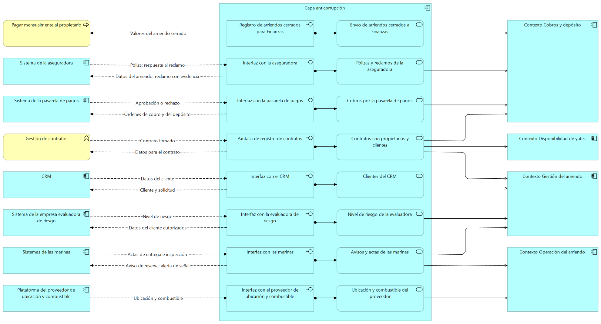

La V9 muestra las integraciones con procesos y sistemas externos. Hay ocho, una por servicio de la capa anticorrupción (SA-01 a SA-08). Cada una tiene su interfaz de aplicación del lado de YateGear, los flujos de la V4.10 con su nombre y su dirección, y el contexto de la V8 que usa el servicio. Así la V9 lleva la tabla de intercambios de la V4 a la capa de aplicación, sobre los componentes y servicios de la V8.

Para leerla: hay una fila por integración y se lee de izquierda a derecha: la contraparte de la V8, los flujos, la capa anticorrupción con la interfaz y su servicio SA anidados, y los contextos que usan cada servicio. Los flujos van en dos carriles por fila: arriba el que entra y abajo el que sale. Calificaciones no aparece porque no tiene integraciones. La dirección es la de la V4: "sale" es lo que YateGear envía y "entra" lo que recibe; la flecha del flujo va de quien da a quien recibe.

| Servicio | Contraparte (V8) | Interfaz (V9) | Sale | Entra | Momento | Lo usan (contexto: comandos) | Patrón (V8) |
|---|---|---|---|---|---|---|---|
| SA-01 Clientes del CRM | CRM | Interfaz con el CRM | "Cliente y solicitud" | "Datos del cliente" | Consulta y reserva | Gestión del arriendo: SB-06 | Capa anticorrupción |
| SA-02 Contratos con propietarios y clientes | Gestión de contratos (función de la V4) | Pantalla de registro de contratos | "Datos para el contrato" | "Contrato firmado" | Reserva, después de la evaluación de riesgo; registro del yate | Disponibilidad de yates: SB-01. Gestión del arriendo: SB-07. Cobros y depósito: SB-15 | Capa anticorrupción |
| SA-03 Pólizas y reclamos de la aseguradora | Sistema de la aseguradora | Interfaz con la aseguradora | "Datos del arriendo; reclamo con evidencia" | "Póliza; respuesta al reclamo" | Reserva y cierre | Cobros y depósito: SB-13, SB-16 | Capa anticorrupción |
| SA-04 Nivel de riesgo de la evaluadora | Sistema de la empresa evaluadora de riesgo | Interfaz con la evaluadora de riesgo | "Datos del cliente autorizados" | "Nivel de riesgo" | Reserva, antes del contrato | Gestión del arriendo: SB-12 | Capa anticorrupción |
| SA-05 Avisos y actas de las marinas | Sistemas de las marinas | Interfaz con las marinas | "Aviso de reserva; alerta de señal" | "Actas de entrega e inspección" | Todo el arriendo | Gestión del arriendo: SB-31. Operación del arriendo: SB-22, SB-23, SB-27 | Capa anticorrupción |
| SA-06 Cobros por la pasarela de pagos | Sistema de la pasarela de pagos | Interfaz con la pasarela de pagos | "Órdenes de cobro y del depósito" | "Aprobación o rechazo" | Reserva, cancelación y cierre | Cobros y depósito: SB-13, SB-14, SB-15, SB-19, SB-20, SB-21 | Servicio abierto / Capa anticorrupción |
| SA-07 Ubicación y combustible del proveedor | Plataforma del proveedor de ubicación y combustible | Interfaz con el proveedor de ubicación y combustible | - | "Ubicación y combustible" | Desde la entrega hasta la devolución | Operación del arriendo: SB-25 | Capa anticorrupción |
| SA-08 Envío de arriendos cerrados a Finanzas | Pagar mensualmente al propietario (proceso de la V3) | Registro de arriendos cerrados para Finanzas | "Valores del arriendo cerrado" | - | Cierre del arriendo | Cobros y depósito: SB-17 | Lenguaje publicado |

En total son 14 flujos: 7 entran a YateGear, de SA-01 a SA-07, y 7 salen, de SA-01 a SA-06 y SA-08. Lo que lleva cada flujo está en su documentación, con el mismo texto de las columnas "Sale" y "Entra" de la tabla de intercambios de la V4. La columna "Patrón (V8)" muestra que cada interfaz sigue el patrón de su integración: en SA-06 la pasarela es un servicio abierto (V8-SUP-01) y la interfaz de YateGear traduce su lenguaje; en SA-08 la interfaz es el registro con formato fijo del lenguaje publicado (V8-DEC-09).

Qué servicio usa cada contexto:

| Contexto | Servicios SA que usa (comandos) |
|---|---|
| Contexto Disponibilidad de yates | SA-02 (SB-01) |
| Contexto Gestión del arriendo | SA-01 (SB-06), SA-02 (SB-07), SA-04 (SB-12), SA-05 (SB-31) |
| Contexto Cobros y depósito | SA-02 (SB-15), SA-03 (SB-13, SB-16), SA-06 (SB-13, SB-14, SB-15, SB-19, SB-20, SB-21), SA-08 (SB-17) |
| Contexto Operación del arriendo | SA-05 (SB-22, SB-23, SB-27), SA-07 (SB-25) |
| Contexto Calificaciones | Ninguno: no tiene integraciones externas |

Cada comando de la tabla está asignado en el modelo al contexto de su fila (V8).

#### Decisiones de la V9

| ID | Qué se decidió | Por qué |
|---|---|---|
| V9-DEC-01 | Una interfaz por integración, del lado de YateGear, compuesta en la capa anticorrupción y asignada a su servicio SA. | La interfaz de aplicación es el punto por donde cada servicio se comunica con su contraparte, y es de la capa porque la capa traduce. Las interfaces de los sistemas externos no las diseña YateGear, así que no se modelan: el componente externo de la V8 ya las representa. Una por integración, para que cada flujo tenga su punto exacto y cada traducción quede aparte. |
| V9-DEC-02 | Los 14 flujos de la V4.10, uno a uno, entre la contraparte de la V8 y la interfaz. | La V4.10 ya dice qué información se intercambia y en qué dirección. Se copian con el mismo nombre y la misma dirección, así que la coherencia con la V4 se revisa flujo por flujo. No se agrega ningún intercambio: H-20 confirma las siete interoperabilidades. La propiedad `Momento` toma el valor de la V4, uno por servicio. |
| V9-DEC-03 | Quién usa cada servicio SA se modela a nivel de contexto, con 11 relaciones de servicio; los comandos van en las tablas. | A nivel de comando serían 19 líneas en vez de 11, y no hacen falta: la V8 asignó cada comando a su contexto, así que el comando se lee en el modelo. |
| V9-DEC-04 | Qué no va en la V9. | Calificaciones, que no tiene integraciones; los flujos entre contextos, que quedan en la V8 y la V6; y la consulta del seguimiento por la marina, que entra como usuario al servicio de consulta SB-26, sin cambiar sus sistemas, y no es un intercambio entre sistemas. |
| V9-DEC-05 | No se crean objetos de datos ni se fija el formato técnico de cada interfaz. | Lo que lleva cada flujo ya está en su nombre, su documentación y los contratos de la V4. El protocolo y el formato dependen de cada contraparte, y la entrevista no los dio. La V9 fija qué información pasa, en qué dirección y por cuál interfaz. |
| V9-DEC-06 | La interfaz de SA-02 es una pantalla y la de SA-08 es el registro publicado. | Para los contratos no hay sistema con el cual integrarse, porque hoy son PDF por correo (INT-01): alguien de Comercial registra el contrato firmado en una pantalla (V8-SUP-03). SA-08 es lenguaje publicado (V8-DEC-09): su interfaz es el registro con formato fijo que recibe Finanzas. |
| V9-DEC-07 | Las 4 relaciones de servicio de la capa anticorrupción a los contextos (V8) se quedan en el modelo. | Son el resumen de la V8, y las 11 de la V9 son el detalle por servicio. Aquellas se derivan de estas: la capa realiza el servicio SA y el servicio sirve al contexto, así que la capa sirve al contexto. Los cuatro contextos coinciden. |

#### Supuestos de la V9

La V9 no agrega supuestos. Usa V8-SUP-01 en la interfaz de SA-06 y V8-SUP-03 en la pantalla de registro de contratos.

Con la V9 queda completa la capa de aplicación; la sección 8 traza cada componente de aplicación hasta la meta y la capacidad que lo justifican.

## 8. Trazabilidad de la meta al componente

La V10 muestra la trazabilidad vertical de la meta al componente de aplicación, con relaciones de realización, influencia, servicio y asignación: cada componente de aplicación se traza hasta la meta y la capacidad que lo justifican. No diseña nada nuevo y no agrega hechos del negocio: muestra en una sola lectura la cadena que las vistas anteriores dejaron en el modelo. Responde dos preguntas por cada componente de aplicación: qué meta lo justifica, por el camino de los requerimientos (V10), y qué capacidad lo justifica, por el camino de las capacidades (V10.1). La V10.2 sigue un solo servicio básico por los dos caminos sin resumir ningún nivel.

La cadena, de arriba abajo; todas las relaciones apuntan hacia arriba, del nivel que justifica al nivel justificado:

| Nivel | Elementos | Relación hacia arriba | Cantidad | Viene de |
|---|---|---|---|---|
| Meta | 4: "Crecer con control" y sus 3 submetas | Agregación de la meta raíz a cada submeta | 3 | V1 |
| Resultado y principio | 2 y 2 | Realización --> meta | 4 | V1 |
| Requerimiento | 7 | Realización --> meta, resultado o principio | 10 | V1 |
| Restricción | 4 | Influencia --> requerimiento o meta | 6 | V1 |
| Servicio de plataforma | 6 | Realización --> requerimiento | 9 | V4 |
| Servicio de dominio | 8 | Servicio --> servicio de plataforma | 14 | V4 |
| Servicio básico | 30 | Agregación desde su servicio de dominio | 30 | V4 |
| Comando o servicio de consulta | 24 y 6 | Realización --> servicio básico | 30 | V6 y V8 |
| Contexto (componente de aplicación) | 5 | Asignación --> comando (24) y realización --> servicio de consulta (6) | 30 | V8 |
| Capa anticorrupción (componente de aplicación) | 1 | Servicio --> contexto | 4 | V8 |

El camino de las capacidades sale del servicio de dominio: el servicio de dominio realiza capacidades impactadas (11 realizaciones), la capacidad realiza cursos de acción (12) y el curso de acción realiza metas (5).

Lo único que agrega la V10 son 8 realizaciones contexto --> servicio de dominio, una por servicio de dominio (V10-DEC-02). Entre el contexto y el servicio de dominio no había una relación directa: la traza pasaba por el comando y el servicio básico. Son relaciones de resumen decididas por el equipo, no una derivación de ArchiMate. Del modelo sí se deriva que el contexto realiza cada servicio básico, porque ejecuta el comando que lo realiza o realiza el servicio de consulta que lo realiza; el paso al servicio de dominio no se deriva, porque las reglas de derivación no recorren una agregación en sentido contrario. El resumen se justifica porque cada contexto realiza todos los servicios básicos de su servicio de dominio, y ningún otro contexto realiza alguno de ellos.

Cómo leer los dos caminos. No dicen lo mismo y no deben sumarse. El camino de los requerimientos es ancho: un servicio de plataforma realiza varios requerimientos, y todo servicio de dominio que le sirve queda unido a todos ellos. Por ejemplo, "Gestión de yates y disponibilidad" sirve a "Reserva del arriendo", que realiza el requerimiento de pagos, y leída de corrido la traza diría que el contexto de disponibilidad justifica "Cobros claros y con evidencia", y no es así. El camino de las capacidades es angosto: cada servicio de dominio realiza solo sus capacidades, y por él "Contexto Disponibilidad de yates" llega únicamente a "Cero dobles reservas". Regla de lectura: la V10 dice a qué servicio del negocio contribuye cada componente; la V10.1 dice qué meta lo justifica directamente. Cuando los dos caminos no coinciden, manda la V10.1.

Cada componente de aplicación, hasta la meta y la capacidad que lo justifican (tabla generada leyendo el modelo):

| Componente de aplicación | Servicios de dominio | Metas por el camino de los requerimientos | Capacidades que lo justifican | Metas por el camino de las capacidades |
|---|---|---|---|---|
| Contexto Disponibilidad de yates | SD-01 | Cero dobles reservas; Cobros claros y con evidencia; Menos riesgo en cada arriendo | Gestión del inventario de yates por marina; Habilitación y bloqueo de yates | Cero dobles reservas |
| Contexto Gestión del arriendo | SD-02, SD-03 | Cero dobles reservas; Cobros claros y con evidencia; Crecer con control; Menos riesgo en cada arriendo | Gestión de reservas; Evaluación del riesgo del arriendo | Cero dobles reservas; Menos riesgo en cada arriendo |
| Contexto Cobros y depósito | SD-04, SD-05 | Cero dobles reservas; Cobros claros y con evidencia; Menos riesgo en cada arriendo | Cobro del arriendo; Gestión del seguro del arriendo; Gestión del depósito para daños | Cobros claros y con evidencia; Menos riesgo en cada arriendo |
| Contexto Operación del arriendo | SD-06, SD-07 | Cobros claros y con evidencia; Menos riesgo en cada arriendo | Coordinación de la preparación y entrega del yate al cliente; Gestión de la devolución y la inspección; Seguimiento de ubicación y combustible | Cobros claros y con evidencia; Menos riesgo en cada arriendo |
| Contexto Calificaciones | SD-08 | Crecer con control | Gestión de calificaciones mutuas | Ninguna: su capacidad no tiene curso de acción |
| Capa anticorrupción | - | Las de los cuatro contextos a los que sirve (todos menos Calificaciones) | - | Las de esos cuatro contextos |

La capa anticorrupción no realiza servicios de dominio ni capacidades: se justifica por los contextos a los que sirve. Además, en la V4 su servicio "Avisos y actas de las marinas" realiza la restricción "Marinas que no cambian sus sistemas" (V4-DEC-10).

Cada servicio de dominio: a qué sirve y qué realiza

| Servicio de dominio | Contexto | Sirve a (servicio de plataforma) | Requerimientos que realiza la plataforma | Capacidades que realiza | Cursos de acción --> meta |
|---|---|---|---|---|---|
| SD-01 Gestión de yates y disponibilidad | Disponibilidad de yates | Oferta de yates por marina; Reserva del arriendo | Inventario de yates por marina, habilitados o bloqueados por el propietario; Reserva confirmada y notificada al propietario y a la marina; Autorización del cliente para el tratamiento de sus datos; Pagos del arriendo: alquiler, depósito, seguro y combustible | Gestión del inventario de yates por marina; Habilitación y bloqueo de yates | Inventario siempre al día con lo que decide el propietario y las reservas confirmadas --> Cero dobles reservas |
| SD-02 Gestión de reservas | Gestión del arriendo | Reserva del arriendo; Entrega y recepción del yate; Calificaciones mutuas | Reserva confirmada y notificada al propietario y a la marina; Autorización del cliente para el tratamiento de sus datos; Pagos del arriendo: alquiler, depósito, seguro y combustible; Cierre con devolución, inspección y ajustes de dinero; Calificaciones mutuas entre clientes y propietarios | Gestión de reservas | Inventario siempre al día con lo que decide el propietario y las reservas confirmadas --> Cero dobles reservas. Entregar el yate solo con riesgo aceptable, contrato firmado y pagos completos --> Menos riesgo en cada arriendo |
| SD-03 Evaluación del riesgo del arriendo | Gestión del arriendo | Reserva del arriendo | Reserva confirmada y notificada al propietario y a la marina; Autorización del cliente para el tratamiento de sus datos; Pagos del arriendo: alquiler, depósito, seguro y combustible | Evaluación del riesgo del arriendo | Entregar el yate solo con riesgo aceptable, contrato firmado y pagos completos --> Menos riesgo en cada arriendo |
| SD-04 Gestión de cobros del arriendo | Cobros y depósito | Reserva del arriendo; Ajustes de dinero del cierre | Reserva confirmada y notificada al propietario y a la marina; Autorización del cliente para el tratamiento de sus datos; Pagos del arriendo: alquiler, depósito, seguro y combustible; Cierre con devolución, inspección y ajustes de dinero | Cobro del arriendo; Gestión del seguro del arriendo | Entregar el yate solo con riesgo aceptable, contrato firmado y pagos completos --> Menos riesgo en cada arriendo. Respaldar todo cobro con las actas y fotos de entrega e inspección --> Cobros claros y con evidencia |
| SD-05 Gestión del depósito para daños | Cobros y depósito | Reserva del arriendo; Ajustes de dinero del cierre | Reserva confirmada y notificada al propietario y a la marina; Autorización del cliente para el tratamiento de sus datos; Pagos del arriendo: alquiler, depósito, seguro y combustible; Cierre con devolución, inspección y ajustes de dinero | Gestión del depósito para daños | Entregar el yate solo con riesgo aceptable, contrato firmado y pagos completos --> Menos riesgo en cada arriendo. Respaldar todo cobro con las actas y fotos de entrega e inspección --> Cobros claros y con evidencia |
| SD-06 Gestión de la entrega y la inspección | Operación del arriendo | Ajustes de dinero del cierre; Entrega y recepción del yate | Pagos del arriendo: alquiler, depósito, seguro y combustible; Cierre con devolución, inspección y ajustes de dinero | Coordinación de la preparación y entrega del yate al cliente; Gestión de la devolución y la inspección | Respaldar todo cobro con las actas y fotos de entrega e inspección --> Cobros claros y con evidencia |
| SD-07 Seguimiento de ubicación y combustible | Operación del arriendo | Seguimiento del yate arrendado | Seguimiento en tiempo real de ubicación y combustible | Seguimiento de ubicación y combustible | Seguimiento visible para la marina y el cliente --> Cobros claros y con evidencia, Menos riesgo en cada arriendo |
| SD-08 Gestión de calificaciones | Calificaciones | Calificaciones mutuas | Calificaciones mutuas entre clientes y propietarios | Gestión de calificaciones mutuas | - |

Cada requerimiento: a qué meta llega y quién lo realiza

| Requerimiento | Llega a | Lo realiza (servicio de plataforma) | Restricciones que influyen |
|---|---|---|---|
| Autorización del cliente para el tratamiento de sus datos | Ninguna meta | Reserva del arriendo | Ley 1581 de 2012 de protección de datos personales |
| Calificaciones mutuas entre clientes y propietarios | Crecer con control | Calificaciones mutuas | - |
| Cierre con devolución, inspección y ajustes de dinero | Cobros claros y con evidencia (por el principio "Todo cobro va con evidencia" y por el resultado "Depósito devuelto en máximo 3 días") | Ajustes de dinero del cierre; Entrega y recepción del yate | Marinas que no cambian sus sistemas |
| Inventario de yates por marina, habilitados o bloqueados por el propietario | Cero dobles reservas | Oferta de yates por marina | - |
| Pagos del arriendo: alquiler, depósito, seguro y combustible | Cobros claros y con evidencia (por el principio "Todo cobro va con evidencia" y por el resultado "Depósito devuelto en máximo 3 días") | Reserva del arriendo; Ajustes de dinero del cierre | - |
| Reserva confirmada y notificada al propietario y a la marina | Cero dobles reservas; Menos riesgo en cada arriendo (por el principio "Ante la duda, se protege el yate del propietario") | Reserva del arriendo | Marinas que no cambian sus sistemas; Licencia de navegación vigente del cliente |
| Seguimiento en tiempo real de ubicación y combustible | Menos riesgo en cada arriendo (por el principio "Ante la duda, se protege el yate del propietario"); Cobros claros y con evidencia (por el resultado "Reclamos por cobros reducidos a la mitad") | Seguimiento del yate arrendado | Marinas que no cambian sus sistemas |

Además de los servicios de plataforma, SB-11 "Verificar los requisitos del cliente" realiza el requerimiento "Autorización del cliente para el tratamiento de sus datos" y la restricción "Licencia de navegación vigente del cliente" (V4-DEC-10). A SB-11 lo realiza el servicio de consulta del mismo nombre, del "Contexto Gestión del arriendo".

Qué comando o servicio de consulta realiza cada uno de los 30 servicios básicos, y en qué contexto, se lee en la V4 (servicios de dominio y sus servicios básicos), la V6 (comandos por agregado y servicios básicos que no son comandos) y la V8 (contextos con sus comandos y servicios de consulta).

### V10 - Trazabilidad vertical

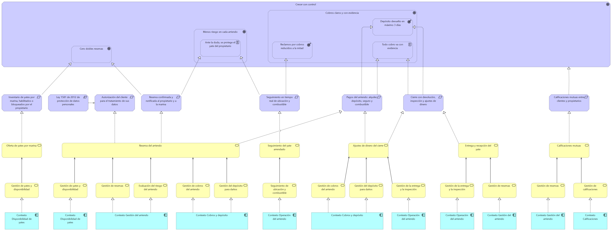

La vista principal traza de la meta al componente, por el camino de los requerimientos. Se lee de arriba abajo en cinco filas: metas, requerimientos, servicios de plataforma, servicios de dominio y contextos. "Crecer con control" contiene sus tres submetas, y cada submeta contiene los resultados y los principios que la realizan (sección 11). Junto a "Autorización del cliente para el tratamiento de sus datos" va la restricción de la Ley 1581, que es donde termina su traza (V10-DEC-04).

Para leerla: las dos filas de abajo se organizan en un bloque por servicio de plataforma. Debajo de cada uno van los servicios de dominio que le sirven y, debajo de estos, su contexto. Un servicio de dominio que sirve a más de un servicio de plataforma aparece debajo de cada uno, con su contexto, como en la V4.01: es el mismo elemento del modelo.

### V10.1 - Trazabilidad por capacidades

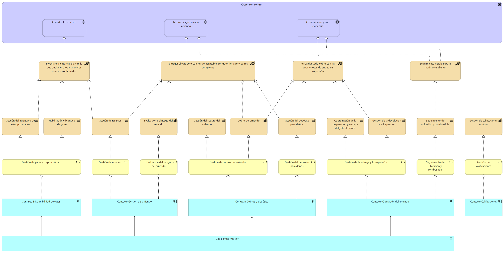

La V10.1 agrega la capacidad: se lee de arriba abajo en seis filas: metas, cursos de acción, capacidades impactadas, servicios de dominio, contextos y capa anticorrupción. Cada elemento aparece una sola vez. Es la primera vista donde se ven los cursos de acción de la V2.

Para leerla: cada servicio de dominio va debajo de las capacidades que realiza, y cada contexto debajo de sus servicios de dominio. La capa anticorrupción es una barra bajo los cuatro contextos a los que sirve; "Contexto Calificaciones" queda fuera de la barra porque no tiene integraciones. Dos capacidades no tienen línea hacia arriba: "Gestión del seguro del arriendo" y "Gestión de calificaciones mutuas" no realizan ningún curso de acción.

### V10.2 - Detalle: Confirmar la reserva

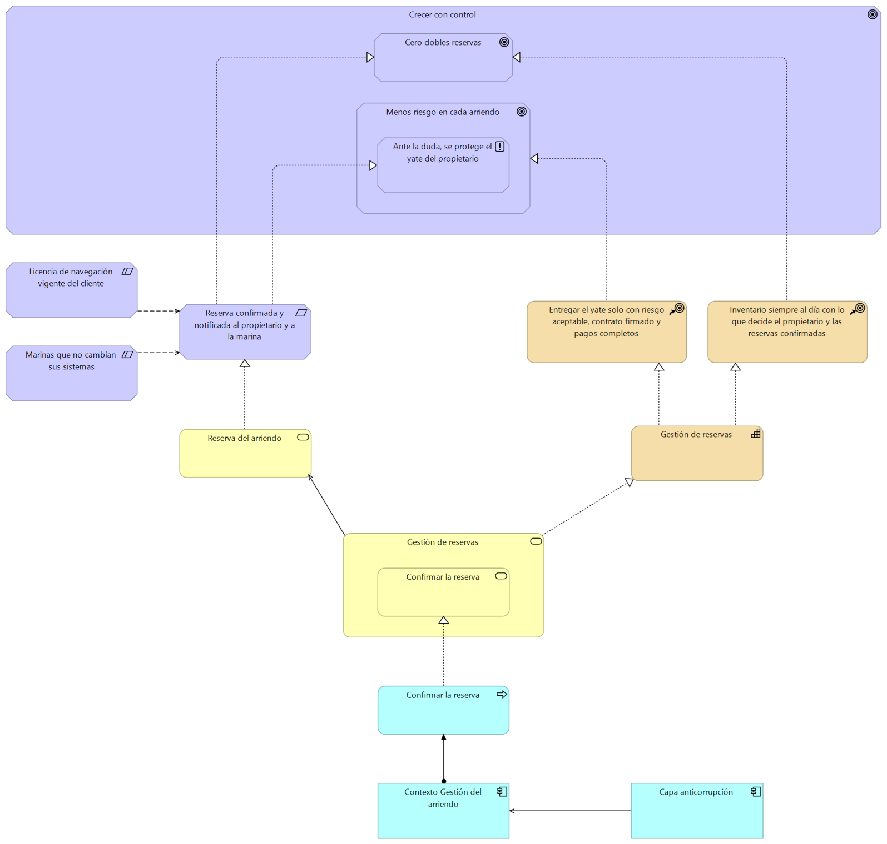

La V10.2 sigue un servicio básico, "Confirmar la reserva", sin resumir ningún nivel, y se lee de abajo arriba. El "Contexto Gestión del arriendo" ejecuta el comando "Confirmar la reserva" (asignación); el comando realiza el servicio básico del mismo nombre, que está dentro de su servicio de dominio, "Gestión de reservas"; la capa anticorrupción sirve al contexto. Por la izquierda, el servicio de dominio sirve a "Reserva del arriendo", que realiza el requerimiento "Reserva confirmada y notificada al propietario y a la marina", en el que influyen dos restricciones. Por la derecha, el servicio de dominio realiza la capacidad "Gestión de reservas", que realiza dos cursos de acción. Las dos ramas llegan a las mismas dos metas: "Cero dobles reservas" y "Menos riesgo en cada arriendo", esta última por el principio en la rama izquierda.

Es la única vista con las cuatro relaciones de la trazabilidad vertical: realización, influencia, servicio y asignación.

#### Casos particulares de la traza

Se dejan como están (V10-DEC-06):

- "Contexto Calificaciones" llega por los requerimientos solo a la meta raíz, "Crecer con control". Se apoya en dos supuestos encadenados de la V1: V1-SUP-01 (la meta que agrupa las tres submetas) y V1-SUP-04 (el requerimiento de calificaciones la realiza). El experto dijo que las calificaciones sirven para "saber si vamos bien" y dan confianza a ambos lados (E2E-07), pero no las ligó a una meta. Por las capacidades no llega a ninguna meta.
- "Gestión de calificaciones mutuas" y "Gestión del seguro del arriendo" no realizan ningún curso de acción. Los cuatro cursos de acción de la V2 salen de H-21, H-07, H-13 y H-12, y ninguno nombra las calificaciones ni la póliza o el reclamo a la aseguradora; H-21 deja las calificaciones fuera del núcleo. Sus servicios de dominio, SD-08 y SD-04, llegan a las metas por los requerimientos.
- "Autorización del cliente para el tratamiento de sus datos" no realiza ninguna meta, por decisión del equipo (V1-DEC-04). Es una obligación legal, y su traza termina en la restricción de la Ley 1581.
- El camino de los requerimientos es más ancho que el de las capacidades; por eso la tabla de componentes da los dos por separado.

#### Decisiones de la V10

Valen para la V10, la V10.1 y la V10.2.

| ID | Qué se decidió | Por qué |
|---|---|---|
| V10-DEC-01 | Tres vistas: la principal, la de capacidades y un detalle. | Cada componente se traza por dos caminos, hasta la meta y hasta la capacidad. En una sola vista, con cada elemento una vez, los dos caminos se cruzarían y se leerían como uno. |
| V10-DEC-02 | 8 realizaciones de resumen contexto --> servicio de dominio. | Sin ellas, la vista principal necesitaría los 30 servicios básicos y los 24 comandos. No son una derivación de ArchiMate sino un resumen decidido por el equipo, justificado porque cada contexto realiza todos los servicios básicos de ese servicio de dominio. La documentación de cada una lo dice, y el detalle se muestra en la V10.2 y en las tablas de la V4, la V6 y la V8. |
| V10-DEC-03 | Qué no va en la V10. | Los sistemas externos, que no son de YateGear y ninguna meta los justifica (V9); los 5 recursos de la V2, que no forman parte de la cadena; interesados, impulsores y evaluaciones, que están por encima de la meta (V1); procesos, actores y roles (V3 y V4.01); y agregados y eventos (V6), de los que solo se usa el comando. |
| V10-DEC-04 | En la vista principal solo va una restricción, la de la Ley 1581. | Es la única que cambia la lectura de la traza: explica por qué "Autorización del cliente para el tratamiento de sus datos" no sube a ninguna meta. Las otras tres agregarían 5 líneas que no responden la pregunta de la vista; las dos del requerimiento de la reserva se ven en la V10.2. |
| V10-DEC-05 | La capa anticorrupción se traza por los contextos a los que sirve. | Es un componente de aplicación, así que también se traza. No realiza servicios de dominio ni capacidades: existe para proteger a los contextos (V8-DEC-06). Por eso va en la V10.1 y la V10.2, y no en la principal, donde no tendría línea hacia ningún servicio de dominio. |
| V10-DEC-06 | Los casos particulares de la traza se muestran como están. | Crear las relaciones que faltan sería deducir algo que el experto no dijo, que es lo que V1-DEC-04 descartó. La V10 es una vista de comprobación: si completa la traza donde las fuentes no la dan, deja de servir para eso. |

#### Supuestos de la V10

La V10 no agrega supuestos, porque no agrega hechos del negocio. Sus casos particulares se apoyan en V1-SUP-01 y V1-SUP-04.

La V11, que sigue, resume en una página el diseño del contexto principal de esta traza.

## 9. Bounded Context Canvas

### V11 - Bounded Context Canvas: Gestión del arriendo

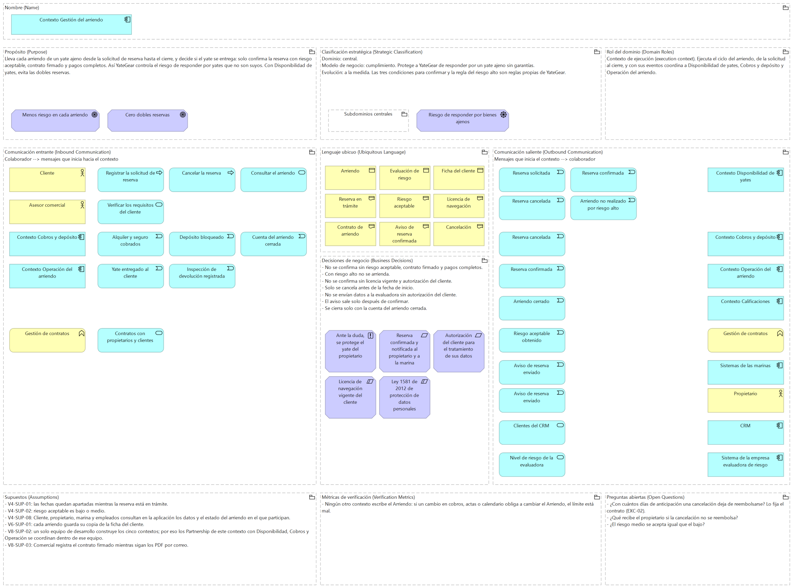

La V11 documenta el contexto delimitado principal, el Contexto Gestión del arriendo, con un Bounded Context Canvas construido en ArchiMate (diapositivas 34 y 35 de 9_DDD_Diseño). En una sola página muestra el propósito, la clasificación estratégica, el rol del dominio, el lenguaje ubicuo, la comunicación entrante y saliente, las decisiones de negocio y los supuestos, con las 11 casillas de la plantilla. Cada casilla reúne lo que las vistas anteriores ya dejaron en el modelo, así que la V11 funciona también como resumen del diseño.

Cómo se modela: cada casilla es una agrupación nueva, con el nombre de la casilla en español y el de la plantilla entre paréntesis, y la propiedad `Casilla del canvas`. El texto de la casilla está en su propiedad `Contenido`, y una expresión de etiqueta de Archi (`${name}` y `${property:Contenido}`) lo muestra debajo del nombre (V11-DEC-04). Nueve de las 11 casillas tienen esa propiedad; Nombre y Lenguaje ubicuo no la tienen. Dentro de cada casilla van los elementos que ya existen en el modelo, anidados y con una agregación casilla --> elemento.

Para leerla: la vista copia la plantilla de la diapositiva 35. Arriba va el nombre; en la segunda franja, propósito, clasificación estratégica y rol del dominio; en la franja del medio, comunicación entrante a la izquierda, lenguaje ubicuo y decisiones de negocio en el centro, y comunicación saliente a la derecha; abajo, supuestos, métricas de verificación y preguntas abiertas. Cada colaborador que está en las dos columnas de comunicación queda en la misma fila: Contexto Cobros y depósito, Contexto Operación del arriendo y Gestión de contratos. Un elemento puede aparecer más de una vez, porque el canvas ordena por fila: "Reserva confirmada" y "Reserva cancelada" van a dos contextos, "Aviso de reserva enviado" va a la marina y al propietario, y cada elemento tiene una sola agregación desde cada casilla donde está.

La comunicación sigue el criterio de la plantilla de ddd-crew: la entrante son las conversaciones que inicia otro, y la saliente las que inicia este contexto, sean comandos, consultas o eventos. En "Comunicación entrante" cada fila es un colaborador a la izquierda y, a su derecha, los mensajes que le manda al contexto. En "Comunicación saliente" cada fila son los mensajes que manda el contexto y, a la derecha, a quién se los manda. El tipo de mensaje se lee en el tipo de elemento: proceso de aplicación es comando, servicio es consulta o integración, y evento es evento.

| Casilla | Contenido | Elementos del modelo | De dónde sale |
|---|---|---|---|
| Nombre | Contexto Gestión del arriendo | El componente de la V8 | V8 |
| Propósito | Lleva cada arriendo de un yate ajeno desde la solicitud de reserva hasta el cierre, y decide si el yate se entrega: solo confirma la reserva con riesgo aceptable, contrato firmado y pagos completos. Así YateGear controla el riesgo de responder por yates que no son suyos. Con Disponibilidad de yates, evita las dobles reservas. | Metas "Menos riesgo en cada arriendo" y "Cero dobles reservas" | V5, clasificación; CIE-01, CTX-03; V10.1 |
| Clasificación estratégica | Dominio: central. Modelo de negocio: cumplimiento. Evolución: a la medida. | Agrupación "Subdominios centrales" (V5) e impulsor "Riesgo de responder por bienes ajenos" (V1) | V5, V1; V11-DEC-03 |
| Rol del dominio | Contexto de ejecución (execution context) | - | V6.1, V8; V11-DEC-03 |
| Comunicación entrante | Cliente --> Registrar la solicitud de reserva, Cancelar la reserva, Consultar el arriendo. Asesor comercial --> Verificar los requisitos del cliente. Cobros y depósito --> Alquiler y seguro cobrados, Depósito bloqueado, Cuenta del arriendo cerrada. Operación del arriendo --> Yate entregado al cliente, Inspección de devolución registrada. Gestión de contratos --> Contratos con propietarios y clientes. | 5 colaboradores y 10 mensajes | V6, eventos entre dominios; V8; V9, servicios por contexto |
| Comunicación saliente | Reserva solicitada, Reserva confirmada, Reserva cancelada y Arriendo no realizado por riesgo alto --> Disponibilidad de yates. Reserva cancelada --> Cobros y depósito. Reserva confirmada --> Operación del arriendo. Arriendo cerrado --> Calificaciones. Riesgo aceptable obtenido --> Gestión de contratos. Aviso de reserva enviado --> Sistemas de las marinas. Aviso de reserva enviado --> Propietario. Clientes del CRM --> CRM. Nivel de riesgo de la evaluadora --> Sistema de la empresa evaluadora de riesgo. | 9 mensajes (7 eventos y 2 servicios de la capa anticorrupción) y 9 colaboradores | V6, eventos entre dominios; V8, mapa: "Reserva confirmada" --> Operación (regla de SB-22 en el Partnership) y "Arriendo cerrado" --> Calificaciones (conformista); V9, servicios por contexto; diapositiva 35 |
| Lenguaje ubicuo | Arriendo, Evaluación de riesgo, Ficha del cliente, Reserva en trámite, Riesgo aceptable, Licencia de navegación, Contrato de arriendo, Aviso de reserva confirmada, Cancelación | 3 objetos de negocio y 6 representaciones | V7, glosario de Gestión del arriendo |
| Decisiones de negocio | Los 4 invariantes y las 3 reglas de comando del agregado Arriendo | Principio "Ante la duda, se protege el yate del propietario", requerimientos "Reserva confirmada y notificada al propietario y a la marina" y "Autorización del cliente para el tratamiento de sus datos", y las restricciones de licencia vigente y Ley 1581 | V6.1; V1 |
| Supuestos | V4-SUP-01, V4-SUP-02, V4-SUP-08, V6-SUP-01, V8-SUP-02 y V8-SUP-03 | - | V4, V6, V8 |
| Métricas de verificación | Ningún otro contexto escribe el Arriendo: si un cambio en cobros, actas o calendario obliga a cambiar el Arriendo, el límite está mal. | - | V5-DEC-02; V11-DEC-05; diapositiva 35 |
| Preguntas abiertas | Plazo exacto de una cancelación que ya no se reembolsa. Qué recibe el propietario si la cancelación no se reembolsa. Si el riesgo medio se acepta igual que el bajo. | - | EXC-02, D-03; V6, límite de la información del negocio; V4-SUP-02 |

Las decisiones de negocio son las del agregado Arriendo en la V6.1. Las cuatro primeras son invariantes y las otras tres, reglas de comando:

1. No se confirma sin riesgo aceptable, contrato firmado y pagos completos (REG-01, H-07).
2. Con riesgo alto no se arrienda (REG-01).
3. No se confirma sin licencia vigente y autorización del cliente (H-09, H-19).
4. Solo se cancela antes de la fecha de inicio (EXC-02).
5. No se envían datos a la evaluadora sin la autorización del cliente (H-19).
6. El aviso a la marina y al propietario sale solo después de confirmar (H-07).
7. El arriendo se cierra solo cuando Cobros y depósito cierra la cuenta (E2E-01).

La métrica prueba el límite del contexto. Es la regla de dueño de la V5: no se inventan porcentajes, porque el experto no dio cifras (V11-DEC-05).

#### Decisiones de la V11

| ID | Qué se decidió | Por qué |
|---|---|---|
| V11-DEC-01 | El contexto principal es Gestión del arriendo. | Es central (V5) y es el que decide si un yate ajeno se entrega: no confirma sin riesgo aceptable, contrato firmado y pagos completos, una de las cuatro prioridades que el experto llamó "el corazón" (CIE-01). En la V8 es el contexto con más relaciones (tres Partnership y un conformista), y su número de arriendo es la identidad que usan los demás; en la V9 usa cuatro servicios de la capa anticorrupción. Cobros y depósito también es central, pero depende de Gestión del arriendo para la cancelación, las fechas y el cierre. |
| V11-DEC-02 | Una sola vista con la forma de la plantilla de la diapositiva 35. | En una sola página se lee el contexto completo. Copiar la posición de las casillas permite leer la vista como cualquier canvas de ddd-crew. Se incluyen las 11 casillas de la plantilla: las métricas y las preguntas abiertas dicen cómo se comprueba el diseño y qué falta saber. |
| V11-DEC-03 | Clasificación: central, cumplimiento y a la medida. Rol: contexto de ejecución. | Central, como en la V5. Cumplimiento, porque el contexto protege a YateGear de responder por un yate ajeno sin garantías; no se marca ingresos porque el dinero lo maneja Cobros y depósito. A la medida, porque las tres condiciones y la regla del riesgo alto son reglas propias de YateGear (V5-DEC-05). De ejecución, porque ejecuta el ciclo del arriendo de punta a punta. |
| V11-DEC-04 | El texto de cada casilla se muestra con una expresión de etiqueta. | Archi permite que la etiqueta de un objeto lea propiedades del elemento. Así el texto vive en el modelo, se edita en un solo lugar y no hacen falta notas. Esta decisión permite representar el canvas dentro del modelo ArchiMate y conservar la trazabilidad de sus elementos. |
| V11-DEC-05 | La única métrica prueba el límite del contexto. | La métrica es la regla de dueño: si un cambio en los cobros, las actas o el calendario obliga a cambiar el Arriendo, el límite está mal puesto (V5-DEC-02). Las metas de la V1 van en el propósito. No se inventan porcentajes, porque el experto no dio cifras. |
| V11-DEC-06 | Sin líneas en la vista. | La plantilla no usa líneas: la fila dice quién manda o recibe cada mensaje. Las relaciones de verdad ya están en el modelo (V6, V8 y V9). |
| V11-DEC-07 | Disponibilidad de yates solo está en la comunicación saliente. | Gestión del arriendo le publica cuatro eventos. Lo que lee de Disponibilidad también es una conversación que inicia Gestión del arriendo, pero esa lectura no tiene un elemento propio en el modelo. La relación entre los dos contextos ya está en la V8 como Partnership. |
| V11-DEC-08 | Una vista ArchiMate con agrupaciones y expresiones de etiqueta, no una plantilla aparte. | Se evaluaron el Canvas Modelling Toolkit de Archi y las plantillas de Miro de ddd-crew: las dos dibujan cajas que son copias sin relación con el modelo. Con agrupaciones, los elementos del canvas son los del modelo y conservan su traza. |

#### Supuestos de la V11

La V11 no agrega supuestos. Su casilla de supuestos reúne los que usa el diseño de Gestión del arriendo:

| ID | Supuesto |
|---|---|
| V4-SUP-01 | Las fechas se apartan desde la solicitud de reserva y se ocupan al confirmar; si la reserva no sigue, se sueltan. |
| V4-SUP-02 | Riesgo aceptable es bajo o medio. |
| V4-SUP-08 | Cliente, propietario, marina y empleados consultan en la aplicación los datos y el estado del arriendo en el que participan. |
| V6-SUP-01 | La ficha del cliente es la copia que cada arriendo guarda de los datos del cliente que necesita: referencia al CRM, licencia de navegación y autorización de datos. El dato compartido entre arriendos es la referencia al CRM. |
| V8-SUP-02 | Un solo equipo de desarrollo de software construye los cinco contextos. Por eso los Partnership y el cliente-proveedor se resuelven coordinando dentro de ese equipo, y los contextos se avisan con eventos sin necesidad de un servicio abierto entre ellos. |
| V8-SUP-03 | Mientras los contratos sigan siendo PDF por correo (INT-01), alguien de Comercial registra en SA-02 la referencia del contrato firmado y sus condiciones de cancelación. |

En este contexto, V8-SUP-02 hace que sus tres Partnership, con Disponibilidad de yates, Cobros y depósito y Operación del arriendo, se coordinen dentro de ese equipo. Sus preguntas abiertas son las que dejó la entrevista para este contexto, y se reúnen con las demás en la sección 10.

## 10. Decisiones y supuestos

Las decisiones de diseño de cada vista están en su sección, con su ID y su justificación:

- [Decisiones de la V1](#decisiones-de-la-v1)
- [Decisiones de la V2](#decisiones-de-la-v2)
- [Decisiones de la V3](#decisiones-de-la-v3)
- [Decisiones de la V4](#decisiones-de-la-v4), que valen también para la V4.01 a la V4.10
- [Decisiones de la V5](#decisiones-de-la-v5)
- [Decisiones de la V7](#decisiones-de-la-v7)
- [Decisiones de la V6](#decisiones-de-la-v6), para la V6.1 a la V6.5
- [Decisiones de la V8](#decisiones-de-la-v8)
- [Decisiones de la V9](#decisiones-de-la-v9)
- [Decisiones de la V10](#decisiones-de-la-v10), para la V10, la V10.1 y la V10.2
- [Decisiones de la V11](#decisiones-de-la-v11)

### Supuestos por vista

Cada supuesto está en la sección de su vista, con su texto y por qué se asumió. Son 33, en seis vistas; las demás usan los de vistas anteriores. En la documentación del modelo, los supuestos se marcan con el prefijo "Supuesto:" o con su ID.

| Vista | Supuestos propios | Usa supuestos de otras vistas |
|---|---|---|
| V1 | [V1-SUP-01 a V1-SUP-07](#supuestos-de-la-v1) | - |
| V2 | [V2-SUP-01 a V2-SUP-07](#supuestos-de-la-v2) | - |
| V3 | [V3-SUP-01 a V3-SUP-06](#supuestos-de-la-v3) | - |
| V4 | [V4-SUP-01 a V4-SUP-09](#supuestos-de-la-v4) | V3-SUP-06, que desde la V4 se cita como V4-SUP-02 |
| V5 | Ninguno | V2-SUP-07 |
| V7 | Ninguno | V4-SUP-02 |
| V6 | [V6-SUP-01 a V6-SUP-04](#supuestos-de-la-v6) | V4-SUP-01, V4-SUP-02, V4-SUP-03, V4-SUP-04, V4-SUP-05, V4-SUP-06, V4-SUP-07 y V4-SUP-09 |
| V8 | [V8-SUP-01 a V8-SUP-03](#supuestos-de-la-v8) | V4-SUP-01, V4-SUP-02, V4-SUP-05, V4-SUP-07, V4-SUP-09 y V6-SUP-01 |
| V9 | Ninguno | V8-SUP-01 y V8-SUP-03 |
| V10 | Ninguno | V1-SUP-01 y V1-SUP-04, en los casos particulares de la traza |
| V11 | Ninguno | V4-SUP-01, V4-SUP-02, V4-SUP-08, V6-SUP-01, V8-SUP-02 y V8-SUP-03 |

### Límites de la información del negocio y preguntas abiertas

Donde la entrevista no dio un dato, el diseño lo deja como supuesto, como regla del contrato con el cliente o como pregunta abierta.

- Límite de la información del negocio (V6). El experto no definió qué recibe el propietario cuando una cancelación no se reembolsa, y remitió los detalles de la cancelación al contrato con el cliente (EXC-02). Con el criterio de D-03 y D-04, la aplicación no lo inventa: la cuenta de una reserva cancelada guarda el reembolso o la razón de no reembolsar, y no se envía a Finanzas por SA-08.
- Preguntas abiertas del contexto principal (V11):
  - El plazo que hace que una cancelación ya no se reembolse está en el contrato con el cliente; el experto remitió al abogado (EXC-02, D-03).
  - El experto no definió qué recibe el propietario cuando una cancelación no se reembolsa (V6).
  - El experto solo dijo que con riesgo alto no se arrienda; que el riesgo medio sea aceptable es un supuesto (V4-SUP-02).
- Otros datos que la entrevista no dio:
  - El tiempo sin lecturas que dispara la alerta de pérdida de señal (V4-SUP-04).
  - Quién le pone precio a los daños (V4-SUP-03).
  - Cuánto dura el bloqueo del depósito en la tarjeta de crédito (V4-SUP-07).
  - El protocolo y el formato técnico de cada interfaz, que dependen de cada contraparte (V9-DEC-05).
  - Cifras para las métricas del canvas (V11-DEC-05).

## 11. Convenciones del modelo

### IDs

- Las decisiones se numeran Vn-DEC-xx y los supuestos Vn-SUP-xx, donde Vn es la vista donde se tomaron. No se usan D-xx ni S-xx sueltos, para no confundirlos con los hallazgos descartados D-01 a D-06.
- Las decisiones de cada vista se numeran sin huecos.
- Un supuesto de una vista anterior se cita con su ID original. V3-SUP-06 se cita como V4-SUP-02 desde la V4.
- Los códigos de servicio (SP, SD, SB, SA y EX) son estables: si un servicio sale, su código se retira y no se reutiliza, para no romper la trazabilidad de las fases siguientes. Por eso los códigos SB y EX no se renumeran y conservan los huecos de los servicios retirados.
- Los hallazgos van de H-01 a H-21 y los descartados de D-01 a D-06, como en el análisis de hallazgos. Las respuestas del experto se citan con el ID de su pregunta en el guion. Los puntos del alcance van de A1 a A6.

### Anidamientos de la vista

Las agregaciones de pertenencia (área --> capacidad en la V2, clasificación --> dominio --> objeto en la V5, dominio --> término en la V7, y las demás de esta tabla) se muestran por anidamiento, sin líneas, para que las vistas queden limpias. En la V10, las submetas, los resultados y los principios van dentro de su meta, para que las líneas de los requerimientos lleguen al resultado o al principio exacto que realizan sin dibujar una fila más. Cada anidamiento de una vista corresponde a una relación del modelo, salvo la unión de la V3. La V1 y las vistas V4.01 a V4.10 no tienen anidamientos.

| Vista | Contenedor | Contenido | Relación en el modelo | Dirección |
|---|---|---|---|---|
| V2 | Agrupación de área ("Gerencia", "Comercial", "Operaciones", "Finanzas", "Servicio al cliente", "Apoyo corporativo") | Capacidad | Agregación | Contenedor --> contenido |
| V3 | Agrupación "Alcance de la aplicación" | Proceso de negocio | Agregación | Contenedor --> contenido |
| V3 | Agrupación "Alcance de la aplicación" | Evento de negocio | Agregación | Contenedor --> contenido |
| V3 | Agrupación "Alcance de la aplicación" | Unión "Nivel de riesgo" | Ninguna: una unión conecta relaciones y no pertenece a una agrupación (V3-DEC-04) | - |
| V4 | Agrupación de la capa 1, "1. Proceso de punta a punta" | Proceso de negocio de la V3 | Agregación | Contenedor --> contenido |
| V4 | Agrupación de cada capa, de la 2 a la 5 | Servicio de negocio de esa capa: de plataforma (SP), de dominio (SD), básico (SB) o de la capa anticorrupción (SA) | Agregación | Contenedor --> contenido |
| V4 | Agrupación de cada capa, de la 2 a la 5 | Servicio fuera del alcance de esa capa (EX, en gris) | Agregación | Contenedor --> contenido |
| V5 | Agrupación de clasificación ("Subdominios centrales", "Subdominios de soporte", "Subdominios genéricos") | Agrupación de dominio | Agregación | Contenedor --> contenido |
| V5 | Agrupación de dominio | Objeto de negocio | Agregación | Contenedor --> contenido |
| V7 | Agrupación de dominio | Objeto de negocio | Agregación | Contenedor --> contenido |
| V7 | Agrupación de dominio | Representación (término) | Agregación | Contenedor --> contenido |
| V7 | Agrupación de dominio | Significado | Agregación | Contenedor --> contenido |
| V6.1 a V6.5 | Agrupación de dominio | Agrupación de agregado ("Agregado Arriendo", "Agregado Yate" y las demás) | Agregación | Contenedor --> contenido |
| V6.1 a V6.5 | Agrupación de dominio | Objeto de negocio | Agregación | Contenedor --> contenido |
| V6.1 a V6.5 | Agrupación de agregado | Objeto de datos: la raíz y, en "Agregado Cuenta del arriendo", también la entidad "Cobro" | Agregación | Contenedor --> contenido |
| V6.1 a V6.5 | Agrupación de agregado | Comando (proceso de aplicación) | Agregación | Contenedor --> contenido |
| V6.1 a V6.5 | Agrupación de agregado | Evento (evento de aplicación) | Agregación | Contenedor --> contenido |
| V6.1 a V6.4 | Raíz (objeto de datos) | Objeto de valor | Composición | Contenedor --> contenido |
| V8 | Componente "Capa anticorrupción" | Servicio de aplicación de la capa (SA-01 a SA-08) | Realización | Contenedor --> contenido |
| V8 | Componente de contexto ("Contexto Disponibilidad de yates" y los demás) | Servicio de consulta del contexto | Realización | Contenedor --> contenido |
| V9 | Componente "Capa anticorrupción" | Interfaz de aplicación | Composición | Contenedor --> contenido |
| V9 | Componente "Capa anticorrupción" | Servicio de aplicación de la capa (SA-01 a SA-08) | Realización, de la V8 | Contenedor --> contenido |
| V10, V10.1 y V10.2 | Meta raíz "Crecer con control" | Submeta | Agregación | Contenedor --> contenido |
| V10 | Meta | Resultado | Realización | Contenido --> contenedor: el resultado realiza la meta que lo contiene |
| V10 y V10.2 | Meta | Principio | Realización | Contenido --> contenedor: el principio realiza la meta que lo contiene |
| V10.2 | Servicio de dominio "Gestión de reservas" | Servicio básico "Confirmar la reserva" | Agregación | Contenedor --> contenido |
| V11 | Casilla del canvas (agrupación de la V11) | Cualquier elemento del modelo | Agregación | Contenedor --> contenido |
| V11 | Casilla "Clasificación estratégica" | Agrupación "Subdominios centrales" de la V5 | Agregación | Contenedor --> contenido |

### Totales del modelo

El modelo tiene 425 elementos, 913 relaciones y 27 vistas.

| Capa | Elementos | Detalle |
|---|---|---|
| Estrategia | 39 | 23 capacidades, 7 etapas de flujo de valor, 5 recursos y 4 cursos de acción |
| Motivación | 36 | 4 interesados, 3 impulsores, 4 evaluaciones, 4 metas, 2 resultados, 2 principios, 7 requerimientos, 4 restricciones y 6 significados |
| Negocio | 199 | 65 servicios de negocio, 52 contratos, 22 representaciones, 14 procesos, 14 objetos de negocio, 10 actores, 10 funciones, 6 eventos y 6 roles |
| Aplicación | 109 | 31 eventos de aplicación, 24 procesos de aplicación, 20 objetos de datos, 14 servicios de aplicación, 12 componentes y 8 interfaces |
| Otros | 42 | 41 agrupaciones y 1 unión |

| Relación | Cantidad |
|---|---|
| Agregación | 331 |
| Realización | 144 |
| Asociación | 102 |
| Asignación | 72 |
| Servicio | 72 |
| Acceso | 73 |
| Disparo | 55 |
| Flujo | 36 |
| Composición | 18 |
| Influencia | 10 |

Las 27 vistas son V1, V2, V3, V4 y sus diez vistas de apoyo V4.01 a V4.10, V5, V6.1 a V6.5, V7, V8, V9, V10, V10.1, V10.2 y V11.

## 12. Tabla de aportes

| Integrante | Usuario de GitHub | Qué construyó |
|---|---|---|
| Edwin Vélez | david181222 | Fase 1: V1 y V2. Fase 3: V5. Fase 4: V6. Fase 5: V9. Generador: el piloto, Contexto Gestión del arriendo |
| José Díaz | jeliasdiaz | Fase 0: análisis de hallazgos y entrevista simulada. Fase 1: V3. Fase 3: V7. Trazabilidad: V10. Generador: varios contextos en una solución y los contextos Calificaciones, Disponibilidad de yates y Operación del arriendo (J1 a J8) |
| Santiago Martínez | spectuu | Fase 0: instrucción de rol y guion de la entrevista. Fase 2: V4. Fase 5: V8. Fase 6: V11. Generador: el Contexto Cobros y depósito, la integración entre contextos y los escenarios de punta a punta (S1 a S5) |
